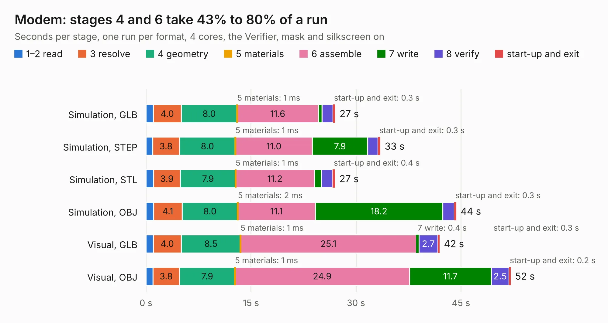

# 74. Modem

Board 74 of the 3,128 of [Corpus Testing](../Corpus-Testing.md), on [Corpus Page 1](../CorpusTestingPages/Corpus-Testing-01.md#74-modem).

| Mode and format | 1–2 read | 3 resolve | 4 geometry | 5 materials | 6 assemble | 7 write | 8 verify | start-up and exit | Total |
|---|---:|---:|---:|---:|---:|---:|---:|---:|---:|
| Simulation, GLB | 1.1 | 4.0 | 8.0 | 1&nbsp;ms | 11.6 | 0.5 | 1.6 | 0.3 | 27.0 |
| Simulation, STEP | 0.9 | 3.8 | 8.0 | 1&nbsp;ms | 11.0 | 7.9 | 1.5 | 0.3 | 33.5 |
| Simulation, STL | 1.1 | 3.9 | 7.9 | 1&nbsp;ms | 11.2 | 1.0 | 1.6 | 0.4 | 27.0 |
| Simulation, OBJ | 1.1 | 4.1 | 8.0 | 2&nbsp;ms | 11.1 | 18.2 | 1.7 | 0.3 | 44.3 |
| Visual, GLB | 1.0 | 4.0 | 8.5 | 1&nbsp;ms | 25.1 | 0.4 | 2.7 | 0.3 | 41.9 |
| Visual, OBJ | 1.0 | 3.8 | 7.9 | 1&nbsp;ms | 24.9 | 11.7 | 2.5 | 0.2 | 52.1 |

<table align="center"><tr><td valign="top">

| Board | Repo: [ahmadexp/Open-Source-PC110](https://github.com/ahmadexp/Open-Source-PC110) Board: `Modem.kicad_pcb` |
|---|---|
| Folder | PCB / Modem |
| Complexity | 360&nbsp;/&nbsp;1000 (size&nbsp;240, features&nbsp;120) |
| KESE&nbsp;features | through vias, custom pads, rounded, trapezoid or chamfered pads, filled zones, copper drawings, copper text, curved board outline, stack-up, dielectric εr and tanδ |
| Tested | 9th November 2026 |
| Copper&nbsp;layers | 6 |
| File&nbsp;format | KiCad 10 (20260206) |
| Parts,&nbsp;tracks,&nbsp;vias | 211, 3,642, 344 |
| Triangles,&nbsp;simulation | 3,141,144 in 275 parts |
| Verifier | PASS in all six runs |

</td><td valign="top">

<table>
<tr><th>File type</th><th>File size</th><th>Peak memory used</th></tr>
<tr><th colspan="3" align="left">Simulation</th></tr>
<tr><td>GLB</td><td align="right">106&nbsp;MB</td><td align="right">984&nbsp;MB</td></tr>
<tr><td>STEP</td><td align="right">414&nbsp;MB</td><td align="right">1.2&nbsp;GB</td></tr>
<tr><td>STL</td><td align="right">157&nbsp;MB</td><td align="right">1.0&nbsp;GB</td></tr>
<tr><td>OBJ</td><td align="right">331&nbsp;MB</td><td align="right">2.0&nbsp;GB</td></tr>
<tr><th colspan="3" align="left">Visual</th></tr>
<tr><td>GLB</td><td align="right">67&nbsp;MB</td><td align="right">1.2&nbsp;GB</td></tr>
<tr><td>OBJ</td><td align="right">213&nbsp;MB</td><td align="right">1.6&nbsp;GB</td></tr>
</table>

</td></tr></table>

| Previous | Next |
|:---|---:|
| [73. PC110](b0073b_Open-Source-PC110_PCB-Mainboard-Single-Sheet-Schematic_PC110.md) | [75. PSU](b0075b_Open-Source-PC110_PSU.md) |
