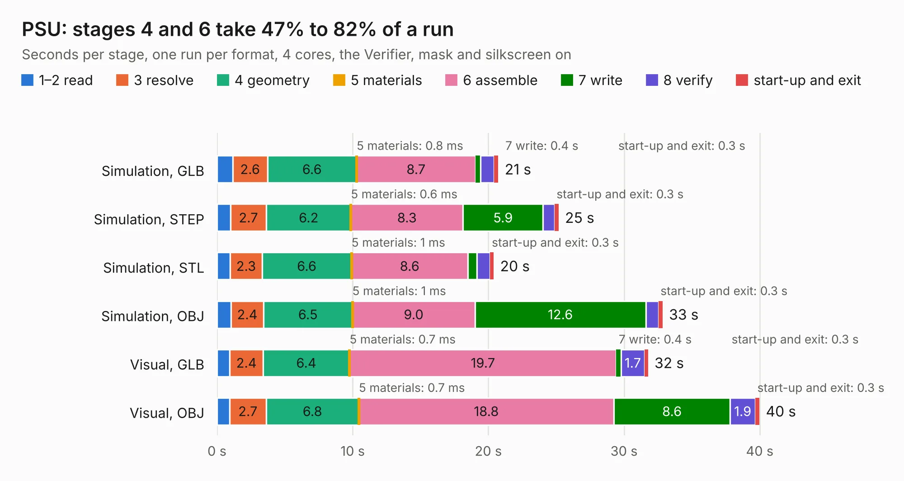

# 75. PSU

Board 75 of the 3,108 of [Corpus Testing](../Corpus-Testing.md), on [Corpus Page 1](../CorpusTestingPages/Corpus-Testing-01.md#75-psu).

| Mode and format | 1–2 read | 3 resolve | 4 geometry | 5 materials | 6 assemble | 7 write | 8 verify | start-up and exit | Total |
|---|---:|---:|---:|---:|---:|---:|---:|---:|---:|
| Simulation, GLB | 1.2 | 2.6 | 6.6 | 0.8&nbsp;ms | 8.7 | 0.4 | 1.0 | 0.3 | 20.7 |
| Simulation, STEP | 1.0 | 2.7 | 6.2 | 0.6&nbsp;ms | 8.3 | 5.9 | 0.9 | 0.3 | 25.2 |
| Simulation, STL | 1.0 | 2.3 | 6.6 | 1&nbsp;ms | 8.6 | 0.7 | 1.0 | 0.3 | 20.4 |
| Simulation, OBJ | 1.0 | 2.4 | 6.5 | 1&nbsp;ms | 9.0 | 12.6 | 0.9 | 0.3 | 32.8 |
| Visual, GLB | 0.9 | 2.4 | 6.4 | 0.7&nbsp;ms | 19.7 | 0.4 | 1.7 | 0.3 | 31.8 |
| Visual, OBJ | 0.9 | 2.7 | 6.8 | 0.7&nbsp;ms | 18.8 | 8.6 | 1.9 | 0.3 | 40.0 |

<table align="center"><tr><td valign="top">

| Board | Repo: [ahmadexp/Open-Source-PC110](https://github.com/ahmadexp/Open-Source-PC110) Board: `PSU.kicad_pcb` |
|---|---|
| Folder | PCB / PSU |
| Complexity | 345&nbsp;/&nbsp;1000 (size&nbsp;225, features&nbsp;120) |
| KESE&nbsp;features | through vias, custom pads, rounded, trapezoid or chamfered pads, filled zones, copper drawings, copper text, curved board outline, stack-up, dielectric εr and tanδ |
| Tested | 9th November 2026 |
| Copper&nbsp;layers | 4 |
| File&nbsp;format | KiCad 10 (20260206) |
| Parts,&nbsp;tracks,&nbsp;vias | 256, 2,401, 212 |
| Triangles,&nbsp;simulation | 1,939,178 in 172 parts |
| Verifier | PASS in all six runs |

</td><td valign="top">

<table>
<tr><th>File type</th><th>File size</th><th>Peak memory used</th></tr>
<tr><th colspan="3" align="left">Simulation</th></tr>
<tr><td>GLB</td><td align="right">67&nbsp;MB</td><td align="right">693&nbsp;MB</td></tr>
<tr><td>STEP</td><td align="right">311&nbsp;MB</td><td align="right">863&nbsp;MB</td></tr>
<tr><td>STL</td><td align="right">97&nbsp;MB</td><td align="right">692&nbsp;MB</td></tr>
<tr><td>OBJ</td><td align="right">204&nbsp;MB</td><td align="right">1.3&nbsp;GB</td></tr>
<tr><th colspan="3" align="left">Visual</th></tr>
<tr><td>GLB</td><td align="right">49&nbsp;MB</td><td align="right">894&nbsp;MB</td></tr>
<tr><td>OBJ</td><td align="right">151&nbsp;MB</td><td align="right">1.1&nbsp;GB</td></tr>
</table>

</td></tr></table>

| Previous | Next |
|:---|---:|
| [74. Modem](b0074b_Open-Source-PC110_Modem.md) | [76. RAM-Module](b0076b_Open-Source-PC110_RAM-Module.md) |
