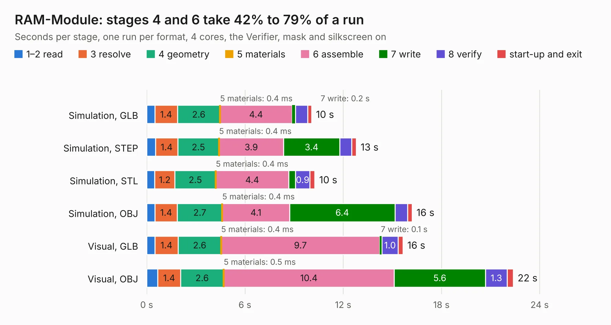

# 76. RAM-Module

Board 76 of the 3,132 of [Corpus Testing](../Corpus-Testing.md), on [Corpus Page 1](../CorpusTestingPages/Corpus-Testing-01.md#76-ram-module).

| Mode and format | 1–2 read | 3 resolve | 4 geometry | 5 materials | 6 assemble | 7 write | 8 verify | start-up and exit | Total |
|---|---:|---:|---:|---:|---:|---:|---:|---:|---:|
| Simulation, GLB | 0.5 | 1.4 | 2.6 | 0.4&nbsp;ms | 4.4 | 0.2 | 0.7 | 0.2 | 10.1 |
| Simulation, STEP | 0.5 | 1.4 | 2.5 | 0.4&nbsp;ms | 3.9 | 3.4 | 0.7 | 0.3 | 12.8 |
| Simulation, STL | 0.5 | 1.2 | 2.5 | 0.4&nbsp;ms | 4.4 | 0.4 | 0.9 | 0.3 | 10.3 |
| Simulation, OBJ | 0.5 | 1.4 | 2.7 | 0.4&nbsp;ms | 4.1 | 6.4 | 0.8 | 0.3 | 16.2 |
| Visual, GLB | 0.5 | 1.4 | 2.6 | 0.4&nbsp;ms | 9.7 | 0.1 | 1.0 | 0.3 | 15.7 |
| Visual, OBJ | 0.7 | 1.4 | 2.6 | 0.5&nbsp;ms | 10.4 | 5.6 | 1.3 | 0.4 | 22.4 |

<table align="center"><tr><td valign="top">

| Board | Repo: [ahmadexp/Open-Source-PC110](https://github.com/ahmadexp/Open-Source-PC110) Board: `RAM-Module.kicad_pcb` |
|---|---|
| Folder | PCB / RAM-16MB |
| Complexity | 304&nbsp;/&nbsp;1000 (size&nbsp;194, features&nbsp;110) |
| KESE&nbsp;features | through vias, rounded, trapezoid or chamfered pads, filled zones, copper text, curved board outline, knockout text, stack-up, dielectric εr and tanδ |
| Tested | 9th November 2026 |
| Copper&nbsp;layers | 4 |
| File&nbsp;format | KiCad 9 (20241229) |
| Parts,&nbsp;tracks,&nbsp;vias | 21, 1,851, 152 |
| Triangles,&nbsp;simulation | 1,031,920 in 67 parts |
| Verifier | PASS in all six runs |

</td><td valign="top">

<table>
<tr><th>File type</th><th>File size</th><th>Peak memory used</th></tr>
<tr><th colspan="3" align="left">Simulation</th></tr>
<tr><td>GLB</td><td align="right">35&nbsp;MB</td><td align="right">526&nbsp;MB</td></tr>
<tr><td>STEP</td><td align="right">155&nbsp;MB</td><td align="right">558&nbsp;MB</td></tr>
<tr><td>STL</td><td align="right">52&nbsp;MB</td><td align="right">521&nbsp;MB</td></tr>
<tr><td>OBJ</td><td align="right">105&nbsp;MB</td><td align="right">754&nbsp;MB</td></tr>
<tr><th colspan="3" align="left">Visual</th></tr>
<tr><td>GLB</td><td align="right">25&nbsp;MB</td><td align="right">650&nbsp;MB</td></tr>
<tr><td>OBJ</td><td align="right">78&nbsp;MB</td><td align="right">653&nbsp;MB</td></tr>
</table>

</td></tr></table>

| Previous | Next |
|:---|---:|
| [75. PSU](b0075b_Open-Source-PC110_PSU.md) | [77. ALU](b0077b_AOS16_ALU.md) |
