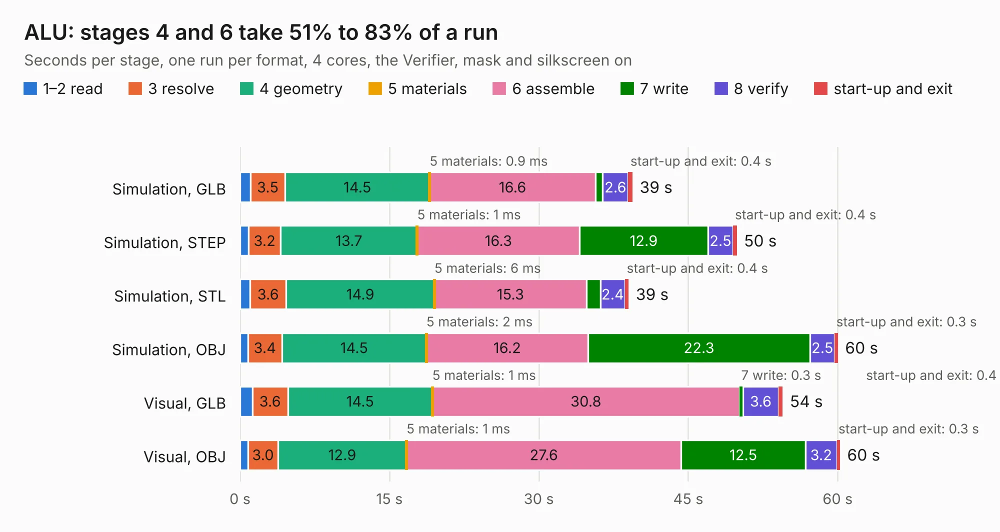

# 77. ALU

Board 77 of the 3,128 of [Corpus Testing](../Corpus-Testing.md), on [Corpus Page 1](../CorpusTestingPages/Corpus-Testing-01.md#77-alu).

| Mode and format | 1–2 read | 3 resolve | 4 geometry | 5 materials | 6 assemble | 7 write | 8 verify | start-up and exit | Total |
|---|---:|---:|---:|---:|---:|---:|---:|---:|---:|
| Simulation, GLB | 1.1 | 3.5 | 14.5 | 0.9&nbsp;ms | 16.6 | 0.7 | 2.6 | 0.4 | 39.4 |
| Simulation, STEP | 0.9 | 3.2 | 13.7 | 1&nbsp;ms | 16.3 | 12.9 | 2.5 | 0.4 | 49.9 |
| Simulation, STL | 1.0 | 3.6 | 14.9 | 6&nbsp;ms | 15.3 | 1.4 | 2.4 | 0.4 | 39.0 |
| Simulation, OBJ | 0.8 | 3.4 | 14.5 | 2&nbsp;ms | 16.2 | 22.3 | 2.5 | 0.3 | 60.0 |
| Visual, GLB | 1.2 | 3.6 | 14.5 | 1&nbsp;ms | 30.8 | 0.3 | 3.6 | 0.4 | 54.5 |
| Visual, OBJ | 0.8 | 3.0 | 12.9 | 1&nbsp;ms | 27.6 | 12.5 | 3.2 | 0.3 | 60.2 |

<table align="center"><tr><td valign="top">

| Board | Repo: [AJain9199/AOS16](https://github.com/AJain9199/AOS16) Board: `ALU.kicad_pcb` |
|---|---|
| Folder | ALU |
| Complexity | 337&nbsp;/&nbsp;1000 (size&nbsp;252, features&nbsp;85) |
| KESE&nbsp;features | through vias, rounded, trapezoid or chamfered pads, filled zones, curved board outline, stack-up, dielectric εr and tanδ |
| Tested | 9th November 2026 |
| Copper&nbsp;layers | 4 |
| File&nbsp;format | KiCad 9 (20241229) |
| Parts,&nbsp;tracks,&nbsp;vias | 66, 1,274, 156 |
| Triangles,&nbsp;simulation | 3,127,712 in 160 parts |
| Verifier | PASS in all six runs |

</td><td valign="top">

<table>
<tr><th>File type</th><th>File size</th><th>Peak memory used</th></tr>
<tr><th colspan="3" align="left">Simulation</th></tr>
<tr><td>GLB</td><td align="right">106&nbsp;MB</td><td align="right">961&nbsp;MB</td></tr>
<tr><td>STEP</td><td align="right">412&nbsp;MB</td><td align="right">1.2&nbsp;GB</td></tr>
<tr><td>STL</td><td align="right">156&nbsp;MB</td><td align="right">1.0&nbsp;GB</td></tr>
<tr><td>OBJ</td><td align="right">328&nbsp;MB</td><td align="right">2.1&nbsp;GB</td></tr>
<tr><th colspan="3" align="left">Visual</th></tr>
<tr><td>GLB</td><td align="right">57&nbsp;MB</td><td align="right">1.1&nbsp;GB</td></tr>
<tr><td>OBJ</td><td align="right">176&nbsp;MB</td><td align="right">1.4&nbsp;GB</td></tr>
</table>

</td></tr></table>

| Previous | Next |
|:---|---:|
| [76. RAM-Module](b0076b_Open-Source-PC110_RAM-Module.md) | [78. AOS16 Double Buffer](b0078b_AOS16_AOS16-Double-Buffer.md) |
