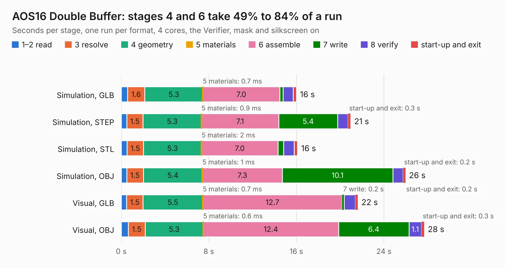

# 78. AOS16 Double Buffer

Board 78 of the 3,119 of [Corpus Testing](../Corpus-Testing.md), on [Corpus Page 1](../CorpusTestingPages/Corpus-Testing-01.md#78-aos16-double-buffer).

| Mode and format | 1–2 read | 3 resolve | 4 geometry | 5 materials | 6 assemble | 7 write | 8 verify | start-up and exit | Total |
|---|---:|---:|---:|---:|---:|---:|---:|---:|---:|
| Simulation, GLB | 0.6 | 1.6 | 5.3 | 0.7&nbsp;ms | 7.0 | 0.3 | 0.9 | 0.3 | 16.0 |
| Simulation, STEP | 0.5 | 1.5 | 5.3 | 0.9&nbsp;ms | 7.1 | 5.4 | 0.9 | 0.3 | 21.0 |
| Simulation, STL | 0.5 | 1.5 | 5.3 | 2&nbsp;ms | 7.0 | 0.5 | 1.0 | 0.3 | 16.1 |
| Simulation, OBJ | 0.5 | 1.5 | 5.4 | 1&nbsp;ms | 7.3 | 10.1 | 0.9 | 0.2 | 26.0 |
| Visual, GLB | 0.5 | 1.5 | 5.5 | 0.7&nbsp;ms | 12.7 | 0.2 | 1.0 | 0.2 | 21.6 |
| Visual, OBJ | 0.7 | 1.5 | 5.3 | 0.6&nbsp;ms | 12.4 | 6.4 | 1.1 | 0.3 | 27.7 |

<table align="center"><tr><td valign="top">

| Board | Repo: [AJain9199/AOS16](https://github.com/AJain9199/AOS16) Board: `AOS16 Double Buffer.kicad_pcb` |
|---|---|
| Folder | AOS16 Double Buffer |
| Complexity | 327&nbsp;/&nbsp;1000 (size&nbsp;252, features&nbsp;75) |
| KESE&nbsp;features | through vias, rounded, trapezoid or chamfered pads, filled zones, stack-up, dielectric εr and tanδ |
| Tested | 9th November 2026 |
| Copper&nbsp;layers | 4 |
| File&nbsp;format | KiCad 9 (20241229) |
| Parts,&nbsp;tracks,&nbsp;vias | 63, 1,134, 142 |
| Triangles,&nbsp;simulation | 1,701,350 in 130 parts |
| Verifier | PASS in all six runs |

</td><td valign="top">

<table>
<tr><th>File type</th><th>File size</th><th>Peak memory used</th></tr>
<tr><th colspan="3" align="left">Simulation</th></tr>
<tr><td>GLB</td><td align="right">58&nbsp;MB</td><td align="right">631&nbsp;MB</td></tr>
<tr><td>STEP</td><td align="right">235&nbsp;MB</td><td align="right">753&nbsp;MB</td></tr>
<tr><td>STL</td><td align="right">85&nbsp;MB</td><td align="right">637&nbsp;MB</td></tr>
<tr><td>OBJ</td><td align="right">175&nbsp;MB</td><td align="right">1.1&nbsp;GB</td></tr>
<tr><th colspan="3" align="left">Visual</th></tr>
<tr><td>GLB</td><td align="right">37&nbsp;MB</td><td align="right">922&nbsp;MB</td></tr>
<tr><td>OBJ</td><td align="right">114&nbsp;MB</td><td align="right">921&nbsp;MB</td></tr>
</table>

</td></tr></table>

| Previous | Next |
|:---|---:|
| [77. ALU](b0077b_AOS16_ALU.md) | [79. AOS16 GPU](b0079b_AOS16_AOS16-GPU.md) |
