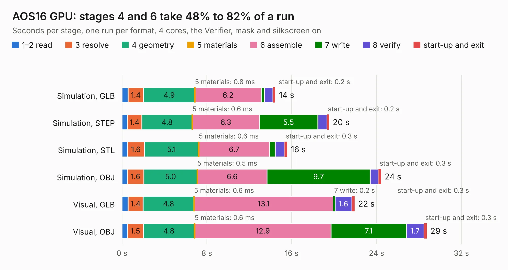

# 79. AOS16 GPU

Board 79 of the 3,108 of [Corpus Testing](../Corpus-Testing.md), on [Corpus Page 1](../CorpusTestingPages/Corpus-Testing-01.md#79-aos16-gpu).

| Mode and format | 1–2 read | 3 resolve | 4 geometry | 5 materials | 6 assemble | 7 write | 8 verify | start-up and exit | Total |
|---|---:|---:|---:|---:|---:|---:|---:|---:|---:|
| Simulation, GLB | 0.6 | 1.4 | 4.9 | 0.8&nbsp;ms | 6.2 | 0.3 | 0.8 | 0.2 | 14.5 |
| Simulation, STEP | 0.5 | 1.4 | 4.8 | 0.6&nbsp;ms | 6.3 | 5.5 | 0.9 | 0.2 | 19.5 |
| Simulation, STL | 0.5 | 1.6 | 5.1 | 0.6&nbsp;ms | 6.7 | 0.5 | 0.9 | 0.3 | 15.6 |
| Simulation, OBJ | 0.5 | 1.6 | 5.0 | 0.5&nbsp;ms | 6.6 | 9.7 | 0.8 | 0.3 | 24.4 |
| Visual, GLB | 0.6 | 1.4 | 4.8 | 0.6&nbsp;ms | 13.1 | 0.2 | 1.6 | 0.3 | 21.9 |
| Visual, OBJ | 0.5 | 1.5 | 4.8 | 0.6&nbsp;ms | 12.9 | 7.1 | 1.7 | 0.3 | 28.7 |

<table align="center"><tr><td valign="top">

| Board | Repo: [AJain9199/AOS16](https://github.com/AJain9199/AOS16) Board: `AOS16 GPU.kicad_pcb` |
|---|---|
| Folder | AOS16 GPU |
| Complexity | 290&nbsp;/&nbsp;1000 (size&nbsp;205, features&nbsp;85) |
| KESE&nbsp;features | through vias, rounded, trapezoid or chamfered pads, filled zones, curved board outline, stack-up, dielectric εr and tanδ |
| Tested | 9th November 2026 |
| Copper&nbsp;layers | 4 |
| File&nbsp;format | KiCad 9 (20241229) |
| Parts,&nbsp;tracks,&nbsp;vias | 105, 1,114, 175 |
| Triangles,&nbsp;simulation | 1,867,922 in 120 parts |
| Verifier | PASS in all six runs |

</td><td valign="top">

<table>
<tr><th>File type</th><th>File size</th><th>Peak memory used</th></tr>
<tr><th colspan="3" align="left">Simulation</th></tr>
<tr><td>GLB</td><td align="right">64&nbsp;MB</td><td align="right">743&nbsp;MB</td></tr>
<tr><td>STEP</td><td align="right">281&nbsp;MB</td><td align="right">858&nbsp;MB</td></tr>
<tr><td>STL</td><td align="right">93&nbsp;MB</td><td align="right">764&nbsp;MB</td></tr>
<tr><td>OBJ</td><td align="right">193&nbsp;MB</td><td align="right">1.3&nbsp;GB</td></tr>
<tr><th colspan="3" align="left">Visual</th></tr>
<tr><td>GLB</td><td align="right">43&nbsp;MB</td><td align="right">795&nbsp;MB</td></tr>
<tr><td>OBJ</td><td align="right">131&nbsp;MB</td><td align="right">954&nbsp;MB</td></tr>
</table>

</td></tr></table>

| Previous | Next |
|:---|---:|
| [78. AOS16 Double Buffer](b0078b_AOS16_AOS16-Double-Buffer.md) | [80. AOS16 Register](b0080b_AOS16_AOS16-Register.md) |
