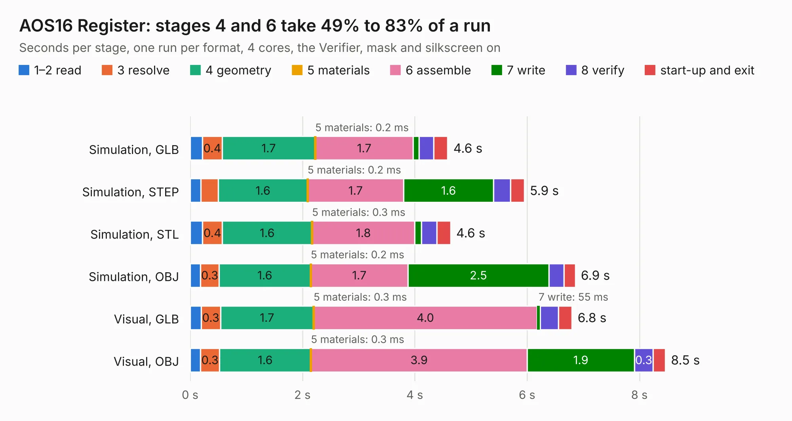

# 80. AOS16 Register

Board 80 of the 3,126 of [Corpus Testing](../Corpus-Testing.md), on [Corpus Page 1](../CorpusTestingPages/Corpus-Testing-01.md#80-aos16-register).

| Mode and format | 1–2 read | 3 resolve | 4 geometry | 5 materials | 6 assemble | 7 write | 8 verify | start-up and exit | Total |
|---|---:|---:|---:|---:|---:|---:|---:|---:|---:|
| Simulation, GLB | 0.2 | 0.4 | 1.7 | 0.2&nbsp;ms | 1.7 | 0.1 | 0.3 | 0.3 | 4.6 |
| Simulation, STEP | 0.2 | 0.3 | 1.6 | 0.2&nbsp;ms | 1.7 | 1.6 | 0.3 | 0.2 | 5.9 |
| Simulation, STL | 0.2 | 0.4 | 1.6 | 0.3&nbsp;ms | 1.8 | 0.1 | 0.3 | 0.2 | 4.6 |
| Simulation, OBJ | 0.2 | 0.3 | 1.6 | 0.2&nbsp;ms | 1.7 | 2.5 | 0.3 | 0.2 | 6.9 |
| Visual, GLB | 0.2 | 0.3 | 1.7 | 0.3&nbsp;ms | 4.0 | 55&nbsp;ms | 0.3 | 0.2 | 6.8 |
| Visual, OBJ | 0.2 | 0.3 | 1.6 | 0.3&nbsp;ms | 3.9 | 1.9 | 0.3 | 0.2 | 8.5 |

<table align="center"><tr><td valign="top">

| Board | Repo: [AJain9199/AOS16](https://github.com/AJain9199/AOS16) Board: `AOS16 Register.kicad_pcb` |
|---|---|
| Folder | AOS16 Register |
| Complexity | 209&nbsp;/&nbsp;1000 (size&nbsp;154, features&nbsp;55) |
| KESE&nbsp;features | through vias, rounded, trapezoid or chamfered pads, filled zones, curved board outline |
| Tested | 9th November 2026 |
| Copper&nbsp;layers | 2 |
| File&nbsp;format | KiCad 8 (20240108) |
| Parts,&nbsp;tracks,&nbsp;vias | 44, 297, 19 |
| Triangles,&nbsp;simulation | 449,674 in 65 parts |
| Verifier | PASS in all six runs |

</td><td valign="top">

<table>
<tr><th>File type</th><th>File size</th><th>Peak memory used</th></tr>
<tr><th colspan="3" align="left">Simulation</th></tr>
<tr><td>GLB</td><td align="right">15&nbsp;MB</td><td align="right">297&nbsp;MB</td></tr>
<tr><td>STEP</td><td align="right">73&nbsp;MB</td><td align="right">327&nbsp;MB</td></tr>
<tr><td>STL</td><td align="right">22&nbsp;MB</td><td align="right">293&nbsp;MB</td></tr>
<tr><td>OBJ</td><td align="right">45&nbsp;MB</td><td align="right">311&nbsp;MB</td></tr>
<tr><th colspan="3" align="left">Visual</th></tr>
<tr><td>GLB</td><td align="right">11&nbsp;MB</td><td align="right">341&nbsp;MB</td></tr>
<tr><td>OBJ</td><td align="right">33&nbsp;MB</td><td align="right">350&nbsp;MB</td></tr>
</table>

</td></tr></table>

| Previous | Next |
|:---|---:|
| [79. AOS16 GPU](b0079b_AOS16_AOS16-GPU.md) | [81. AOS16 Timer](b0081b_AOS16_AOS16-Timer.md) |
