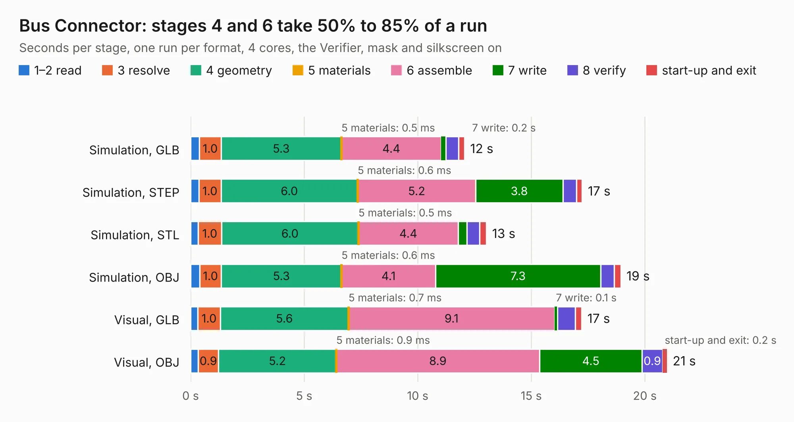

# 82. Bus Connector

Board 82 of the 3,106 of [Corpus Testing](../Corpus-Testing.md), on [Corpus Page 1](../CorpusTestingPages/Corpus-Testing-01.md#82-bus-connector).

| Mode and format | 1–2 read | 3 resolve | 4 geometry | 5 materials | 6 assemble | 7 write | 8 verify | start-up and exit | Total |
|---|---:|---:|---:|---:|---:|---:|---:|---:|---:|
| Simulation, GLB | 0.4 | 1.0 | 5.3 | 0.5&nbsp;ms | 4.4 | 0.2 | 0.6 | 0.3 | 12.1 |
| Simulation, STEP | 0.4 | 1.0 | 6.0 | 0.6&nbsp;ms | 5.2 | 3.8 | 0.6 | 0.2 | 17.2 |
| Simulation, STL | 0.3 | 1.0 | 6.0 | 0.5&nbsp;ms | 4.4 | 0.4 | 0.6 | 0.3 | 13.0 |
| Simulation, OBJ | 0.4 | 1.0 | 5.3 | 0.6&nbsp;ms | 4.1 | 7.3 | 0.6 | 0.3 | 18.9 |
| Visual, GLB | 0.3 | 1.0 | 5.6 | 0.7&nbsp;ms | 9.1 | 0.1 | 0.8 | 0.3 | 17.2 |
| Visual, OBJ | 0.3 | 0.9 | 5.2 | 0.9&nbsp;ms | 8.9 | 4.5 | 0.9 | 0.2 | 21.0 |

<table align="center"><tr><td valign="top">

| Board | Repo: [AJain9199/AOS16](https://github.com/AJain9199/AOS16) Board: `Bus Connector.kicad_pcb` |
|---|---|
| Folder | Bus Connector |
| Complexity | 232&nbsp;/&nbsp;1000 (size&nbsp;147, features&nbsp;85) |
| KESE&nbsp;features | through vias, rounded, trapezoid or chamfered pads, filled zones, curved board outline, stack-up, dielectric εr and tanδ |
| Tested | 9th November 2026 |
| Copper&nbsp;layers | 2 |
| File&nbsp;format | KiCad 9 (20241229) |
| Parts,&nbsp;tracks,&nbsp;vias | 13, 309, 60 |
| Triangles,&nbsp;simulation | 1,228,318 in 36 parts |
| Verifier | PASS in all six runs |

</td><td valign="top">

<table>
<tr><th>File type</th><th>File size</th><th>Peak memory used</th></tr>
<tr><th colspan="3" align="left">Simulation</th></tr>
<tr><td>GLB</td><td align="right">42&nbsp;MB</td><td align="right">486&nbsp;MB</td></tr>
<tr><td>STEP</td><td align="right">176&nbsp;MB</td><td align="right">613&nbsp;MB</td></tr>
<tr><td>STL</td><td align="right">61&nbsp;MB</td><td align="right">500&nbsp;MB</td></tr>
<tr><td>OBJ</td><td align="right">124&nbsp;MB</td><td align="right">831&nbsp;MB</td></tr>
<tr><th colspan="3" align="left">Visual</th></tr>
<tr><td>GLB</td><td align="right">26&nbsp;MB</td><td align="right">669&nbsp;MB</td></tr>
<tr><td>OBJ</td><td align="right">79&nbsp;MB</td><td align="right">635&nbsp;MB</td></tr>
</table>

</td></tr></table>

| Previous | Next |
|:---|---:|
| [81. AOS16 Timer](b0081b_AOS16_AOS16-Timer.md) | [83. Bus Probe](b0083b_AOS16_Bus-Probe.md) |
