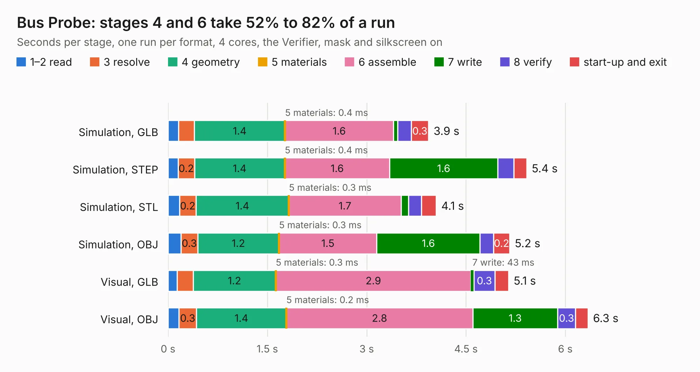

# 83. Bus Probe

Board 83 of the 3,117 of [Corpus Testing](../Corpus-Testing.md), on [Corpus Page 1](../CorpusTestingPages/Corpus-Testing-01.md#83-bus-probe).

| Mode and format | 1–2 read | 3 resolve | 4 geometry | 5 materials | 6 assemble | 7 write | 8 verify | start-up and exit | Total |
|---|---:|---:|---:|---:|---:|---:|---:|---:|---:|
| Simulation, GLB | 0.2 | 0.2 | 1.4 | 0.4&nbsp;ms | 1.6 | 64&nbsp;ms | 0.2 | 0.3 | 3.9 |
| Simulation, STEP | 0.2 | 0.2 | 1.4 | 0.4&nbsp;ms | 1.6 | 1.6 | 0.2 | 0.2 | 5.4 |
| Simulation, STL | 0.2 | 0.2 | 1.4 | 0.3&nbsp;ms | 1.7 | 0.1 | 0.2 | 0.2 | 4.1 |
| Simulation, OBJ | 0.2 | 0.3 | 1.2 | 0.3&nbsp;ms | 1.5 | 1.6 | 0.2 | 0.2 | 5.2 |
| Visual, GLB | 0.1 | 0.2 | 1.2 | 0.3&nbsp;ms | 2.9 | 43&nbsp;ms | 0.3 | 0.2 | 5.1 |
| Visual, OBJ | 0.2 | 0.3 | 1.4 | 0.2&nbsp;ms | 2.8 | 1.3 | 0.3 | 0.2 | 6.3 |

<table align="center"><tr><td valign="top">

| Board | Repo: [AJain9199/AOS16](https://github.com/AJain9199/AOS16) Board: `Bus Probe.kicad_pcb` |
|---|---|
| Folder | Bus Connector / Bus Probe |
| Complexity | 239&nbsp;/&nbsp;1000 (size&nbsp;184, features&nbsp;55) |
| KESE&nbsp;features | through vias, rounded, trapezoid or chamfered pads, filled zones, curved board outline |
| Tested | 9th November 2026 |
| Copper&nbsp;layers | 2 |
| File&nbsp;format | KiCad 9 (20241229) |
| Parts,&nbsp;tracks,&nbsp;vias | 27, 242, 8 |
| Triangles,&nbsp;simulation | 382,562 in 60 parts |
| Verifier | PASS in all six runs |

</td><td valign="top">

<table>
<tr><th>File type</th><th>File size</th><th>Peak memory used</th></tr>
<tr><th colspan="3" align="left">Simulation</th></tr>
<tr><td>GLB</td><td align="right">13&nbsp;MB</td><td align="right">278&nbsp;MB</td></tr>
<tr><td>STEP</td><td align="right">66&nbsp;MB</td><td align="right">309&nbsp;MB</td></tr>
<tr><td>STL</td><td align="right">19&nbsp;MB</td><td align="right">270&nbsp;MB</td></tr>
<tr><td>OBJ</td><td align="right">38&nbsp;MB</td><td align="right">317&nbsp;MB</td></tr>
<tr><th colspan="3" align="left">Visual</th></tr>
<tr><td>GLB</td><td align="right">9.2&nbsp;MB</td><td align="right">298&nbsp;MB</td></tr>
<tr><td>OBJ</td><td align="right">27&nbsp;MB</td><td align="right">300&nbsp;MB</td></tr>
</table>

</td></tr></table>

| Previous | Next |
|:---|---:|
| [82. Bus Connector](b0082b_AOS16_Bus-Connector.md) | [84. Bus Terminator](b0084b_AOS16_Bus-Terminator.md) |
