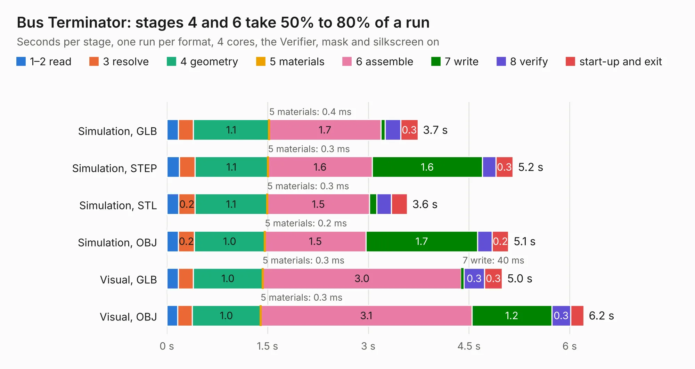

# 84. Bus Terminator

Board 84 of the 3,120 of [Corpus Testing](../Corpus-Testing.md), on [Corpus Page 1](../CorpusTestingPages/Corpus-Testing-01.md#84-bus-terminator).

| Mode and format | 1–2 read | 3 resolve | 4 geometry | 5 materials | 6 assemble | 7 write | 8 verify | start-up and exit | Total |
|---|---:|---:|---:|---:|---:|---:|---:|---:|---:|
| Simulation, GLB | 0.2 | 0.2 | 1.1 | 0.4&nbsp;ms | 1.7 | 64&nbsp;ms | 0.2 | 0.3 | 3.7 |
| Simulation, STEP | 0.2 | 0.2 | 1.1 | 0.3&nbsp;ms | 1.6 | 1.6 | 0.2 | 0.3 | 5.2 |
| Simulation, STL | 0.2 | 0.2 | 1.1 | 0.3&nbsp;ms | 1.5 | 0.1 | 0.2 | 0.2 | 3.6 |
| Simulation, OBJ | 0.2 | 0.2 | 1.0 | 0.2&nbsp;ms | 1.5 | 1.7 | 0.2 | 0.2 | 5.1 |
| Visual, GLB | 0.2 | 0.2 | 1.0 | 0.3&nbsp;ms | 3.0 | 40&nbsp;ms | 0.3 | 0.3 | 5.0 |
| Visual, OBJ | 0.2 | 0.2 | 1.0 | 0.3&nbsp;ms | 3.1 | 1.2 | 0.3 | 0.2 | 6.2 |

<table align="center"><tr><td valign="top">

| Board | Repo: [AJain9199/AOS16](https://github.com/AJain9199/AOS16) Board: `Bus Terminator.kicad_pcb` |
|---|---|
| Folder | Bus Connector / Bus Terminator |
| Complexity | 201&nbsp;/&nbsp;1000 (size&nbsp;131, features&nbsp;70) |
| KESE&nbsp;features | rounded, trapezoid or chamfered pads, filled zones, curved board outline, stack-up, dielectric εr and tanδ |
| Tested | 9th November 2026 |
| Copper&nbsp;layers | 2 |
| File&nbsp;format | KiCad 9 (20241229) |
| Parts,&nbsp;tracks,&nbsp;vias | 38, 96, 0 |
| Triangles,&nbsp;simulation | 358,362 in 45 parts |
| Verifier | PASS in all six runs |

</td><td valign="top">

<table>
<tr><th>File type</th><th>File size</th><th>Peak memory used</th></tr>
<tr><th colspan="3" align="left">Simulation</th></tr>
<tr><td>GLB</td><td align="right">12&nbsp;MB</td><td align="right">256&nbsp;MB</td></tr>
<tr><td>STEP</td><td align="right">64&nbsp;MB</td><td align="right">300&nbsp;MB</td></tr>
<tr><td>STL</td><td align="right">18&nbsp;MB</td><td align="right">258&nbsp;MB</td></tr>
<tr><td>OBJ</td><td align="right">36&nbsp;MB</td><td align="right">272&nbsp;MB</td></tr>
<tr><th colspan="3" align="left">Visual</th></tr>
<tr><td>GLB</td><td align="right">8.6&nbsp;MB</td><td align="right">289&nbsp;MB</td></tr>
<tr><td>OBJ</td><td align="right">25&nbsp;MB</td><td align="right">297&nbsp;MB</td></tr>
</table>

</td></tr></table>

| Previous | Next |
|:---|---:|
| [83. Bus Probe](b0083b_AOS16_Bus-Probe.md) | [85. bus_boards](b0085b_AOS16_bus-boards.md) |
