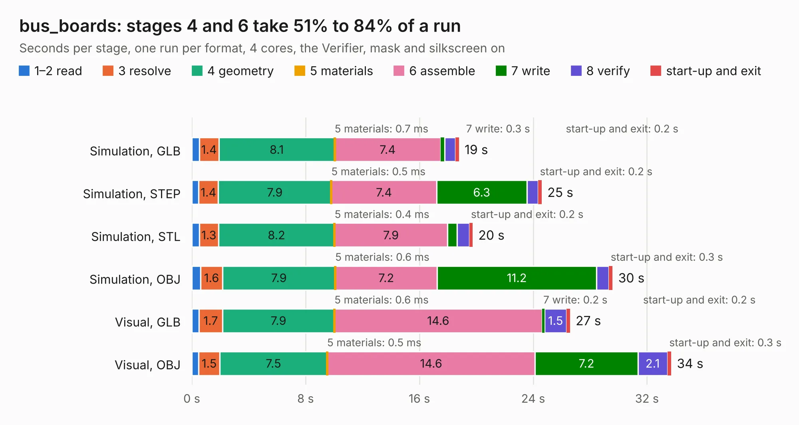

# 85 bus_boards

Board 85 of the 3,138 of [Corpus Testing](../Corpus-Testing.md), on [Corpus Page 1](../CorpusTestingPages/Corpus-Testing-01.md#85-bus_boards).

| Mode and format | 1–2 read | 3 resolve | 4 geometry | 5 materials | 6 assemble | 7 write | 8 verify | start-up and exit | Total |
|---|---:|---:|---:|---:|---:|---:|---:|---:|---:|
| Simulation, GLB | 0.5 | 1.4 | 8.1 | 0.7&nbsp;ms | 7.4 | 0.3 | 0.8 | 0.2 | 18.8 |
| Simulation, STEP | 0.5 | 1.4 | 7.9 | 0.5&nbsp;ms | 7.4 | 6.3 | 0.8 | 0.2 | 24.6 |
| Simulation, STL | 0.5 | 1.3 | 8.2 | 0.4&nbsp;ms | 7.9 | 0.7 | 0.9 | 0.2 | 19.7 |
| Simulation, OBJ | 0.6 | 1.6 | 7.9 | 0.6&nbsp;ms | 7.2 | 11.2 | 0.9 | 0.3 | 29.6 |
| Visual, GLB | 0.5 | 1.7 | 7.9 | 0.6&nbsp;ms | 14.6 | 0.2 | 1.5 | 0.2 | 26.6 |
| Visual, OBJ | 0.5 | 1.5 | 7.5 | 0.5&nbsp;ms | 14.6 | 7.2 | 2.1 | 0.3 | 33.7 |

<table align="center"><tr><td valign="top">

| Board | Repo: [AJain9199/AOS16](https://github.com/AJain9199/AOS16) Board: `bus_boards.kicad_pcb` |
|---|---|
| Folder | Bus Connector |
| Complexity | 300&nbsp;/&nbsp;1000 (size&nbsp;215, features&nbsp;85) |
| KESE&nbsp;features | through vias, rounded, trapezoid or chamfered pads, filled zones, curved board outline, stack-up, dielectric εr and tanδ |
| Tested | 9th November 2026 |
| Copper&nbsp;layers | 2 |
| File&nbsp;format | KiCad 9 (20241229) |
| Parts,&nbsp;tracks,&nbsp;vias | 78, 647, 68 |
| Triangles,&nbsp;simulation | 1,957,280 in 83 parts |
| Verifier | PASS in all six runs |

</td><td valign="top">

<table>
<tr><th>File type</th><th>File size</th><th>Peak memory used</th></tr>
<tr><th colspan="3" align="left">Simulation</th></tr>
<tr><td>GLB</td><td align="right">66&nbsp;MB</td><td align="right">719&nbsp;MB</td></tr>
<tr><td>STEP</td><td align="right">306&nbsp;MB</td><td align="right">908&nbsp;MB</td></tr>
<tr><td>STL</td><td align="right">98&nbsp;MB</td><td align="right">683&nbsp;MB</td></tr>
<tr><td>OBJ</td><td align="right">203&nbsp;MB</td><td align="right">1.3&nbsp;GB</td></tr>
<tr><th colspan="3" align="left">Visual</th></tr>
<tr><td>GLB</td><td align="right">44&nbsp;MB</td><td align="right">919&nbsp;MB</td></tr>
<tr><td>OBJ</td><td align="right">133&nbsp;MB</td><td align="right">984&nbsp;MB</td></tr>
</table>

</td></tr></table>

| Previous | Next |
|:---|---:|
| [84 Bus Terminator](b0084b_AOS16_Bus-Terminator.md) | [86 clock](b0086b_AOS16_clock.md) |
