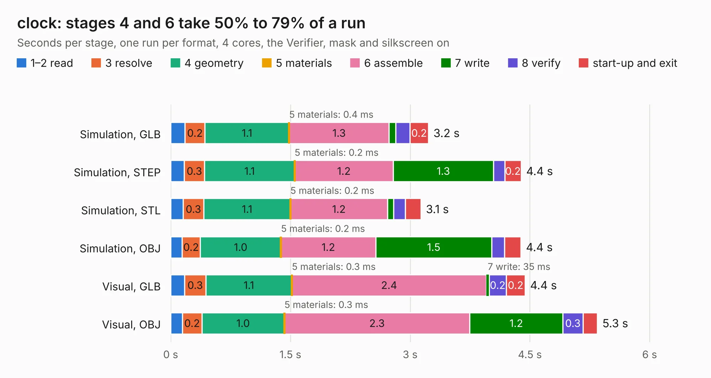

# 86. clock

Board 86 of the 3,109 of [Corpus Testing](../Corpus-Testing.md), on [Corpus Page 1](../CorpusTestingPages/Corpus-Testing-01.md#86-clock).

| Mode and format | 1–2 read | 3 resolve | 4 geometry | 5 materials | 6 assemble | 7 write | 8 verify | start-up and exit | Total |
|---|---:|---:|---:|---:|---:|---:|---:|---:|---:|
| Simulation, GLB | 0.2 | 0.2 | 1.1 | 0.4&nbsp;ms | 1.3 | 84&nbsp;ms | 0.2 | 0.2 | 3.2 |
| Simulation, STEP | 0.2 | 0.3 | 1.1 | 0.2&nbsp;ms | 1.2 | 1.3 | 0.1 | 0.2 | 4.4 |
| Simulation, STL | 0.2 | 0.3 | 1.1 | 0.2&nbsp;ms | 1.2 | 78&nbsp;ms | 0.1 | 0.2 | 3.1 |
| Simulation, OBJ | 0.1 | 0.2 | 1.0 | 0.2&nbsp;ms | 1.2 | 1.5 | 0.2 | 0.2 | 4.4 |
| Visual, GLB | 0.2 | 0.3 | 1.1 | 0.3&nbsp;ms | 2.4 | 35&nbsp;ms | 0.2 | 0.2 | 4.4 |
| Visual, OBJ | 0.1 | 0.2 | 1.0 | 0.3&nbsp;ms | 2.3 | 1.2 | 0.3 | 0.2 | 5.3 |

<table align="center"><tr><td valign="top">

| Board | Repo: [AJain9199/AOS16](https://github.com/AJain9199/AOS16) Board: `clock.kicad_pcb` |
|---|---|
| Folder | clock |
| Complexity | 234&nbsp;/&nbsp;1000 (size&nbsp;149, features&nbsp;85) |
| KESE&nbsp;features | through vias, rounded, trapezoid or chamfered pads, filled zones, curved board outline, stack-up, dielectric εr and tanδ |
| Tested | 9th November 2026 |
| Copper&nbsp;layers | 2 |
| File&nbsp;format | KiCad 9 (20241229) |
| Parts,&nbsp;tracks,&nbsp;vias | 35, 237, 21 |
| Triangles,&nbsp;simulation | 314,148 in 48 parts |
| Verifier | PASS in all six runs |

</td><td valign="top">

<table>
<tr><th>File type</th><th>File size</th><th>Peak memory used</th></tr>
<tr><th colspan="3" align="left">Simulation</th></tr>
<tr><td>GLB</td><td align="right">11&nbsp;MB</td><td align="right">248&nbsp;MB</td></tr>
<tr><td>STEP</td><td align="right">48&nbsp;MB</td><td align="right">275&nbsp;MB</td></tr>
<tr><td>STL</td><td align="right">16&nbsp;MB</td><td align="right">249&nbsp;MB</td></tr>
<tr><td>OBJ</td><td align="right">31&nbsp;MB</td><td align="right">273&nbsp;MB</td></tr>
<tr><th colspan="3" align="left">Visual</th></tr>
<tr><td>GLB</td><td align="right">7.8&nbsp;MB</td><td align="right">267&nbsp;MB</td></tr>
<tr><td>OBJ</td><td align="right">23&nbsp;MB</td><td align="right">266&nbsp;MB</td></tr>
</table>

</td></tr></table>

| Previous | Next |
|:---|---:|
| [85. bus_boards](b0085b_AOS16_bus-boards.md) | [87. Control](b0087b_AOS16_Control.md) |
