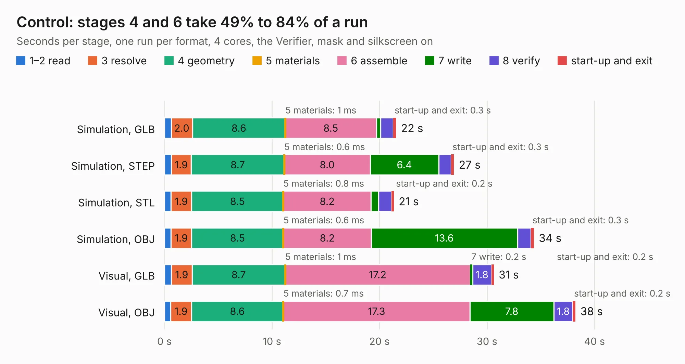

# 87. Control

Board 87 of the 3,109 of [Corpus Testing](../Corpus-Testing.md), on [Corpus Page 1](../CorpusTestingPages/Corpus-Testing-01.md#87-control).

| Mode and format | 1–2 read | 3 resolve | 4 geometry | 5 materials | 6 assemble | 7 write | 8 verify | start-up and exit | Total |
|---|---:|---:|---:|---:|---:|---:|---:|---:|---:|
| Simulation, GLB | 0.6 | 2.0 | 8.6 | 1&nbsp;ms | 8.5 | 0.4 | 1.2 | 0.3 | 21.5 |
| Simulation, STEP | 0.6 | 1.9 | 8.7 | 0.6&nbsp;ms | 8.0 | 6.4 | 1.2 | 0.3 | 26.9 |
| Simulation, STL | 0.6 | 1.9 | 8.5 | 0.8&nbsp;ms | 8.2 | 0.7 | 1.2 | 0.2 | 21.3 |
| Simulation, OBJ | 0.6 | 1.9 | 8.5 | 0.6&nbsp;ms | 8.2 | 13.6 | 1.3 | 0.3 | 34.4 |
| Visual, GLB | 0.6 | 1.9 | 8.7 | 1&nbsp;ms | 17.2 | 0.2 | 1.8 | 0.2 | 30.6 |
| Visual, OBJ | 0.6 | 1.9 | 8.6 | 0.7&nbsp;ms | 17.3 | 7.8 | 1.8 | 0.2 | 38.2 |

<table align="center"><tr><td valign="top">

| Board | Repo: [AJain9199/AOS16](https://github.com/AJain9199/AOS16) Board: `Control.kicad_pcb` |
|---|---|
| Folder | Control |
| Complexity | 331&nbsp;/&nbsp;1000 (size&nbsp;246, features&nbsp;85) |
| KESE&nbsp;features | through vias, rounded, trapezoid or chamfered pads, filled zones, curved board outline, stack-up, dielectric εr and tanδ |
| Tested | 9th November 2026 |
| Copper&nbsp;layers | 4 |
| File&nbsp;format | KiCad 9 (20241229) |
| Parts,&nbsp;tracks,&nbsp;vias | 120, 1,248, 101 |
| Triangles,&nbsp;simulation | 2,569,814 in 172 parts |
| Verifier | PASS in all six runs |

</td><td valign="top">

<table>
<tr><th>File type</th><th>File size</th><th>Peak memory used</th></tr>
<tr><th colspan="3" align="left">Simulation</th></tr>
<tr><td>GLB</td><td align="right">87&nbsp;MB</td><td align="right">913&nbsp;MB</td></tr>
<tr><td>STEP</td><td align="right">363&nbsp;MB</td><td align="right">1.0&nbsp;GB</td></tr>
<tr><td>STL</td><td align="right">129&nbsp;MB</td><td align="right">814&nbsp;MB</td></tr>
<tr><td>OBJ</td><td align="right">269&nbsp;MB</td><td align="right">1.7&nbsp;GB</td></tr>
<tr><th colspan="3" align="left">Visual</th></tr>
<tr><td>GLB</td><td align="right">52&nbsp;MB</td><td align="right">1000&nbsp;MB</td></tr>
<tr><td>OBJ</td><td align="right">159&nbsp;MB</td><td align="right">1.1&nbsp;GB</td></tr>
</table>

</td></tr></table>

| Previous | Next |
|:---|---:|
| [86. clock](b0086b_AOS16_clock.md) | [88. Memory Controller](b0088b_AOS16_Memory-Controller.md) |
