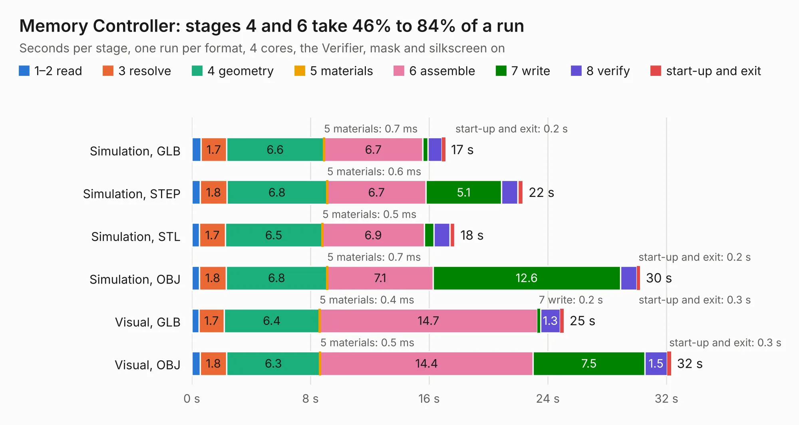

# 88. Memory Controller

Board 88 of the 3,130 of [Corpus Testing](../Corpus-Testing.md), on [Corpus Page 1](../CorpusTestingPages/Corpus-Testing-01.md#88-memory-controller).

| Mode and format | 1–2 read | 3 resolve | 4 geometry | 5 materials | 6 assemble | 7 write | 8 verify | start-up and exit | Total |
|---|---:|---:|---:|---:|---:|---:|---:|---:|---:|
| Simulation, GLB | 0.6 | 1.7 | 6.6 | 0.7&nbsp;ms | 6.7 | 0.3 | 0.9 | 0.2 | 17.1 |
| Simulation, STEP | 0.6 | 1.8 | 6.8 | 0.6&nbsp;ms | 6.7 | 5.1 | 1.1 | 0.3 | 22.3 |
| Simulation, STL | 0.5 | 1.7 | 6.5 | 0.5&nbsp;ms | 6.9 | 0.7 | 1.1 | 0.3 | 17.7 |
| Simulation, OBJ | 0.5 | 1.8 | 6.8 | 0.7&nbsp;ms | 7.1 | 12.6 | 1.1 | 0.2 | 30.2 |
| Visual, GLB | 0.5 | 1.7 | 6.4 | 0.4&nbsp;ms | 14.7 | 0.2 | 1.3 | 0.3 | 25.1 |
| Visual, OBJ | 0.6 | 1.8 | 6.3 | 0.5&nbsp;ms | 14.4 | 7.5 | 1.5 | 0.3 | 32.3 |

<table align="center"><tr><td valign="top">

| Board | Repo: [AJain9199/AOS16](https://github.com/AJain9199/AOS16) Board: `Memory Controller.kicad_pcb` |
|---|---|
| Folder | Memory Controller |
| Complexity | 318&nbsp;/&nbsp;1000 (size&nbsp;233, features&nbsp;85) |
| KESE&nbsp;features | through vias, rounded, trapezoid or chamfered pads, filled zones, curved board outline, stack-up, dielectric εr and tanδ |
| Tested | 9th November 2026 |
| Copper&nbsp;layers | 4 |
| File&nbsp;format | KiCad 9 (20241229) |
| Parts,&nbsp;tracks,&nbsp;vias | 49, 933, 116 |
| Triangles,&nbsp;simulation | 1,987,404 in 91 parts |
| Verifier | PASS in all six runs |

</td><td valign="top">

<table>
<tr><th>File type</th><th>File size</th><th>Peak memory used</th></tr>
<tr><th colspan="3" align="left">Simulation</th></tr>
<tr><td>GLB</td><td align="right">68&nbsp;MB</td><td align="right">784&nbsp;MB</td></tr>
<tr><td>STEP</td><td align="right">270&nbsp;MB</td><td align="right">804&nbsp;MB</td></tr>
<tr><td>STL</td><td align="right">99&nbsp;MB</td><td align="right">789&nbsp;MB</td></tr>
<tr><td>OBJ</td><td align="right">206&nbsp;MB</td><td align="right">1.3&nbsp;GB</td></tr>
<tr><th colspan="3" align="left">Visual</th></tr>
<tr><td>GLB</td><td align="right">40&nbsp;MB</td><td align="right">852&nbsp;MB</td></tr>
<tr><td>OBJ</td><td align="right">121&nbsp;MB</td><td align="right">904&nbsp;MB</td></tr>
</table>

</td></tr></table>

| Previous | Next |
|:---|---:|
| [87. Control](b0087b_AOS16_Control.md) | [89. Program Counter](b0089b_AOS16_Program-Counter.md) |
