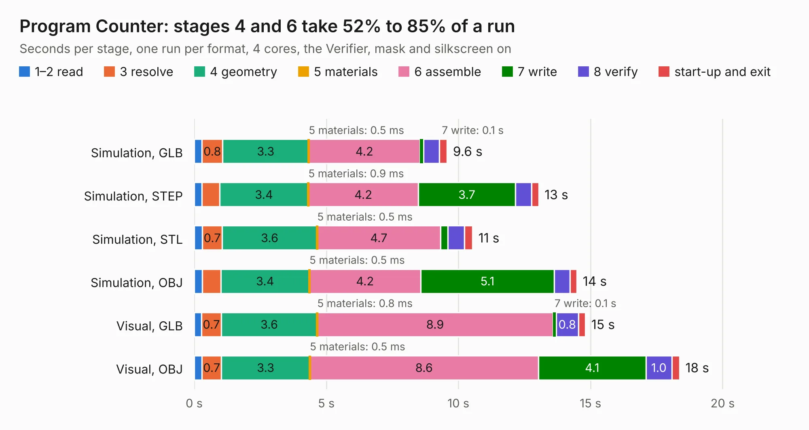

# 88. Program Counter

Board 88 of the 3,103 of [Corpus Testing](../Corpus-Testing.md), on [Corpus Page 1](../CorpusTestingPages/Corpus-Testing-01.md#88-program-counter).

| Mode and format | 1–2 read | 3 resolve | 4 geometry | 5 materials | 6 assemble | 7 write | 8 verify | start-up and exit | Total |
|---|---:|---:|---:|---:|---:|---:|---:|---:|---:|
| Simulation, GLB | 0.3 | 0.8 | 3.3 | 0.5&nbsp;ms | 4.2 | 0.1 | 0.6 | 0.3 | 9.6 |
| Simulation, STEP | 0.3 | 0.7 | 3.4 | 0.9&nbsp;ms | 4.2 | 3.7 | 0.6 | 0.3 | 13.0 |
| Simulation, STL | 0.3 | 0.7 | 3.6 | 0.5&nbsp;ms | 4.7 | 0.3 | 0.6 | 0.3 | 10.5 |
| Simulation, OBJ | 0.3 | 0.7 | 3.4 | 0.5&nbsp;ms | 4.2 | 5.1 | 0.6 | 0.3 | 14.5 |
| Visual, GLB | 0.3 | 0.7 | 3.6 | 0.8&nbsp;ms | 8.9 | 0.1 | 0.8 | 0.3 | 14.8 |
| Visual, OBJ | 0.3 | 0.7 | 3.3 | 0.5&nbsp;ms | 8.6 | 4.1 | 1.0 | 0.3 | 18.4 |

<table align="center"><tr><td valign="top">

| Board | Repo: [AJain9199/AOS16](https://github.com/AJain9199/AOS16) Board: `Program Counter.kicad_pcb` |
|---|---|
| Folder | Program Counter |
| Complexity | 294&nbsp;/&nbsp;1000 (size&nbsp;209, features&nbsp;85) |
| KESE&nbsp;features | through vias, rounded, trapezoid or chamfered pads, filled zones, curved board outline, stack-up, dielectric εr and tanδ |
| Tested | 9th November 2026 |
| Copper&nbsp;layers | 2 |
| File&nbsp;format | KiCad 9 (20241229) |
| Parts,&nbsp;tracks,&nbsp;vias | 50, 561, 78 |
| Triangles,&nbsp;simulation | 848,784 in 87 parts |
| Verifier | PASS in all six runs |

</td><td valign="top">

<table>
<tr><th>File type</th><th>File size</th><th>Peak memory used</th></tr>
<tr><th colspan="3" align="left">Simulation</th></tr>
<tr><td>GLB</td><td align="right">29&nbsp;MB</td><td align="right">429&nbsp;MB</td></tr>
<tr><td>STEP</td><td align="right">140&nbsp;MB</td><td align="right">478&nbsp;MB</td></tr>
<tr><td>STL</td><td align="right">42&nbsp;MB</td><td align="right">403&nbsp;MB</td></tr>
<tr><td>OBJ</td><td align="right">85&nbsp;MB</td><td align="right">610&nbsp;MB</td></tr>
<tr><th colspan="3" align="left">Visual</th></tr>
<tr><td>GLB</td><td align="right">22&nbsp;MB</td><td align="right">638&nbsp;MB</td></tr>
<tr><td>OBJ</td><td align="right">66&nbsp;MB</td><td align="right">612&nbsp;MB</td></tr>
</table>

</td></tr></table>

| Previous | Next |
|:---|---:|
| [87. Memory Controller](b0087b_AOS16_Memory-Controller.md) | [89. reg4x16](b0089b_AOS16_reg4x16.md) |
