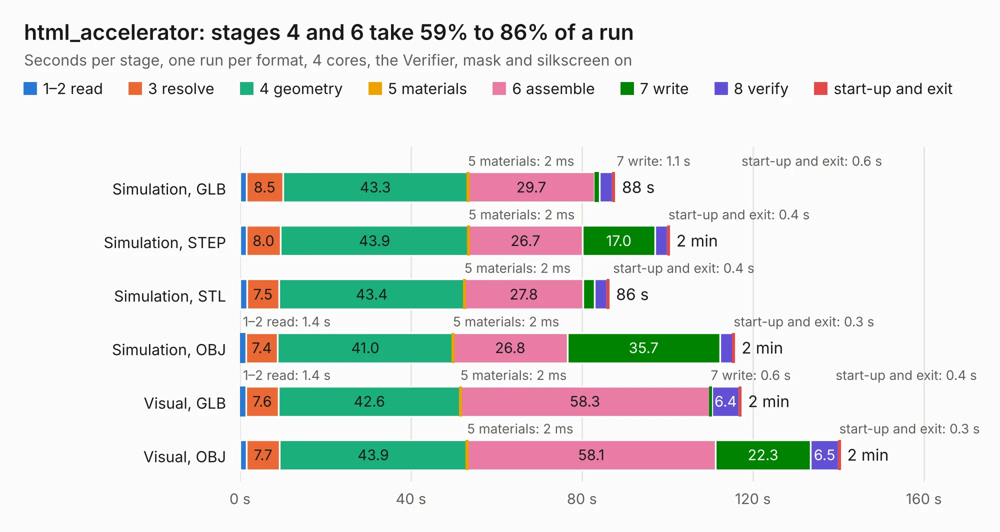

# 89. html_accelerator

Board 89 of the 3,100 of [Corpus Testing](../Corpus-Testing.md), on [Corpus Page 1](../CorpusTestingPages/Corpus-Testing-01.md#89-html_accelerator).

| Mode and format | 1–2 read | 3 resolve | 4 geometry | 5 materials | 6 assemble | 7 write | 8 verify | start-up and exit | Total |
|---|---:|---:|---:|---:|---:|---:|---:|---:|---:|
| Simulation, GLB | 1.5 | 8.5 | 43.3 | 2&nbsp;ms | 29.7 | 1.1 | 3.1 | 0.6 | 87.7 |
| Simulation, STEP | 1.5 | 8.0 | 43.9 | 2&nbsp;ms | 26.7 | 17.0 | 2.9 | 0.4 | 100.4 |
| Simulation, STL | 1.6 | 7.5 | 43.4 | 2&nbsp;ms | 27.8 | 2.7 | 3.0 | 0.4 | 86.3 |
| Simulation, OBJ | 1.4 | 7.4 | 41.0 | 2&nbsp;ms | 26.8 | 35.7 | 3.1 | 0.3 | 115.7 |
| Visual, GLB | 1.4 | 7.6 | 42.6 | 2&nbsp;ms | 58.3 | 0.6 | 6.4 | 0.4 | 117.2 |
| Visual, OBJ | 1.5 | 7.7 | 43.9 | 2&nbsp;ms | 58.1 | 22.3 | 6.5 | 0.3 | 140.4 |

<table align="center"><tr><td valign="top">

| Board | Repo: [akastanley/html_accelerator](https://github.com/akastanley/html_accelerator) Board: `html_accelerator.kicad_pcb` |
|---|---|
| Folder | PCB / html_accelerator |
| Complexity | 440&nbsp;/&nbsp;1000 (size&nbsp;280, features&nbsp;160) |
| KESE&nbsp;features | through vias, rounded, trapezoid or chamfered pads, arc tracks, filled zones, copper drawings, curved board outline, knockout text, TrueType text, stack-up, dielectric εr and tanδ, copper finish, mask and silkscreen colours |
| Tested | 9th November 2026 |
| Copper&nbsp;layers | 4 |
| File&nbsp;format | KiCad 10 (20260206) |
| Parts,&nbsp;tracks,&nbsp;vias | 168, 2,688, 1,305 |
| Triangles,&nbsp;simulation | 6,289,994 in 866 parts |
| Verifier | PASS in all six runs |

</td><td valign="top">

<table>
<tr><th>File type</th><th>File size</th><th>Peak memory used</th></tr>
<tr><th colspan="3" align="left">Simulation</th></tr>
<tr><td>GLB</td><td align="right">214&nbsp;MB</td><td align="right">1.7&nbsp;GB</td></tr>
<tr><td>STEP</td><td align="right">930&nbsp;MB</td><td align="right">2.5&nbsp;GB</td></tr>
<tr><td>STL</td><td align="right">315&nbsp;MB</td><td align="right">1.7&nbsp;GB</td></tr>
<tr><td>OBJ</td><td align="right">683&nbsp;MB</td><td align="right">4.1&nbsp;GB</td></tr>
<tr><th colspan="3" align="left">Visual</th></tr>
<tr><td>GLB</td><td align="right">128&nbsp;MB</td><td align="right">2.2&nbsp;GB</td></tr>
<tr><td>OBJ</td><td align="right">418&nbsp;MB</td><td align="right">2.8&nbsp;GB</td></tr>
</table>

</td></tr></table>

| Previous | Next |
|:---|---:|
| [88. reg4x16](b0088b_AOS16_reg4x16.md) | [90. i386sx-motherboard](b0090b_fpgamotherboard_i386sx-motherboard.md) |
