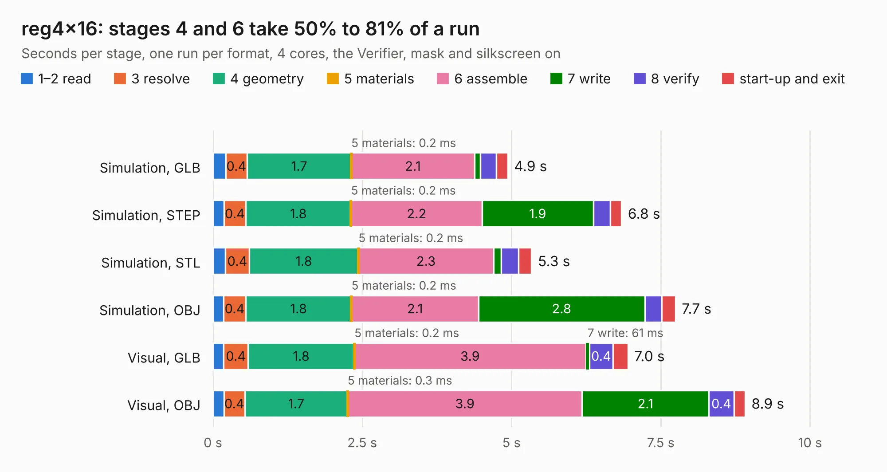

# 90. reg4x16

Board 90 of the 3,131 of [Corpus Testing](../Corpus-Testing.md), on [Corpus Page 1](../CorpusTestingPages/Corpus-Testing-01.md#90-reg4x16).

| Mode and format | 1–2 read | 3 resolve | 4 geometry | 5 materials | 6 assemble | 7 write | 8 verify | start-up and exit | Total |
|---|---:|---:|---:|---:|---:|---:|---:|---:|---:|
| Simulation, GLB | 0.2 | 0.4 | 1.7 | 0.2&nbsp;ms | 2.1 | 98&nbsp;ms | 0.3 | 0.2 | 4.9 |
| Simulation, STEP | 0.2 | 0.4 | 1.8 | 0.2&nbsp;ms | 2.2 | 1.9 | 0.3 | 0.2 | 6.8 |
| Simulation, STL | 0.2 | 0.4 | 1.8 | 0.2&nbsp;ms | 2.3 | 0.1 | 0.3 | 0.2 | 5.3 |
| Simulation, OBJ | 0.2 | 0.4 | 1.8 | 0.2&nbsp;ms | 2.1 | 2.8 | 0.3 | 0.2 | 7.7 |
| Visual, GLB | 0.2 | 0.4 | 1.8 | 0.2&nbsp;ms | 3.9 | 61&nbsp;ms | 0.4 | 0.3 | 7.0 |
| Visual, OBJ | 0.2 | 0.4 | 1.7 | 0.3&nbsp;ms | 3.9 | 2.1 | 0.4 | 0.2 | 8.9 |

<table align="center"><tr><td valign="top">

| Board | Repo: [AJain9199/AOS16](https://github.com/AJain9199/AOS16) Board: `reg4x16.kicad_pcb` |
|---|---|
| Folder | reg4x16 |
| Complexity | 239&nbsp;/&nbsp;1000 (size&nbsp;154, features&nbsp;85) |
| KESE&nbsp;features | through vias, rounded, trapezoid or chamfered pads, filled zones, curved board outline, stack-up, dielectric εr and tanδ |
| Tested | 9th November 2026 |
| Copper&nbsp;layers | 2 |
| File&nbsp;format | KiCad 9 (20241229) |
| Parts,&nbsp;tracks,&nbsp;vias | 21, 377, 67 |
| Triangles,&nbsp;simulation | 525,358 in 40 parts |
| Verifier | PASS in all six runs |

</td><td valign="top">

<table>
<tr><th>File type</th><th>File size</th><th>Peak memory used</th></tr>
<tr><th colspan="3" align="left">Simulation</th></tr>
<tr><td>GLB</td><td align="right">18&nbsp;MB</td><td align="right">323&nbsp;MB</td></tr>
<tr><td>STEP</td><td align="right">84&nbsp;MB</td><td align="right">373&nbsp;MB</td></tr>
<tr><td>STL</td><td align="right">26&nbsp;MB</td><td align="right">316&nbsp;MB</td></tr>
<tr><td>OBJ</td><td align="right">52&nbsp;MB</td><td align="right">399&nbsp;MB</td></tr>
<tr><th colspan="3" align="left">Visual</th></tr>
<tr><td>GLB</td><td align="right">14&nbsp;MB</td><td align="right">426&nbsp;MB</td></tr>
<tr><td>OBJ</td><td align="right">42&nbsp;MB</td><td align="right">429&nbsp;MB</td></tr>
</table>

</td></tr></table>

| Previous | Next |
|:---|---:|
| [89. Program Counter](b0089b_AOS16_Program-Counter.md) | [91. html_accelerator](b0091b_html-accelerator_html-accelerator.md) |
