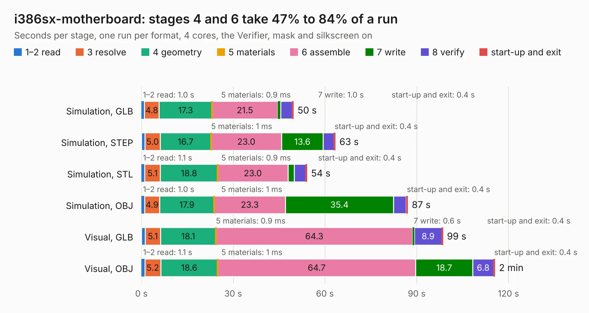

# 91. i386sx-motherboard

Board 91 of the 3,103 of [Corpus Testing](../Corpus-Testing.md), on [Corpus Page 1](../CorpusTestingPages/Corpus-Testing-01.md#91-i386sx-motherboard).

| Mode and format | 1–2 read | 3 resolve | 4 geometry | 5 materials | 6 assemble | 7 write | 8 verify | start-up and exit | Total |
|---|---:|---:|---:|---:|---:|---:|---:|---:|---:|
| Simulation, GLB | 1.0 | 4.8 | 17.3 | 0.9&nbsp;ms | 21.5 | 1.0 | 3.7 | 0.4 | 49.6 |
| Simulation, STEP | 1.2 | 5.0 | 16.7 | 1&nbsp;ms | 23.0 | 13.6 | 3.6 | 0.4 | 63.4 |
| Simulation, STL | 1.1 | 5.1 | 18.8 | 0.9&nbsp;ms | 23.0 | 2.1 | 3.7 | 0.4 | 54.1 |
| Simulation, OBJ | 1.0 | 4.9 | 17.9 | 1&nbsp;ms | 23.3 | 35.4 | 4.1 | 0.4 | 87.0 |
| Visual, GLB | 1.2 | 5.1 | 18.1 | 0.9&nbsp;ms | 64.3 | 0.6 | 8.9 | 0.4 | 98.5 |
| Visual, OBJ | 1.1 | 5.2 | 18.6 | 1&nbsp;ms | 64.7 | 18.7 | 6.8 | 0.4 | 115.5 |

<table align="center"><tr><td valign="top">

| Board | Repo: [alphaonex86/fpgamotherboard](https://github.com/alphaonex86/fpgamotherboard) Board: `i386sx-motherboard.kicad_pcb` |
|---|---|
| Folder | i386 / fpga-ep4ce22 |
| Complexity | 398&nbsp;/&nbsp;1000 (size&nbsp;298, features&nbsp;100) |
| KESE&nbsp;features | through vias, slotted holes, rounded, trapezoid or chamfered pads, filled zones, stack-up, dielectric εr and tanδ, copper finish |
| Tested | 9th November 2026 |
| Copper&nbsp;layers | 6 |
| File&nbsp;format | KiCad 10 (20260206) |
| Parts,&nbsp;tracks,&nbsp;vias | 148, 5,607, 689 |
| Triangles,&nbsp;simulation | 5,728,798 in 229 parts |
| Verifier | PASS in all six runs |

</td><td valign="top">

<table>
<tr><th>File type</th><th>File size</th><th>Peak memory used</th></tr>
<tr><th colspan="3" align="left">Simulation</th></tr>
<tr><td>GLB</td><td align="right">193&nbsp;MB</td><td align="right">1.4&nbsp;GB</td></tr>
<tr><td>STEP</td><td align="right">749&nbsp;MB</td><td align="right">1.9&nbsp;GB</td></tr>
<tr><td>STL</td><td align="right">286&nbsp;MB</td><td align="right">1.4&nbsp;GB</td></tr>
<tr><td>OBJ</td><td align="right">605&nbsp;MB</td><td align="right">3.6&nbsp;GB</td></tr>
<tr><th colspan="3" align="left">Visual</th></tr>
<tr><td>GLB</td><td align="right">111&nbsp;MB</td><td align="right">1.9&nbsp;GB</td></tr>
<tr><td>OBJ</td><td align="right">359&nbsp;MB</td><td align="right">2.3&nbsp;GB</td></tr>
</table>

</td></tr></table>

| Previous | Next |
|:---|---:|
| [90. html_accelerator](b0090b_html-accelerator_html-accelerator.md) | [92. i386sx-gw2ar18](b0092b_fpgamotherboard_i386sx-gw2ar18.md) |
