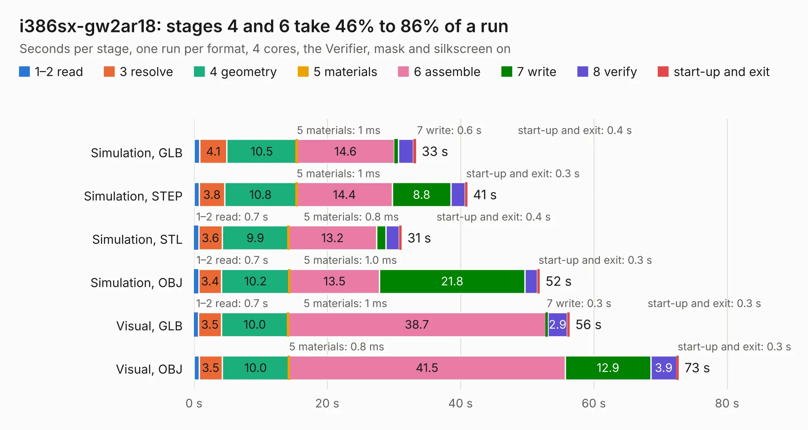

# 93. i386sx-gw2ar18

Board 93 of the 3,118 of [Corpus Testing](../Corpus-Testing.md), on [Corpus Page 1](../CorpusTestingPages/Corpus-Testing-01.md#93-i386sx-gw2ar18).

| Mode and format | 1–2 read | 3 resolve | 4 geometry | 5 materials | 6 assemble | 7 write | 8 verify | start-up and exit | Total |
|---|---:|---:|---:|---:|---:|---:|---:|---:|---:|
| Simulation, GLB | 0.9 | 4.1 | 10.5 | 1&nbsp;ms | 14.6 | 0.6 | 2.3 | 0.4 | 33.3 |
| Simulation, STEP | 0.8 | 3.8 | 10.8 | 1&nbsp;ms | 14.4 | 8.8 | 2.1 | 0.3 | 41.0 |
| Simulation, STL | 0.7 | 3.6 | 9.9 | 0.8&nbsp;ms | 13.2 | 1.4 | 2.0 | 0.4 | 31.2 |
| Simulation, OBJ | 0.7 | 3.4 | 10.2 | 1.0&nbsp;ms | 13.5 | 21.8 | 1.9 | 0.3 | 51.9 |
| Visual, GLB | 0.7 | 3.5 | 10.0 | 1&nbsp;ms | 38.7 | 0.3 | 2.9 | 0.3 | 56.4 |
| Visual, OBJ | 0.8 | 3.5 | 10.0 | 0.8&nbsp;ms | 41.5 | 12.9 | 3.9 | 0.3 | 72.7 |

<table align="center"><tr><td valign="top">

| Board | Repo: [alphaonex86/fpgamotherboard](https://github.com/alphaonex86/fpgamotherboard) Board: `i386sx-gw2ar18.kicad_pcb` |
|---|---|
| Folder | i386 / fpga-gw2ar18 / hw |
| Complexity | 373&nbsp;/&nbsp;1000 (size&nbsp;273, features&nbsp;100) |
| KESE&nbsp;features | through vias, slotted holes, rounded, trapezoid or chamfered pads, filled zones, stack-up, dielectric εr and tanδ, copper finish |
| Tested | 9th November 2026 |
| Copper&nbsp;layers | 6 |
| File&nbsp;format | KiCad 10 (20260206) |
| Parts,&nbsp;tracks,&nbsp;vias | 129, 3,277, 357 |
| Triangles,&nbsp;simulation | 3,256,002 in 173 parts |
| Verifier | PASS in all six runs |

</td><td valign="top">

<table>
<tr><th>File type</th><th>File size</th><th>Peak memory used</th></tr>
<tr><th colspan="3" align="left">Simulation</th></tr>
<tr><td>GLB</td><td align="right">111&nbsp;MB</td><td align="right">1.0&nbsp;GB</td></tr>
<tr><td>STEP</td><td align="right">449&nbsp;MB</td><td align="right">1.1&nbsp;GB</td></tr>
<tr><td>STL</td><td align="right">163&nbsp;MB</td><td align="right">1.0&nbsp;GB</td></tr>
<tr><td>OBJ</td><td align="right">344&nbsp;MB</td><td align="right">2.1&nbsp;GB</td></tr>
<tr><th colspan="3" align="left">Visual</th></tr>
<tr><td>GLB</td><td align="right">62&nbsp;MB</td><td align="right">1.2&nbsp;GB</td></tr>
<tr><td>OBJ</td><td align="right">194&nbsp;MB</td><td align="right">1.4&nbsp;GB</td></tr>
</table>

</td></tr></table>

| Previous | Next |
|:---|---:|
| [92. i386sx-motherboard](b0092b_fpgamotherboard_i386sx-motherboard.md) | [94. socket3-csg324](b0094b_fpgamotherboard_socket3-csg324.md) |
