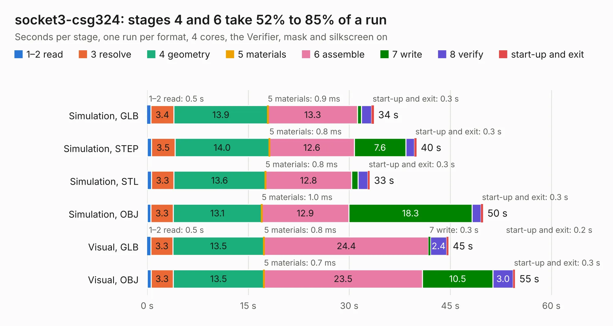

# 94. socket3-csg324

Board 94 of the 3,123 of [Corpus Testing](../Corpus-Testing.md), on [Corpus Page 1](../CorpusTestingPages/Corpus-Testing-01.md#94-socket3-csg324).

| Mode and format | 1–2 read | 3 resolve | 4 geometry | 5 materials | 6 assemble | 7 write | 8 verify | start-up and exit | Total |
|---|---:|---:|---:|---:|---:|---:|---:|---:|---:|
| Simulation, GLB | 0.5 | 3.4 | 13.9 | 0.9&nbsp;ms | 13.3 | 0.6 | 1.5 | 0.3 | 33.6 |
| Simulation, STEP | 0.6 | 3.5 | 14.0 | 0.8&nbsp;ms | 12.6 | 7.6 | 1.3 | 0.3 | 40.0 |
| Simulation, STL | 0.6 | 3.3 | 13.6 | 0.8&nbsp;ms | 12.8 | 1.0 | 1.4 | 0.3 | 33.0 |
| Simulation, OBJ | 0.6 | 3.3 | 13.1 | 1.0&nbsp;ms | 12.9 | 18.3 | 1.3 | 0.3 | 49.9 |
| Visual, GLB | 0.5 | 3.3 | 13.5 | 0.8&nbsp;ms | 24.4 | 0.3 | 2.4 | 0.2 | 44.7 |
| Visual, OBJ | 0.6 | 3.3 | 13.5 | 0.7&nbsp;ms | 23.5 | 10.5 | 3.0 | 0.3 | 54.6 |

<table align="center"><tr><td valign="top">

| Board | Repo: [alphaonex86/fpgamotherboard](https://github.com/alphaonex86/fpgamotherboard) Board: `socket3-csg324.kicad_pcb` |
|---|---|
| Folder | socket3 / fpga-xc7a50t-csg324 / hw |
| Complexity | 206&nbsp;/&nbsp;1000 (size&nbsp;141, features&nbsp;65) |
| KESE&nbsp;features | slotted holes, rounded, trapezoid or chamfered pads, stack-up, dielectric εr and tanδ, copper finish |
| Tested | 9th November 2026 |
| Copper&nbsp;layers | 6 |
| File&nbsp;format | KiCad 10 (20260206) |
| Parts,&nbsp;tracks,&nbsp;vias | 215, 0, 0 |
| Triangles,&nbsp;simulation | 3,165,612 in 283 parts |
| Note | mostly unrouted |
| Verifier | PASS in all six runs |

</td><td valign="top">

<table>
<tr><th>File type</th><th>File size</th><th>Peak memory used</th></tr>
<tr><th colspan="3" align="left">Simulation</th></tr>
<tr><td>GLB</td><td align="right">104&nbsp;MB</td><td align="right">972&nbsp;MB</td></tr>
<tr><td>STEP</td><td align="right">369&nbsp;MB</td><td align="right">1.1&nbsp;GB</td></tr>
<tr><td>STL</td><td align="right">158&nbsp;MB</td><td align="right">987&nbsp;MB</td></tr>
<tr><td>OBJ</td><td align="right">336&nbsp;MB</td><td align="right">2.1&nbsp;GB</td></tr>
<tr><th colspan="3" align="left">Visual</th></tr>
<tr><td>GLB</td><td align="right">60&nbsp;MB</td><td align="right">1.2&nbsp;GB</td></tr>
<tr><td>OBJ</td><td align="right">187&nbsp;MB</td><td align="right">1.3&nbsp;GB</td></tr>
</table>

</td></tr></table>

| Previous | Next |
|:---|---:|
| [93. i386sx-gw2ar18](b0093b_fpgamotherboard_i386sx-gw2ar18.md) | [95. socket3-motherboard](b0095b_fpgamotherboard_socket3-motherboard.md) |
