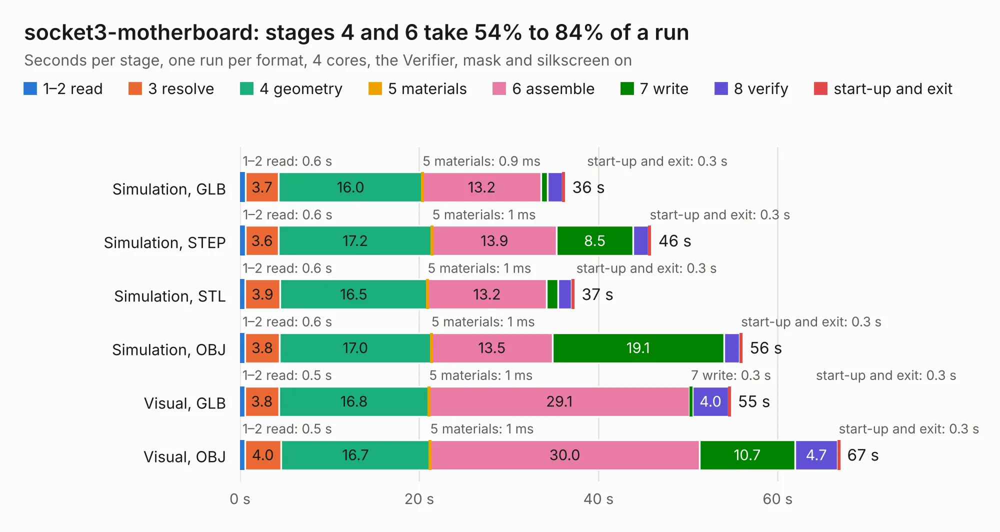

# 95. socket3-motherboard

Board 95 of the 3,124 of [Corpus Testing](../Corpus-Testing.md), on [Corpus Page 1](../CorpusTestingPages/Corpus-Testing-01.md#95-socket3-motherboard).

| Mode and format | 1–2 read | 3 resolve | 4 geometry | 5 materials | 6 assemble | 7 write | 8 verify | start-up and exit | Total |
|---|---:|---:|---:|---:|---:|---:|---:|---:|---:|
| Simulation, GLB | 0.6 | 3.7 | 16.0 | 0.9&nbsp;ms | 13.2 | 0.7 | 1.7 | 0.3 | 36.3 |
| Simulation, STEP | 0.6 | 3.6 | 17.2 | 1&nbsp;ms | 13.9 | 8.5 | 1.7 | 0.3 | 45.9 |
| Simulation, STL | 0.6 | 3.9 | 16.5 | 1&nbsp;ms | 13.2 | 1.3 | 1.6 | 0.3 | 37.3 |
| Simulation, OBJ | 0.6 | 3.8 | 17.0 | 1&nbsp;ms | 13.5 | 19.1 | 1.8 | 0.3 | 56.1 |
| Visual, GLB | 0.5 | 3.8 | 16.8 | 1&nbsp;ms | 29.1 | 0.3 | 4.0 | 0.3 | 54.8 |
| Visual, OBJ | 0.5 | 4.0 | 16.7 | 1&nbsp;ms | 30.0 | 10.7 | 4.7 | 0.3 | 67.0 |

<table align="center"><tr><td valign="top">

| Board | Repo: [alphaonex86/fpgamotherboard](https://github.com/alphaonex86/fpgamotherboard) Board: `socket3-motherboard.kicad_pcb` |
|---|---|
| Folder | socket3 / hw |
| Complexity | 207&nbsp;/&nbsp;1000 (size&nbsp;142, features&nbsp;65) |
| KESE&nbsp;features | slotted holes, rounded, trapezoid or chamfered pads, stack-up, dielectric εr and tanδ, copper finish |
| Tested | 9th November 2026 |
| Copper&nbsp;layers | 6 |
| File&nbsp;format | KiCad 10 (20260206) |
| Parts,&nbsp;tracks,&nbsp;vias | 228, 0, 0 |
| Triangles,&nbsp;simulation | 3,409,814 in 283 parts |
| Note | mostly unrouted |
| Verifier | PASS in all six runs |

</td><td valign="top">

<table>
<tr><th>File type</th><th>File size</th><th>Peak memory used</th></tr>
<tr><th colspan="3" align="left">Simulation</th></tr>
<tr><td>GLB</td><td align="right">113&nbsp;MB</td><td align="right">1.0&nbsp;GB</td></tr>
<tr><td>STEP</td><td align="right">417&nbsp;MB</td><td align="right">1.2&nbsp;GB</td></tr>
<tr><td>STL</td><td align="right">171&nbsp;MB</td><td align="right">1.0&nbsp;GB</td></tr>
<tr><td>OBJ</td><td align="right">363&nbsp;MB</td><td align="right">2.2&nbsp;GB</td></tr>
<tr><th colspan="3" align="left">Visual</th></tr>
<tr><td>GLB</td><td align="right">65&nbsp;MB</td><td align="right">1.4&nbsp;GB</td></tr>
<tr><td>OBJ</td><td align="right">203&nbsp;MB</td><td align="right">1.4&nbsp;GB</td></tr>
</table>

</td></tr></table>

| Previous | Next |
|:---|---:|
| [94. socket3-csg324](b0094b_fpgamotherboard_socket3-csg324.md) | [96. socket370-ti180](b0096b_fpgamotherboard_socket370-fpga-ti180-hw_socket370-ti180.md) |
