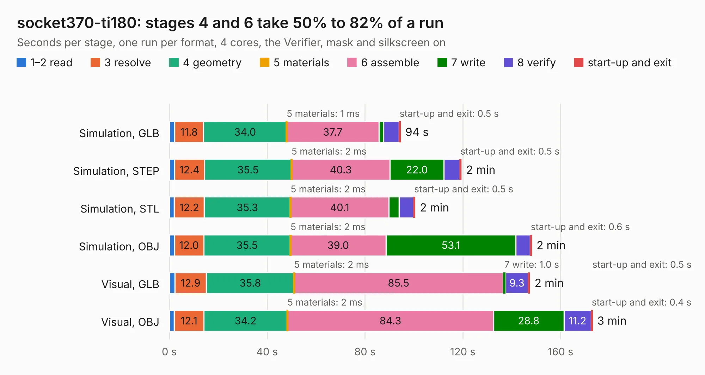

# 96. socket370-ti180

Board 96 of the 3,138 of [Corpus Testing](../Corpus-Testing.md), on [Corpus Page 1](../CorpusTestingPages/Corpus-Testing-01.md#96-socket370-ti180).

| Mode and format | 1–2 read | 3 resolve | 4 geometry | 5 materials | 6 assemble | 7 write | 8 verify | start-up and exit | Total |
|---|---:|---:|---:|---:|---:|---:|---:|---:|---:|
| Simulation, GLB | 2.2 | 11.8 | 34.0 | 1&nbsp;ms | 37.7 | 1.9 | 6.3 | 0.5 | 94.4 |
| Simulation, STEP | 2.1 | 12.4 | 35.5 | 2&nbsp;ms | 40.3 | 22.0 | 6.5 | 0.5 | 119.3 |
| Simulation, STL | 2.1 | 12.2 | 35.3 | 2&nbsp;ms | 40.1 | 4.2 | 5.9 | 0.5 | 100.4 |
| Simulation, OBJ | 2.1 | 12.0 | 35.5 | 2&nbsp;ms | 39.0 | 53.1 | 5.8 | 0.6 | 148.1 |
| Visual, GLB | 2.3 | 12.9 | 35.8 | 2&nbsp;ms | 85.5 | 1.0 | 9.3 | 0.5 | 147.3 |
| Visual, OBJ | 2.1 | 12.1 | 34.2 | 2&nbsp;ms | 84.3 | 28.8 | 11.2 | 0.4 | 172.9 |

<table align="center"><tr><td valign="top">

| Board | Repo: [alphaonex86/fpgamotherboard](https://github.com/alphaonex86/fpgamotherboard) Board: `socket370-ti180.kicad_pcb` |
|---|---|
| Folder | socket370 / fpga-ti180 / hw |
| Complexity | 470&nbsp;/&nbsp;1000 (size&nbsp;330, features&nbsp;140) |
| KESE&nbsp;features | through vias, microvias, slotted holes, rounded, trapezoid or chamfered pads, filled zones, stack-up, dielectric εr and tanδ, copper finish |
| Tested | 9th November 2026 |
| Copper&nbsp;layers | 6 |
| File&nbsp;format | KiCad 10 (20260206) |
| Parts,&nbsp;tracks,&nbsp;vias | 444, 19,588, 1,499 |
| Triangles,&nbsp;simulation | 11,191,706 in 332 parts |
| Verifier | PASS in all six runs |

</td><td valign="top">

<table>
<tr><th>File type</th><th>File size</th><th>Peak memory used</th></tr>
<tr><th colspan="3" align="left">Simulation</th></tr>
<tr><td>GLB</td><td align="right">373&nbsp;MB</td><td align="right">2.6&nbsp;GB</td></tr>
<tr><td>STEP</td><td align="right">1.4&nbsp;GB</td><td align="right">3.7&nbsp;GB</td></tr>
<tr><td>STL</td><td align="right">560&nbsp;MB</td><td align="right">2.6&nbsp;GB</td></tr>
<tr><td>OBJ</td><td align="right">1.2&nbsp;GB</td><td align="right">6.9&nbsp;GB</td></tr>
<tr><th colspan="3" align="left">Visual</th></tr>
<tr><td>GLB</td><td align="right">210&nbsp;MB</td><td align="right">3.4&nbsp;GB</td></tr>
<tr><td>OBJ</td><td align="right">677&nbsp;MB</td><td align="right">4.4&nbsp;GB</td></tr>
</table>

</td></tr></table>

| Previous | Next |
|:---|---:|
| [95. socket3-motherboard](b0095b_fpgamotherboard_socket3-motherboard.md) | [97. socket370-ti180](b0097b_fpgamotherboard_socket370-fpga-ti180-routed_socket370-ti180.md) |
