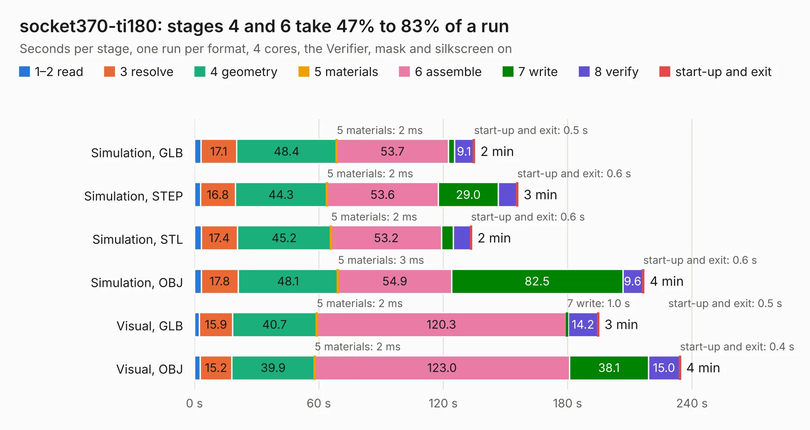

# 96. socket370-ti180

Board 96 of the 3,103 of [Corpus Testing](../Corpus-Testing.md), on [Corpus Page 1](../CorpusTestingPages/Corpus-Testing-01.md#96-socket370-ti180).

| Mode and format | 1–2 read | 3 resolve | 4 geometry | 5 materials | 6 assemble | 7 write | 8 verify | start-up and exit | Total |
|---|---:|---:|---:|---:|---:|---:|---:|---:|---:|
| Simulation, GLB | 3.2 | 17.1 | 48.4 | 2&nbsp;ms | 53.7 | 3.1 | 9.1 | 0.5 | 135.2 |
| Simulation, STEP | 2.9 | 16.8 | 44.3 | 2&nbsp;ms | 53.6 | 29.0 | 8.9 | 0.6 | 156.0 |
| Simulation, STL | 3.3 | 17.4 | 45.2 | 2&nbsp;ms | 53.2 | 5.7 | 8.3 | 0.6 | 133.7 |
| Simulation, OBJ | 3.3 | 17.8 | 48.1 | 3&nbsp;ms | 54.9 | 82.5 | 9.6 | 0.6 | 216.8 |
| Visual, GLB | 2.4 | 15.9 | 40.7 | 2&nbsp;ms | 120.3 | 1.0 | 14.2 | 0.5 | 195.0 |
| Visual, OBJ | 2.8 | 15.2 | 39.9 | 2&nbsp;ms | 123.0 | 38.1 | 15.0 | 0.4 | 234.4 |

<table align="center"><tr><td valign="top">

| Board | Repo: [alphaonex86/fpgamotherboard](https://github.com/alphaonex86/fpgamotherboard) Board: `socket370-ti180.kicad_pcb` |
|---|---|
| Folder | socket370 / fpga-ti180 / routed |
| Complexity | 475&nbsp;/&nbsp;1000 (size&nbsp;335, features&nbsp;140) |
| KESE&nbsp;features | through vias, microvias, slotted holes, rounded, trapezoid or chamfered pads, filled zones, stack-up, dielectric εr and tanδ, copper finish |
| Tested | 9th November 2026 to 10th November 2026 |
| Copper&nbsp;layers | 6 |
| File&nbsp;format | KiCad 10 (20260206) |
| Parts,&nbsp;tracks,&nbsp;vias | 444, 26,277, 1,932 |
| Triangles,&nbsp;simulation | 13,745,814 in 332 parts |
| Verifier | PASS in all six runs |
| Run&nbsp;again | Simulation, GLB; Simulation, STEP; Simulation, STL; Simulation, OBJ: failed in the corpus run, run again with fixes to KESE made after the corpus run, and passed |

</td><td valign="top">

<table>
<tr><th>File type</th><th>File size</th><th>Peak memory used</th></tr>
<tr><th colspan="3" align="left">Simulation</th></tr>
<tr><td>GLB</td><td align="right">461&nbsp;MB</td><td align="right">3.1&nbsp;GB</td></tr>
<tr><td>STEP</td><td align="right">1.7&nbsp;GB</td><td align="right">4.1&nbsp;GB</td></tr>
<tr><td>STL</td><td align="right">687&nbsp;MB</td><td align="right">3.2&nbsp;GB</td></tr>
<tr><td>OBJ</td><td align="right">1.5&nbsp;GB</td><td align="right">8.6&nbsp;GB</td></tr>
<tr><th colspan="3" align="left">Visual</th></tr>
<tr><td>GLB</td><td align="right">253&nbsp;MB</td><td align="right">4.1&nbsp;GB</td></tr>
<tr><td>OBJ</td><td align="right">816&nbsp;MB</td><td align="right">5.3&nbsp;GB</td></tr>
</table>

</td></tr></table>

| Previous | Next |
|:---|---:|
| [95. socket370-ti180](b0095b_fpgamotherboard_socket370-fpga-ti180-hw_socket370-ti180.md) | [97. socket370-motherboard](b0097b_fpgamotherboard_socket370-fpga-xc7a100t-routed_socket370-motherboard.md) |
