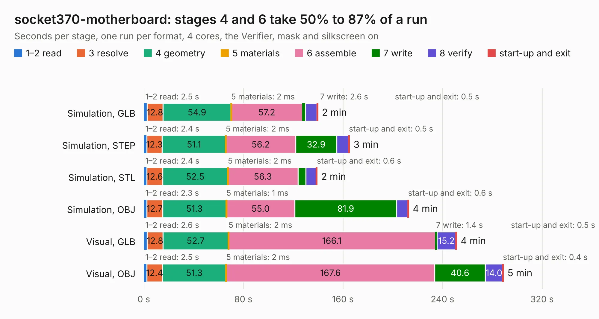

# 98. socket370-motherboard

Board 98 of the 3,130 of [Corpus Testing](../Corpus-Testing.md), on [Corpus Page 1](../CorpusTestingPages/Corpus-Testing-01.md#98-socket370-motherboard).

| Mode and format | 1–2 read | 3 resolve | 4 geometry | 5 materials | 6 assemble | 7 write | 8 verify | start-up and exit | Total |
|---|---:|---:|---:|---:|---:|---:|---:|---:|---:|
| Simulation, GLB | 2.5 | 12.8 | 54.9 | 2&nbsp;ms | 57.2 | 2.6 | 9.2 | 0.5 | 139.7 |
| Simulation, STEP | 2.4 | 12.3 | 51.1 | 2&nbsp;ms | 56.2 | 32.9 | 9.6 | 0.5 | 165.1 |
| Simulation, STL | 2.4 | 12.6 | 52.5 | 2&nbsp;ms | 56.3 | 6.3 | 8.4 | 0.6 | 139.1 |
| Simulation, OBJ | 2.3 | 12.7 | 51.3 | 1&nbsp;ms | 55.0 | 81.9 | 8.9 | 0.6 | 212.7 |
| Visual, GLB | 2.6 | 12.8 | 52.7 | 2&nbsp;ms | 166.1 | 1.4 | 15.2 | 0.5 | 251.2 |
| Visual, OBJ | 2.5 | 12.4 | 51.3 | 2&nbsp;ms | 167.6 | 40.6 | 14.0 | 0.4 | 288.8 |

<table align="center"><tr><td valign="top">

| Board | Repo: [alphaonex86/fpgamotherboard](https://github.com/alphaonex86/fpgamotherboard) Board: `socket370-motherboard.kicad_pcb` |
|---|---|
| Folder | socket370 / fpga-xc7a100t / routed |
| Complexity | 431&nbsp;/&nbsp;1000 (size&nbsp;331, features&nbsp;100) |
| KESE&nbsp;features | through vias, slotted holes, rounded, trapezoid or chamfered pads, filled zones, stack-up, dielectric εr and tanδ, copper finish |
| Tested | 9th November 2026 |
| Copper&nbsp;layers | 6 |
| File&nbsp;format | KiCad 10 (20260206) |
| Parts,&nbsp;tracks,&nbsp;vias | 358, 19,945, 1,241 |
| Triangles,&nbsp;simulation | 13,071,934 in 353 parts |
| Verifier | PASS in all six runs |

</td><td valign="top">

<table>
<tr><th>File type</th><th>File size</th><th>Peak memory used</th></tr>
<tr><th colspan="3" align="left">Simulation</th></tr>
<tr><td>GLB</td><td align="right">440&nbsp;MB</td><td align="right">2.9&nbsp;GB</td></tr>
<tr><td>STEP</td><td align="right">1.8&nbsp;GB</td><td align="right">3.8&nbsp;GB</td></tr>
<tr><td>STL</td><td align="right">654&nbsp;MB</td><td align="right">2.8&nbsp;GB</td></tr>
<tr><td>OBJ</td><td align="right">1.4&nbsp;GB</td><td align="right">8.1&nbsp;GB</td></tr>
<tr><th colspan="3" align="left">Visual</th></tr>
<tr><td>GLB</td><td align="right">243&nbsp;MB</td><td align="right">3.9&nbsp;GB</td></tr>
<tr><td>OBJ</td><td align="right">786&nbsp;MB</td><td align="right">4.7&nbsp;GB</td></tr>
</table>

</td></tr></table>

| Previous | Next |
|:---|---:|
| [97. socket370-ti180](b0097b_fpgamotherboard_socket370-fpga-ti180-routed_socket370-ti180.md) | [99. socket370-motherboard](b0099b_fpgamotherboard_socket370-fpga-xc7a100t_socket370-motherboard.md) |
