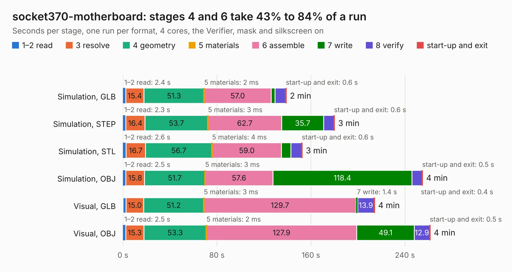

# 99. socket370-motherboard

Board 99 of the 3,111 of [Corpus Testing](../Corpus-Testing.md), on [Corpus Page 1](../CorpusTestingPages/Corpus-Testing-01.md#99-socket370-motherboard).

| Mode and format | 1–2 read | 3 resolve | 4 geometry | 5 materials | 6 assemble | 7 write | 8 verify | start-up and exit | Total |
|---|---:|---:|---:|---:|---:|---:|---:|---:|---:|
| Simulation, GLB | 2.4 | 15.4 | 51.3 | 2&nbsp;ms | 57.0 | 3.2 | 9.0 | 0.6 | 139.0 |
| Simulation, STEP | 2.3 | 16.4 | 53.7 | 3&nbsp;ms | 62.7 | 35.7 | 8.6 | 0.6 | 180.0 |
| Simulation, STL | 2.6 | 16.7 | 56.7 | 4&nbsp;ms | 59.0 | 7.9 | 9.1 | 0.6 | 152.6 |
| Simulation, OBJ | 2.5 | 15.8 | 51.7 | 3&nbsp;ms | 57.6 | 118.4 | 8.4 | 0.5 | 255.0 |
| Visual, GLB | 2.6 | 15.0 | 51.2 | 3&nbsp;ms | 129.7 | 1.4 | 13.9 | 0.4 | 214.1 |
| Visual, OBJ | 2.5 | 15.3 | 53.3 | 2&nbsp;ms | 127.9 | 49.1 | 12.9 | 0.5 | 261.4 |

<table align="center"><tr><td valign="top">

| Board | Repo: [alphaonex86/fpgamotherboard](https://github.com/alphaonex86/fpgamotherboard) Board: `socket370-motherboard.kicad_pcb` |
|---|---|
| Folder | socket370 / fpga-xc7a100t |
| Complexity | 427&nbsp;/&nbsp;1000 (size&nbsp;327, features&nbsp;100) |
| KESE&nbsp;features | through vias, slotted holes, rounded, trapezoid or chamfered pads, filled zones, stack-up, dielectric εr and tanδ, copper finish |
| Tested | 9th November 2026 |
| Copper&nbsp;layers | 8 |
| File&nbsp;format | KiCad 10 (20260206) |
| Parts,&nbsp;tracks,&nbsp;vias | 384, 7,419, 1,302 |
| Triangles,&nbsp;simulation | 14,919,698 in 366 parts |
| Verifier | PASS in all six runs |

</td><td valign="top">

<table>
<tr><th>File type</th><th>File size</th><th>Peak memory used</th></tr>
<tr><th colspan="3" align="left">Simulation</th></tr>
<tr><td>GLB</td><td align="right">492&nbsp;MB</td><td align="right">3.0&nbsp;GB</td></tr>
<tr><td>STEP</td><td align="right">1.6&nbsp;GB</td><td align="right">4.4&nbsp;GB</td></tr>
<tr><td>STL</td><td align="right">746&nbsp;MB</td><td align="right">2.9&nbsp;GB</td></tr>
<tr><td>OBJ</td><td align="right">1.6&nbsp;GB</td><td align="right">9.2&nbsp;GB</td></tr>
<tr><th colspan="3" align="left">Visual</th></tr>
<tr><td>GLB</td><td align="right">234&nbsp;MB</td><td align="right">3.9&nbsp;GB</td></tr>
<tr><td>OBJ</td><td align="right">780&nbsp;MB</td><td align="right">4.8&nbsp;GB</td></tr>
</table>

</td></tr></table>

| Previous | Next |
|:---|---:|
| [98. socket370-motherboard](b0098b_fpgamotherboard_socket370-fpga-xc7a100t-routed_socket370-motherboard.md) | [100. socket7-ti180](b0100b_fpgamotherboard_socket7-fpga-ti180-hw_socket7-ti180.md) |
