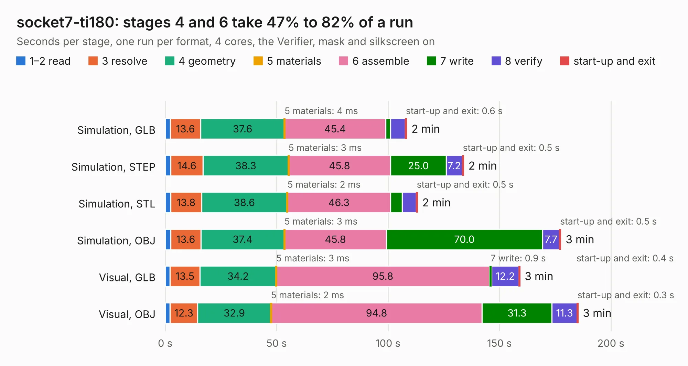

# 99. socket7-ti180

Board 99 of the 3,100 of [Corpus Testing](../Corpus-Testing.md), on [Corpus Page 1](../CorpusTestingPages/Corpus-Testing-01.md#99-socket7-ti180).

| Mode and format | 1–2 read | 3 resolve | 4 geometry | 5 materials | 6 assemble | 7 write | 8 verify | start-up and exit | Total |
|---|---:|---:|---:|---:|---:|---:|---:|---:|---:|
| Simulation, GLB | 2.3 | 13.6 | 37.6 | 4&nbsp;ms | 45.4 | 2.2 | 6.6 | 0.6 | 108.3 |
| Simulation, STEP | 2.4 | 14.6 | 38.3 | 3&nbsp;ms | 45.8 | 25.0 | 7.2 | 0.5 | 133.9 |
| Simulation, STL | 2.5 | 13.8 | 38.6 | 2&nbsp;ms | 46.3 | 5.2 | 6.4 | 0.5 | 113.2 |
| Simulation, OBJ | 2.4 | 13.6 | 37.4 | 3&nbsp;ms | 45.8 | 70.0 | 7.7 | 0.5 | 177.5 |
| Visual, GLB | 2.2 | 13.5 | 34.2 | 3&nbsp;ms | 95.8 | 0.9 | 12.2 | 0.4 | 159.1 |
| Visual, OBJ | 2.2 | 12.3 | 32.9 | 2&nbsp;ms | 94.8 | 31.3 | 11.3 | 0.3 | 185.2 |

<table align="center"><tr><td valign="top">

| Board | Repo: [alphaonex86/fpgamotherboard](https://github.com/alphaonex86/fpgamotherboard) Board: `socket7-ti180.kicad_pcb` |
|---|---|
| Folder | socket7 / fpga-ti180 / routed |
| Complexity | 463&nbsp;/&nbsp;1000 (size&nbsp;323, features&nbsp;140) |
| KESE&nbsp;features | through vias, microvias, slotted holes, rounded, trapezoid or chamfered pads, filled zones, stack-up, dielectric εr and tanδ, copper finish |
| Tested | 9th November 2026 to 10th November 2026 |
| Copper&nbsp;layers | 6 |
| File&nbsp;format | KiCad 10 (20260206) |
| Parts,&nbsp;tracks,&nbsp;vias | 398, 17,224, 1,659 |
| Triangles,&nbsp;simulation | 11,779,760 in 306 parts |
| Verifier | PASS in all six runs |
| Run&nbsp;again | Simulation, GLB; Simulation, STEP; Simulation, STL; Simulation, OBJ: failed in the corpus run, run again with fixes to KESE made after the corpus run, and passed |

</td><td valign="top">

<table>
<tr><th>File type</th><th>File size</th><th>Peak memory used</th></tr>
<tr><th colspan="3" align="left">Simulation</th></tr>
<tr><td>GLB</td><td align="right">395&nbsp;MB</td><td align="right">2.6&nbsp;GB</td></tr>
<tr><td>STEP</td><td align="right">1.4&nbsp;GB</td><td align="right">3.7&nbsp;GB</td></tr>
<tr><td>STL</td><td align="right">589&nbsp;MB</td><td align="right">2.6&nbsp;GB</td></tr>
<tr><td>OBJ</td><td align="right">1.2&nbsp;GB</td><td align="right">7.3&nbsp;GB</td></tr>
<tr><th colspan="3" align="left">Visual</th></tr>
<tr><td>GLB</td><td align="right">219&nbsp;MB</td><td align="right">3.5&nbsp;GB</td></tr>
<tr><td>OBJ</td><td align="right">705&nbsp;MB</td><td align="right">4.6&nbsp;GB</td></tr>
</table>

</td></tr></table>

| Previous | Next |
|:---|---:|
| [98. socket7-ti180](b0098b_fpgamotherboard_socket7-fpga-ti180-hw_socket7-ti180.md) | [100. socket7-motherboard-hdi1](b0100b_fpgamotherboard_socket7-motherboard-hdi1.md) |
