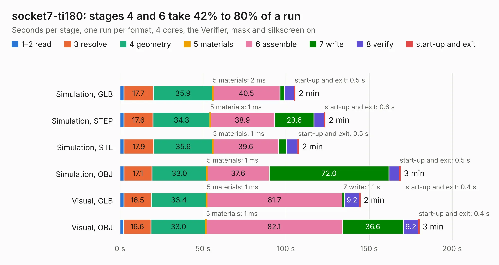

# 100. socket7-ti180

Board 100 of the 3,107 of [Corpus Testing](../Corpus-Testing.md), on [Corpus Page 1](../CorpusTestingPages/Corpus-Testing-01.md#100-socket7-ti180).

| Mode and format | 1–2 read | 3 resolve | 4 geometry | 5 materials | 6 assemble | 7 write | 8 verify | start-up and exit | Total |
|---|---:|---:|---:|---:|---:|---:|---:|---:|---:|
| Simulation, GLB | 2.4 | 17.7 | 35.9 | 2&nbsp;ms | 40.5 | 2.6 | 6.1 | 0.5 | 105.5 |
| Simulation, STEP | 2.5 | 17.6 | 34.3 | 1&nbsp;ms | 38.9 | 23.6 | 6.1 | 0.6 | 123.6 |
| Simulation, STL | 2.5 | 17.9 | 35.6 | 1&nbsp;ms | 39.6 | 4.8 | 6.7 | 0.5 | 107.6 |
| Simulation, OBJ | 2.3 | 17.1 | 33.0 | 1&nbsp;ms | 37.6 | 72.0 | 6.4 | 0.5 | 168.9 |
| Visual, GLB | 2.4 | 16.5 | 33.4 | 1&nbsp;ms | 81.7 | 1.1 | 9.2 | 0.4 | 144.7 |
| Visual, OBJ | 2.3 | 16.6 | 33.0 | 1&nbsp;ms | 82.1 | 36.6 | 9.2 | 0.4 | 180.2 |

<table align="center"><tr><td valign="top">

| Board | Repo: [alphaonex86/fpgamotherboard](https://github.com/alphaonex86/fpgamotherboard) Board: `socket7-ti180.kicad_pcb` |
|---|---|
| Folder | socket7 / fpga-ti180 / hw |
| Complexity | 463&nbsp;/&nbsp;1000 (size&nbsp;323, features&nbsp;140) |
| KESE&nbsp;features | through vias, microvias, slotted holes, rounded, trapezoid or chamfered pads, filled zones, stack-up, dielectric εr and tanδ, copper finish |
| Tested | 9th November 2026 |
| Copper&nbsp;layers | 8 |
| File&nbsp;format | KiCad 10 (20260206) |
| Parts,&nbsp;tracks,&nbsp;vias | 398, 10,910, 1,337 |
| Triangles,&nbsp;simulation | 11,463,286 in 308 parts |
| Verifier | PASS in all six runs |

</td><td valign="top">

<table>
<tr><th>File type</th><th>File size</th><th>Peak memory used</th></tr>
<tr><th colspan="3" align="left">Simulation</th></tr>
<tr><td>GLB</td><td align="right">382&nbsp;MB</td><td align="right">2.4&nbsp;GB</td></tr>
<tr><td>STEP</td><td align="right">1.3&nbsp;GB</td><td align="right">3.5&nbsp;GB</td></tr>
<tr><td>STL</td><td align="right">573&nbsp;MB</td><td align="right">2.4&nbsp;GB</td></tr>
<tr><td>OBJ</td><td align="right">1.2&nbsp;GB</td><td align="right">7.1&nbsp;GB</td></tr>
<tr><th colspan="3" align="left">Visual</th></tr>
<tr><td>GLB</td><td align="right">193&nbsp;MB</td><td align="right">3.2&nbsp;GB</td></tr>
<tr><td>OBJ</td><td align="right">630&nbsp;MB</td><td align="right">4.0&nbsp;GB</td></tr>
</table>

</td></tr></table>

| Previous | Next |
|:---|---:|
| [99. socket370-motherboard](b0099b_fpgamotherboard_socket370-fpga-xc7a100t_socket370-motherboard.md) | [101. socket7-ti180](b0101b_fpgamotherboard_socket7-fpga-ti180-routed_socket7-ti180.md) |
