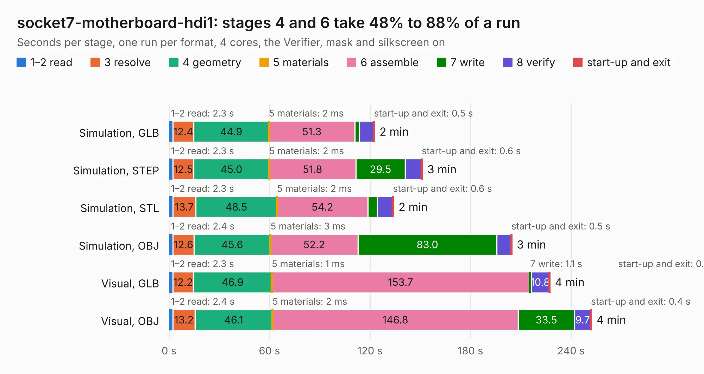

# 102. socket7-motherboard-hdi1

Board 102 of the 3,130 of [Corpus Testing](../Corpus-Testing.md), on [Corpus Page 1](../CorpusTestingPages/Corpus-Testing-01.md#102-socket7-motherboard-hdi1).

| Mode and format | 1–2 read | 3 resolve | 4 geometry | 5 materials | 6 assemble | 7 write | 8 verify | start-up and exit | Total |
|---|---:|---:|---:|---:|---:|---:|---:|---:|---:|
| Simulation, GLB | 2.3 | 12.4 | 44.9 | 2&nbsp;ms | 51.3 | 2.8 | 8.5 | 0.5 | 122.7 |
| Simulation, STEP | 2.3 | 12.5 | 45.0 | 2&nbsp;ms | 51.8 | 29.5 | 9.6 | 0.6 | 151.2 |
| Simulation, STL | 2.3 | 13.7 | 48.5 | 2&nbsp;ms | 54.2 | 5.8 | 9.0 | 0.6 | 134.0 |
| Simulation, OBJ | 2.4 | 12.6 | 45.6 | 3&nbsp;ms | 52.2 | 83.0 | 8.4 | 0.5 | 204.6 |
| Visual, GLB | 2.3 | 12.2 | 46.9 | 1&nbsp;ms | 153.7 | 1.1 | 10.8 | 0.4 | 227.4 |
| Visual, OBJ | 2.4 | 13.2 | 46.1 | 2&nbsp;ms | 146.8 | 33.5 | 9.7 | 0.4 | 252.2 |

<table align="center"><tr><td valign="top">

| Board | Repo: [alphaonex86/fpgamotherboard](https://github.com/alphaonex86/fpgamotherboard) Board: `socket7-motherboard-hdi1.kicad_pcb` |
|---|---|
| Folder | socket7 / fpga-xc7a100t / hdi1 |
| Complexity | 466&nbsp;/&nbsp;1000 (size&nbsp;326, features&nbsp;140) |
| KESE&nbsp;features | through vias, microvias, slotted holes, rounded, trapezoid or chamfered pads, filled zones, stack-up, dielectric εr and tanδ, copper finish |
| Tested | 9th November 2026 |
| Copper&nbsp;layers | 8 |
| File&nbsp;format | KiCad 10 (20260206) |
| Parts,&nbsp;tracks,&nbsp;vias | 313, 11,235, 1,182 |
| Triangles,&nbsp;simulation | 13,879,848 in 329 parts |
| Verifier | PASS in all six runs |

</td><td valign="top">

<table>
<tr><th>File type</th><th>File size</th><th>Peak memory used</th></tr>
<tr><th colspan="3" align="left">Simulation</th></tr>
<tr><td>GLB</td><td align="right">468&nbsp;MB</td><td align="right">2.6&nbsp;GB</td></tr>
<tr><td>STEP</td><td align="right">1.6&nbsp;GB</td><td align="right">3.7&nbsp;GB</td></tr>
<tr><td>STL</td><td align="right">694&nbsp;MB</td><td align="right">2.7&nbsp;GB</td></tr>
<tr><td>OBJ</td><td align="right">1.5&nbsp;GB</td><td align="right">8.7&nbsp;GB</td></tr>
<tr><th colspan="3" align="left">Visual</th></tr>
<tr><td>GLB</td><td align="right">215&nbsp;MB</td><td align="right">3.7&nbsp;GB</td></tr>
<tr><td>OBJ</td><td align="right">711&nbsp;MB</td><td align="right">4.4&nbsp;GB</td></tr>
</table>

</td></tr></table>

| Previous | Next |
|:---|---:|
| [101. socket7-ti180](b0101b_fpgamotherboard_socket7-fpga-ti180-routed_socket7-ti180.md) | [103. socket7-motherboard](b0103b_fpgamotherboard_socket7-fpga-xc7a100t-routed_socket7-motherboard.md) |
