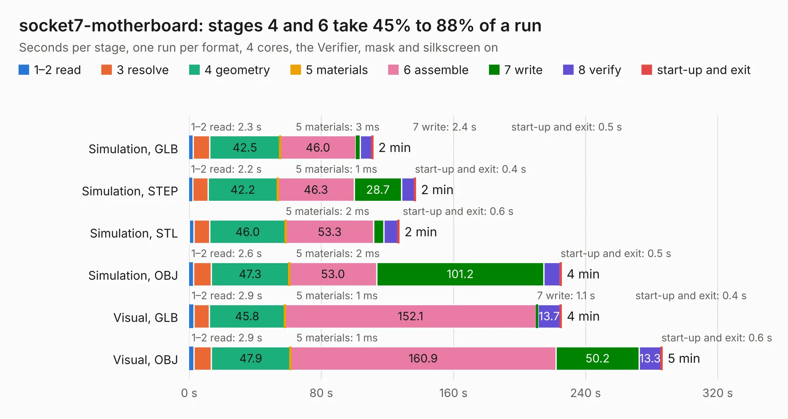

# 103. socket7-motherboard

Board 103 of the 3,132 of [Corpus Testing](../Corpus-Testing.md), on [Corpus Page 1](../CorpusTestingPages/Corpus-Testing-01.md#103-socket7-motherboard).

| Mode and format | 1–2 read | 3 resolve | 4 geometry | 5 materials | 6 assemble | 7 write | 8 verify | start-up and exit | Total |
|---|---:|---:|---:|---:|---:|---:|---:|---:|---:|
| Simulation, GLB | 2.3 | 10.2 | 42.5 | 3&nbsp;ms | 46.0 | 2.4 | 7.2 | 0.5 | 111.1 |
| Simulation, STEP | 2.2 | 9.2 | 42.2 | 1&nbsp;ms | 46.3 | 28.7 | 7.8 | 0.4 | 136.9 |
| Simulation, STL | 3.0 | 9.4 | 46.0 | 2&nbsp;ms | 53.3 | 6.1 | 8.5 | 0.6 | 126.9 |
| Simulation, OBJ | 2.6 | 10.7 | 47.3 | 2&nbsp;ms | 53.0 | 101.2 | 9.8 | 0.5 | 225.1 |
| Visual, GLB | 2.9 | 9.4 | 45.8 | 1&nbsp;ms | 152.1 | 1.1 | 13.7 | 0.4 | 225.2 |
| Visual, OBJ | 2.9 | 10.5 | 47.9 | 1&nbsp;ms | 160.9 | 50.2 | 13.3 | 0.6 | 286.2 |

<table align="center"><tr><td valign="top">

| Board | Repo: [alphaonex86/fpgamotherboard](https://github.com/alphaonex86/fpgamotherboard) Board: `socket7-motherboard.kicad_pcb` |
|---|---|
| Folder | socket7 / fpga-xc7a100t / routed |
| Complexity | 418&nbsp;/&nbsp;1000 (size&nbsp;318, features&nbsp;100) |
| KESE&nbsp;features | through vias, slotted holes, rounded, trapezoid or chamfered pads, filled zones, stack-up, dielectric εr and tanδ, copper finish |
| Tested | 9th November 2026 |
| Copper&nbsp;layers | 6 |
| File&nbsp;format | KiCad 10 (20260206) |
| Parts,&nbsp;tracks,&nbsp;vias | 312, 11,508, 851 |
| Triangles,&nbsp;simulation | 10,576,164 in 327 parts |
| Verifier | PASS in all six runs |

</td><td valign="top">

<table>
<tr><th>File type</th><th>File size</th><th>Peak memory used</th></tr>
<tr><th colspan="3" align="left">Simulation</th></tr>
<tr><td>GLB</td><td align="right">357&nbsp;MB</td><td align="right">2.4&nbsp;GB</td></tr>
<tr><td>STEP</td><td align="right">1.4&nbsp;GB</td><td align="right">3.2&nbsp;GB</td></tr>
<tr><td>STL</td><td align="right">529&nbsp;MB</td><td align="right">2.6&nbsp;GB</td></tr>
<tr><td>OBJ</td><td align="right">1.1&nbsp;GB</td><td align="right">6.5&nbsp;GB</td></tr>
<tr><th colspan="3" align="left">Visual</th></tr>
<tr><td>GLB</td><td align="right">198&nbsp;MB</td><td align="right">3.3&nbsp;GB</td></tr>
<tr><td>OBJ</td><td align="right">641&nbsp;MB</td><td align="right">4.1&nbsp;GB</td></tr>
</table>

</td></tr></table>

| Previous | Next |
|:---|---:|
| [102. socket7-motherboard-hdi1](b0102b_fpgamotherboard_socket7-motherboard-hdi1.md) | [104. socket7-motherboard](b0104b_fpgamotherboard_socket7-fpga-xc7a100t_socket7-motherboard.md) |
