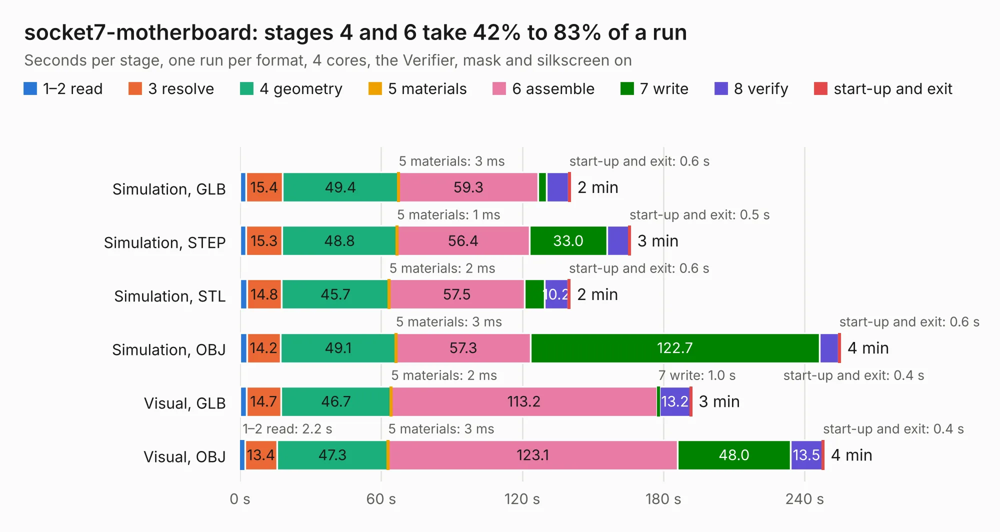

# 104. socket7-motherboard

Board 104 of the 3,119 of [Corpus Testing](../Corpus-Testing.md), on [Corpus Page 1](../CorpusTestingPages/Corpus-Testing-01.md#104-socket7-motherboard).

| Mode and format | 1–2 read | 3 resolve | 4 geometry | 5 materials | 6 assemble | 7 write | 8 verify | start-up and exit | Total |
|---|---:|---:|---:|---:|---:|---:|---:|---:|---:|
| Simulation, GLB | 2.6 | 15.4 | 49.4 | 3&nbsp;ms | 59.3 | 3.6 | 9.3 | 0.6 | 140.3 |
| Simulation, STEP | 2.6 | 15.3 | 48.8 | 1&nbsp;ms | 56.4 | 33.0 | 9.2 | 0.5 | 165.8 |
| Simulation, STL | 2.9 | 14.8 | 45.7 | 2&nbsp;ms | 57.5 | 8.4 | 10.2 | 0.6 | 140.1 |
| Simulation, OBJ | 3.0 | 14.2 | 49.1 | 3&nbsp;ms | 57.3 | 122.7 | 8.1 | 0.6 | 255.0 |
| Visual, GLB | 2.7 | 14.7 | 46.7 | 2&nbsp;ms | 113.2 | 1.0 | 13.2 | 0.4 | 191.8 |
| Visual, OBJ | 2.2 | 13.4 | 47.3 | 3&nbsp;ms | 123.1 | 48.0 | 13.5 | 0.4 | 248.0 |

<table align="center"><tr><td valign="top">

| Board | Repo: [alphaonex86/fpgamotherboard](https://github.com/alphaonex86/fpgamotherboard) Board: `socket7-motherboard.kicad_pcb` |
|---|---|
| Folder | socket7 / fpga-xc7a100t |
| Complexity | 417&nbsp;/&nbsp;1000 (size&nbsp;317, features&nbsp;100) |
| KESE&nbsp;features | through vias, slotted holes, rounded, trapezoid or chamfered pads, filled zones, stack-up, dielectric εr and tanδ, copper finish |
| Tested | 9th November 2026 |
| Copper&nbsp;layers | 8 |
| File&nbsp;format | KiCad 10 (20260206) |
| Parts,&nbsp;tracks,&nbsp;vias | 313, 5,113, 1,117 |
| Triangles,&nbsp;simulation | 13,152,280 in 329 parts |
| Verifier | PASS in all six runs |

</td><td valign="top">

<table>
<tr><th>File type</th><th>File size</th><th>Peak memory used</th></tr>
<tr><th colspan="3" align="left">Simulation</th></tr>
<tr><td>GLB</td><td align="right">432&nbsp;MB</td><td align="right">2.8&nbsp;GB</td></tr>
<tr><td>STEP</td><td align="right">1.4&nbsp;GB</td><td align="right">3.9&nbsp;GB</td></tr>
<tr><td>STL</td><td align="right">658&nbsp;MB</td><td align="right">2.7&nbsp;GB</td></tr>
<tr><td>OBJ</td><td align="right">1.4&nbsp;GB</td><td align="right">8.1&nbsp;GB</td></tr>
<tr><th colspan="3" align="left">Visual</th></tr>
<tr><td>GLB</td><td align="right">206&nbsp;MB</td><td align="right">3.4&nbsp;GB</td></tr>
<tr><td>OBJ</td><td align="right">688&nbsp;MB</td><td align="right">4.5&nbsp;GB</td></tr>
</table>

</td></tr></table>

| Previous | Next |
|:---|---:|
| [103. socket7-motherboard](b0103b_fpgamotherboard_socket7-fpga-xc7a100t-routed_socket7-motherboard.md) | [105. plusd](b0105b_plusD-clone_plusd.md) |
