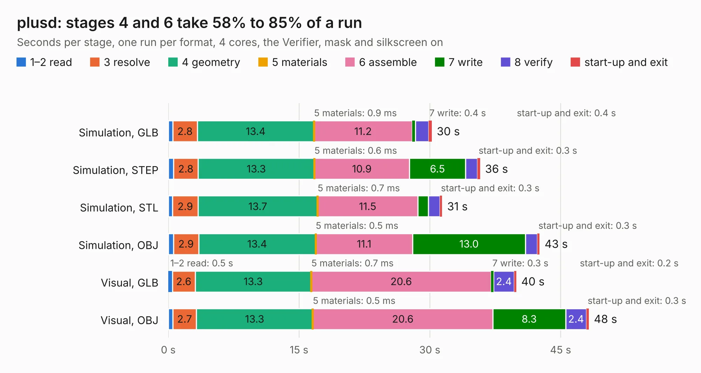

# 105. plusd

Board 105 of the 3,104 of [Corpus Testing](../Corpus-Testing.md), on [Corpus Page 1](../CorpusTestingPages/Corpus-Testing-01.md#105-plusd).

| Mode and format | 1–2 read | 3 resolve | 4 geometry | 5 materials | 6 assemble | 7 write | 8 verify | start-up and exit | Total |
|---|---:|---:|---:|---:|---:|---:|---:|---:|---:|
| Simulation, GLB | 0.5 | 2.8 | 13.4 | 0.9&nbsp;ms | 11.2 | 0.4 | 1.5 | 0.4 | 30.2 |
| Simulation, STEP | 0.6 | 2.8 | 13.3 | 0.6&nbsp;ms | 10.9 | 6.5 | 1.3 | 0.3 | 35.8 |
| Simulation, STL | 0.5 | 2.9 | 13.7 | 0.7&nbsp;ms | 11.5 | 1.2 | 1.3 | 0.3 | 31.4 |
| Simulation, OBJ | 0.6 | 2.9 | 13.4 | 0.5&nbsp;ms | 11.1 | 13.0 | 1.3 | 0.3 | 42.6 |
| Visual, GLB | 0.5 | 2.6 | 13.3 | 0.7&nbsp;ms | 20.6 | 0.3 | 2.4 | 0.2 | 39.9 |
| Visual, OBJ | 0.5 | 2.7 | 13.3 | 0.5&nbsp;ms | 20.6 | 8.3 | 2.4 | 0.3 | 48.2 |

<table align="center"><tr><td valign="top">

| Board | Repo: [alvaroalea/plusD-clone](https://github.com/alvaroalea/plusD-clone) Board: `plusd.kicad_pcb` |
|---|---|
| Complexity | 233&nbsp;/&nbsp;1000 (size&nbsp;188, features&nbsp;45) |
| KESE&nbsp;features | through vias, rounded, trapezoid or chamfered pads, filled zones |
| Tested | 9th November 2026 |
| Copper&nbsp;layers | 2 |
| File&nbsp;format | KiCad 6 (20211014) |
| Parts,&nbsp;tracks,&nbsp;vias | 62, 1,967, 88 |
| Triangles,&nbsp;simulation | 2,590,088 in 119 parts |
| Verifier | PASS in all six runs |

</td><td valign="top">

<table>
<tr><th>File type</th><th>File size</th><th>Peak memory used</th></tr>
<tr><th colspan="3" align="left">Simulation</th></tr>
<tr><td>GLB</td><td align="right">89&nbsp;MB</td><td align="right">789&nbsp;MB</td></tr>
<tr><td>STEP</td><td align="right">452&nbsp;MB</td><td align="right">1.0&nbsp;GB</td></tr>
<tr><td>STL</td><td align="right">130&nbsp;MB</td><td align="right">858&nbsp;MB</td></tr>
<tr><td>OBJ</td><td align="right">274&nbsp;MB</td><td align="right">1.7&nbsp;GB</td></tr>
<tr><th colspan="3" align="left">Visual</th></tr>
<tr><td>GLB</td><td align="right">54&nbsp;MB</td><td align="right">1.0&nbsp;GB</td></tr>
<tr><td>OBJ</td><td align="right">166&nbsp;MB</td><td align="right">1.2&nbsp;GB</td></tr>
</table>

</td></tr></table>

| Previous | Next |
|:---|---:|
| [104. socket7-motherboard](b0104b_fpgamotherboard_socket7-fpga-xc7a100t_socket7-motherboard.md) | [106. plusd_no_route](b0106b_plusD-clone_plusd-no-route.md) |
