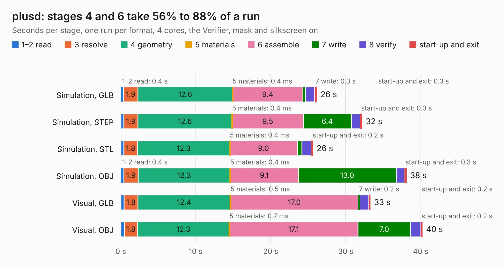

# 106. plusd

Board 106 of the 3,101 of [Corpus Testing](../Corpus-Testing.md), on [Corpus Page 1](../CorpusTestingPages/Corpus-Testing-01.md#106-plusd).

| Mode and format | 1–2 read | 3 resolve | 4 geometry | 5 materials | 6 assemble | 7 write | 8 verify | start-up and exit | Total |
|---|---:|---:|---:|---:|---:|---:|---:|---:|---:|
| Simulation, GLB | 0.4 | 1.9 | 12.6 | 0.4&nbsp;ms | 9.4 | 0.3 | 1.2 | 0.3 | 26.2 |
| Simulation, STEP | 0.4 | 1.9 | 12.6 | 0.4&nbsp;ms | 9.5 | 6.4 | 1.2 | 0.3 | 32.2 |
| Simulation, STL | 0.4 | 1.8 | 12.3 | 0.4&nbsp;ms | 9.0 | 0.6 | 1.3 | 0.2 | 25.7 |
| Simulation, OBJ | 0.4 | 1.9 | 12.3 | 0.4&nbsp;ms | 9.1 | 13.0 | 1.1 | 0.3 | 38.1 |
| Visual, GLB | 0.4 | 1.8 | 12.4 | 0.5&nbsp;ms | 17.0 | 0.2 | 1.2 | 0.2 | 33.3 |
| Visual, OBJ | 0.5 | 1.8 | 12.3 | 0.7&nbsp;ms | 17.1 | 7.0 | 1.3 | 0.2 | 40.3 |

<table align="center"><tr><td valign="top">

| Board | Repo: [alvaroalea/plusD-clone](https://github.com/alvaroalea/plusD-clone) Board: `plusd.kicad_pcb` |
|---|---|
| Folder | Rev_02 |
| Complexity | 220&nbsp;/&nbsp;1000 (size&nbsp;185, features&nbsp;35) |
| KESE&nbsp;features | through vias, filled zones |
| Tested | 9th November 2026 |
| Copper&nbsp;layers | 2 |
| File&nbsp;format | KiCad 5 (20171130) |
| Parts,&nbsp;tracks,&nbsp;vias | 51, 1,835, 91 |
| Triangles,&nbsp;simulation | 2,206,132 in 102 parts |
| Verifier | PASS in all six runs |

</td><td valign="top">

<table>
<tr><th>File type</th><th>File size</th><th>Peak memory used</th></tr>
<tr><th colspan="3" align="left">Simulation</th></tr>
<tr><td>GLB</td><td align="right">76&nbsp;MB</td><td align="right">767&nbsp;MB</td></tr>
<tr><td>STEP</td><td align="right">380&nbsp;MB</td><td align="right">929&nbsp;MB</td></tr>
<tr><td>STL</td><td align="right">110&nbsp;MB</td><td align="right">812&nbsp;MB</td></tr>
<tr><td>OBJ</td><td align="right">232&nbsp;MB</td><td align="right">1.5&nbsp;GB</td></tr>
<tr><th colspan="3" align="left">Visual</th></tr>
<tr><td>GLB</td><td align="right">43&nbsp;MB</td><td align="right">940&nbsp;MB</td></tr>
<tr><td>OBJ</td><td align="right">129&nbsp;MB</td><td align="right">952&nbsp;MB</td></tr>
</table>

</td></tr></table>

| Previous | Next |
|:---|---:|
| [105. plusd](b0105b_plusD-clone_Rev-01_plusd.md) | [107. situacion1](b0107b_plusD-clone_situacion1.md) |
