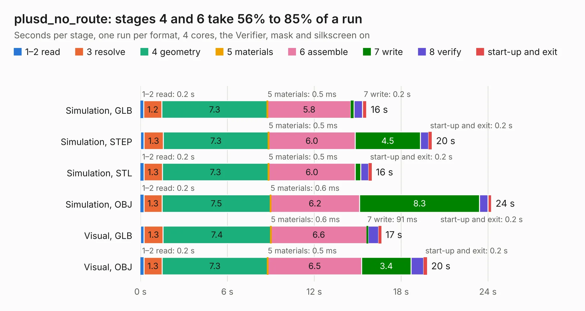

# 106 plusd_no_route

Board 106 of the 3,138 of [Corpus Testing](../Corpus-Testing.md), on [Corpus Page 1](../CorpusTestingPages/Corpus-Testing-01.md#106-plusd_no_route).

| Mode and format | 1–2 read | 3 resolve | 4 geometry | 5 materials | 6 assemble | 7 write | 8 verify | start-up and exit | Total |
|---|---:|---:|---:|---:|---:|---:|---:|---:|---:|
| Simulation, GLB | 0.2 | 1.2 | 7.3 | 0.5&nbsp;ms | 5.8 | 0.2 | 0.6 | 0.3 | 15.6 |
| Simulation, STEP | 0.3 | 1.3 | 7.3 | 0.5&nbsp;ms | 6.0 | 4.5 | 0.6 | 0.2 | 20.1 |
| Simulation, STL | 0.2 | 1.3 | 7.3 | 0.5&nbsp;ms | 6.0 | 0.4 | 0.5 | 0.2 | 16.0 |
| Simulation, OBJ | 0.2 | 1.3 | 7.5 | 0.6&nbsp;ms | 6.2 | 8.3 | 0.6 | 0.2 | 24.2 |
| Visual, GLB | 0.2 | 1.3 | 7.4 | 0.6&nbsp;ms | 6.6 | 91&nbsp;ms | 0.7 | 0.2 | 16.6 |
| Visual, OBJ | 0.2 | 1.3 | 7.3 | 0.5&nbsp;ms | 6.5 | 3.4 | 0.9 | 0.2 | 19.8 |

<table align="center"><tr><td valign="top">

| Board | Repo: [alvaroalea/plusD-clone](https://github.com/alvaroalea/plusD-clone) Board: `plusd_no_route.kicad_pcb` |
|---|---|
| Complexity | 59&nbsp;/&nbsp;1000 (size&nbsp;59, features&nbsp;0) |
| Tested | 9th November 2026 |
| Copper&nbsp;layers | 2 |
| File&nbsp;format | KiCad 5 (20171130) |
| Parts,&nbsp;tracks,&nbsp;vias | 47, 0, 0 |
| Triangles,&nbsp;simulation | 1,550,978 in 100 parts |
| Note | mostly unrouted |
| Verifier | PASS in all six runs |

</td><td valign="top">

<table>
<tr><th>File type</th><th>File size</th><th>Peak memory used</th></tr>
<tr><th colspan="3" align="left">Simulation</th></tr>
<tr><td>GLB</td><td align="right">49&nbsp;MB</td><td align="right">537&nbsp;MB</td></tr>
<tr><td>STEP</td><td align="right">226&nbsp;MB</td><td align="right">688&nbsp;MB</td></tr>
<tr><td>STL</td><td align="right">78&nbsp;MB</td><td align="right">520&nbsp;MB</td></tr>
<tr><td>OBJ</td><td align="right">159&nbsp;MB</td><td align="right">1.0&nbsp;GB</td></tr>
<tr><th colspan="3" align="left">Visual</th></tr>
<tr><td>GLB</td><td align="right">23&nbsp;MB</td><td align="right">577&nbsp;MB</td></tr>
<tr><td>OBJ</td><td align="right">69&nbsp;MB</td><td align="right">605&nbsp;MB</td></tr>
</table>

</td></tr></table>

| Previous | Next |
|:---|---:|
| [105 plusd](b0105b_plusD-clone_plusd.md) | [107 plusd](b0107b_plusD-clone_Rev-01_plusd.md) |
