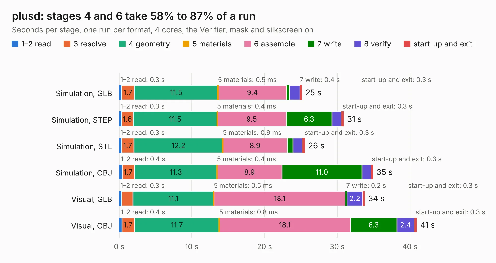

# 107. plusd

Board 107 of the 3,118 of [Corpus Testing](../Corpus-Testing.md), on [Corpus Page 1](../CorpusTestingPages/Corpus-Testing-01.md#107-plusd).

| Mode and format | 1–2 read | 3 resolve | 4 geometry | 5 materials | 6 assemble | 7 write | 8 verify | start-up and exit | Total |
|---|---:|---:|---:|---:|---:|---:|---:|---:|---:|
| Simulation, GLB | 0.3 | 1.7 | 11.5 | 0.5&nbsp;ms | 9.4 | 0.4 | 1.4 | 0.3 | 25.1 |
| Simulation, STEP | 0.3 | 1.6 | 11.5 | 0.4&nbsp;ms | 9.5 | 6.3 | 1.3 | 0.3 | 30.9 |
| Simulation, STL | 0.3 | 1.7 | 12.2 | 0.9&nbsp;ms | 8.9 | 0.8 | 1.3 | 0.3 | 25.5 |
| Simulation, OBJ | 0.4 | 1.7 | 11.3 | 0.4&nbsp;ms | 8.9 | 11.0 | 1.2 | 0.3 | 34.9 |
| Visual, GLB | 0.3 | 1.6 | 11.1 | 0.5&nbsp;ms | 18.1 | 0.2 | 2.2 | 0.3 | 33.8 |
| Visual, OBJ | 0.4 | 1.7 | 11.7 | 0.8&nbsp;ms | 18.1 | 6.3 | 2.4 | 0.3 | 40.9 |

<table align="center"><tr><td valign="top">

| Board | Repo: [alvaroalea/plusD-clone](https://github.com/alvaroalea/plusD-clone) Board: `plusd.kicad_pcb` |
|---|---|
| Folder | Rev_01 |
| Complexity | 214&nbsp;/&nbsp;1000 (size&nbsp;179, features&nbsp;35) |
| KESE&nbsp;features | through vias, filled zones |
| Tested | 9th November 2026 |
| Copper&nbsp;layers | 2 |
| File&nbsp;format | KiCad 5 (20171130) |
| Parts,&nbsp;tracks,&nbsp;vias | 47, 1,452, 36 |
| Triangles,&nbsp;simulation | 2,080,546 in 100 parts |
| Verifier | PASS in all six runs |

</td><td valign="top">

<table>
<tr><th>File type</th><th>File size</th><th>Peak memory used</th></tr>
<tr><th colspan="3" align="left">Simulation</th></tr>
<tr><td>GLB</td><td align="right">72&nbsp;MB</td><td align="right">803&nbsp;MB</td></tr>
<tr><td>STEP</td><td align="right">369&nbsp;MB</td><td align="right">882&nbsp;MB</td></tr>
<tr><td>STL</td><td align="right">104&nbsp;MB</td><td align="right">800&nbsp;MB</td></tr>
<tr><td>OBJ</td><td align="right">219&nbsp;MB</td><td align="right">1.4&nbsp;GB</td></tr>
<tr><th colspan="3" align="left">Visual</th></tr>
<tr><td>GLB</td><td align="right">40&nbsp;MB</td><td align="right">897&nbsp;MB</td></tr>
<tr><td>OBJ</td><td align="right">121&nbsp;MB</td><td align="right">904&nbsp;MB</td></tr>
</table>

</td></tr></table>

| Previous | Next |
|:---|---:|
| [106. plusd_no_route](b0106b_plusD-clone_plusd-no-route.md) | [108. plusd](b0108b_plusD-clone_Rev-02_plusd.md) |
