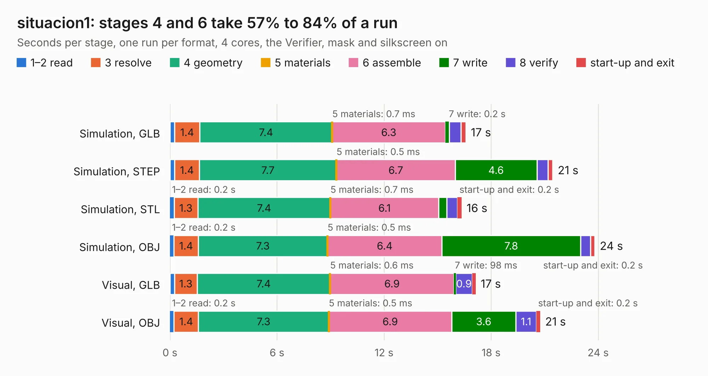

# 109. situacion1

Board 109 of the 3,111 of [Corpus Testing](../Corpus-Testing.md), on [Corpus Page 2](../CorpusTestingPages/Corpus-Testing-02.md#109-situacion1).

| Mode and format | 1–2 read | 3 resolve | 4 geometry | 5 materials | 6 assemble | 7 write | 8 verify | start-up and exit | Total |
|---|---:|---:|---:|---:|---:|---:|---:|---:|---:|
| Simulation, GLB | 0.3 | 1.4 | 7.4 | 0.7&nbsp;ms | 6.3 | 0.2 | 0.7 | 0.3 | 16.6 |
| Simulation, STEP | 0.3 | 1.4 | 7.7 | 0.5&nbsp;ms | 6.7 | 4.6 | 0.6 | 0.3 | 21.5 |
| Simulation, STL | 0.2 | 1.3 | 7.4 | 0.7&nbsp;ms | 6.1 | 0.5 | 0.6 | 0.2 | 16.3 |
| Simulation, OBJ | 0.2 | 1.4 | 7.3 | 0.5&nbsp;ms | 6.4 | 7.8 | 0.6 | 0.2 | 23.8 |
| Visual, GLB | 0.3 | 1.3 | 7.4 | 0.6&nbsp;ms | 6.9 | 98&nbsp;ms | 0.9 | 0.2 | 17.1 |
| Visual, OBJ | 0.2 | 1.4 | 7.3 | 0.5&nbsp;ms | 6.9 | 3.6 | 1.1 | 0.2 | 20.7 |

<table align="center"><tr><td valign="top">

| Board | Repo: [alvaroalea/plusD-clone](https://github.com/alvaroalea/plusD-clone) Board: `situacion1.kicad_pcb` |
|---|---|
| Complexity | 58&nbsp;/&nbsp;1000 (size&nbsp;58, features&nbsp;0) |
| Tested | 9th November 2026 |
| Copper&nbsp;layers | 2 |
| File&nbsp;format | KiCad 5 (20171130) |
| Parts,&nbsp;tracks,&nbsp;vias | 45, 0, 0 |
| Triangles,&nbsp;simulation | 1,586,200 in 95 parts |
| Note | mostly unrouted |
| Verifier | PASS in all six runs |

</td><td valign="top">

<table>
<tr><th>File type</th><th>File size</th><th>Peak memory used</th></tr>
<tr><th colspan="3" align="left">Simulation</th></tr>
<tr><td>GLB</td><td align="right">50&nbsp;MB</td><td align="right">550&nbsp;MB</td></tr>
<tr><td>STEP</td><td align="right">231&nbsp;MB</td><td align="right">711&nbsp;MB</td></tr>
<tr><td>STL</td><td align="right">79&nbsp;MB</td><td align="right">526&nbsp;MB</td></tr>
<tr><td>OBJ</td><td align="right">162&nbsp;MB</td><td align="right">1.0&nbsp;GB</td></tr>
<tr><th colspan="3" align="left">Visual</th></tr>
<tr><td>GLB</td><td align="right">24&nbsp;MB</td><td align="right">661&nbsp;MB</td></tr>
<tr><td>OBJ</td><td align="right">71&nbsp;MB</td><td align="right">607&nbsp;MB</td></tr>
</table>

</td></tr></table>

| Previous | Next |
|:---|---:|
| [108. plusd](b0108b_plusD-clone_Rev-02_plusd.md) | [110. SMD500](b0110b_Amiga-SMD-500_SMD500.md) |
