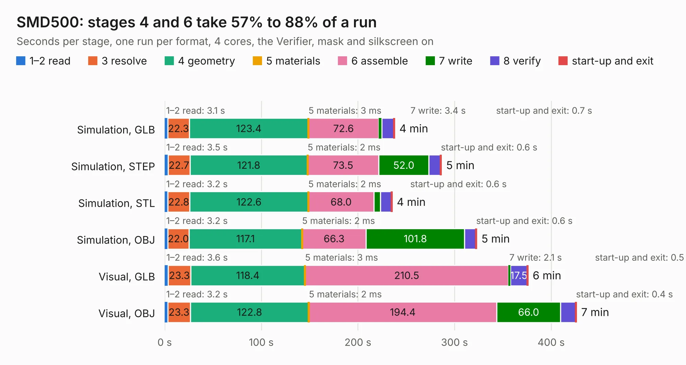

# 110. SMD500

Board 110 of the 3,108 of [Corpus Testing](../Corpus-Testing.md), on [Corpus Page 2](../CorpusTestingPages/Corpus-Testing-02.md#110-smd500).

| Mode and format | 1–2 read | 3 resolve | 4 geometry | 5 materials | 6 assemble | 7 write | 8 verify | start-up and exit | Total |
|---|---:|---:|---:|---:|---:|---:|---:|---:|---:|
| Simulation, GLB | 3.1 | 22.3 | 123.4 | 3&nbsp;ms | 72.6 | 3.4 | 12.2 | 0.7 | 237.8 |
| Simulation, STEP | 3.5 | 22.7 | 121.8 | 2&nbsp;ms | 73.5 | 52.0 | 12.2 | 0.6 | 286.2 |
| Simulation, STL | 3.2 | 22.8 | 122.6 | 2&nbsp;ms | 68.0 | 6.6 | 11.3 | 0.6 | 235.1 |
| Simulation, OBJ | 3.2 | 22.0 | 117.1 | 2&nbsp;ms | 66.3 | 101.8 | 11.8 | 0.6 | 322.7 |
| Visual, GLB | 3.6 | 23.3 | 118.4 | 3&nbsp;ms | 210.5 | 2.1 | 17.5 | 0.5 | 375.8 |
| Visual, OBJ | 3.2 | 23.3 | 122.8 | 2&nbsp;ms | 194.4 | 66.0 | 15.9 | 0.4 | 426.0 |

<table align="center"><tr><td valign="top">

| Board | Repo: [amigalisa/Amiga-SMD-500](https://github.com/amigalisa/Amiga-SMD-500) Board: `SMD500.kicad_pcb` |
|---|---|
| Complexity | 342&nbsp;/&nbsp;1000 (size&nbsp;297, features&nbsp;45) |
| KESE&nbsp;features | through vias, rounded, trapezoid or chamfered pads, filled zones |
| Tested | 9th November 2026 |
| Copper&nbsp;layers | 2 |
| File&nbsp;format | KiCad 5 (20171130) |
| Parts,&nbsp;tracks,&nbsp;vias | 582, 18,007, 1,862 |
| Triangles,&nbsp;simulation | 14,372,138 in 534 parts |
| Verifier | PASS in all six runs |

</td><td valign="top">

<table>
<tr><th>File type</th><th>File size</th><th>Peak memory used</th></tr>
<tr><th colspan="3" align="left">Simulation</th></tr>
<tr><td>GLB</td><td align="right">498&nbsp;MB</td><td align="right">3.7&nbsp;GB</td></tr>
<tr><td>STEP</td><td align="right">2.7&nbsp;GB</td><td align="right">5.2&nbsp;GB</td></tr>
<tr><td>STL</td><td align="right">719&nbsp;MB</td><td align="right">3.9&nbsp;GB</td></tr>
<tr><td>OBJ</td><td align="right">1.6&nbsp;GB</td><td align="right">9.3&nbsp;GB</td></tr>
<tr><th colspan="3" align="left">Visual</th></tr>
<tr><td>GLB</td><td align="right">354&nbsp;MB</td><td align="right">5.3&nbsp;GB</td></tr>
<tr><td>OBJ</td><td align="right">1.1&nbsp;GB</td><td align="right">7.0&nbsp;GB</td></tr>
</table>

</td></tr></table>

| Previous | Next |
|:---|---:|
| [109. situacion1](b0109b_plusD-clone_situacion1.md) | [111. AmigaPCI 68040](b0111b_AmigaPCI-LBC040_AmigaPCI-68040.md) |
