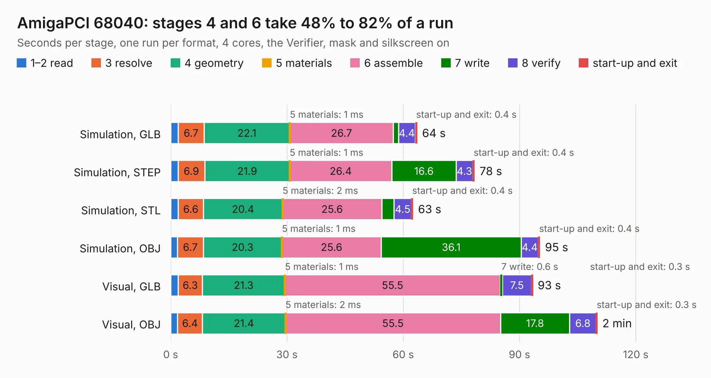

# 111. AmigaPCI 68040

Board 111 of the 3,124 of [Corpus Testing](../Corpus-Testing.md), on [Corpus Page 2](../CorpusTestingPages/Corpus-Testing-02.md#111-amigapci-68040).

| Mode and format | 1–2 read | 3 resolve | 4 geometry | 5 materials | 6 assemble | 7 write | 8 verify | start-up and exit | Total |
|---|---:|---:|---:|---:|---:|---:|---:|---:|---:|
| Simulation, GLB | 1.9 | 6.7 | 22.1 | 1&nbsp;ms | 26.7 | 1.3 | 4.4 | 0.4 | 63.6 |
| Simulation, STEP | 1.9 | 6.9 | 21.9 | 1&nbsp;ms | 26.4 | 16.6 | 4.3 | 0.4 | 78.4 |
| Simulation, STL | 1.9 | 6.6 | 20.4 | 2&nbsp;ms | 25.6 | 3.1 | 4.5 | 0.4 | 62.5 |
| Simulation, OBJ | 1.7 | 6.7 | 20.3 | 1&nbsp;ms | 25.6 | 36.1 | 4.4 | 0.4 | 95.3 |
| Visual, GLB | 1.9 | 6.3 | 21.3 | 1&nbsp;ms | 55.5 | 0.6 | 7.5 | 0.3 | 93.4 |
| Visual, OBJ | 1.8 | 6.4 | 21.4 | 2&nbsp;ms | 55.5 | 17.8 | 6.8 | 0.3 | 110.1 |

<table align="center"><tr><td valign="top">

| Board | Repo: [AmigaPCI/AmigaPCI-LBC040](https://github.com/AmigaPCI/AmigaPCI-LBC040) Board: `AmigaPCI 68040.kicad_pcb` |
|---|---|
| Folder | KiCAD / AmigaPCI-LBC040-REV60 |
| Complexity | 370&nbsp;/&nbsp;1000 (size&nbsp;285, features&nbsp;85) |
| KESE&nbsp;features | through vias, rounded, trapezoid or chamfered pads, filled zones, curved board outline, stack-up, dielectric εr and tanδ |
| Tested | 9th November 2026 |
| Copper&nbsp;layers | 6 |
| File&nbsp;format | KiCad 8 (20240108) |
| Parts,&nbsp;tracks,&nbsp;vias | 126, 4,520, 563 |
| Triangles,&nbsp;simulation | 7,796,750 in 379 parts |
| Verifier | PASS in all six runs |

</td><td valign="top">

<table>
<tr><th>File type</th><th>File size</th><th>Peak memory used</th></tr>
<tr><th colspan="3" align="left">Simulation</th></tr>
<tr><td>GLB</td><td align="right">263&nbsp;MB</td><td align="right">1.8&nbsp;GB</td></tr>
<tr><td>STEP</td><td align="right">981&nbsp;MB</td><td align="right">2.5&nbsp;GB</td></tr>
<tr><td>STL</td><td align="right">390&nbsp;MB</td><td align="right">1.8&nbsp;GB</td></tr>
<tr><td>OBJ</td><td align="right">835&nbsp;MB</td><td align="right">4.9&nbsp;GB</td></tr>
<tr><th colspan="3" align="left">Visual</th></tr>
<tr><td>GLB</td><td align="right">133&nbsp;MB</td><td align="right">2.4&nbsp;GB</td></tr>
<tr><td>OBJ</td><td align="right">436&nbsp;MB</td><td align="right">2.9&nbsp;GB</td></tr>
</table>

</td></tr></table>

| Previous | Next |
|:---|---:|
| [110. SMD500](b0110b_Amiga-SMD-500_SMD500.md) | [112. AmigaPCI Mainboard](b0112b_AmigaPCI-MainBoard_AmigaPCI-Mainboard.md) |
