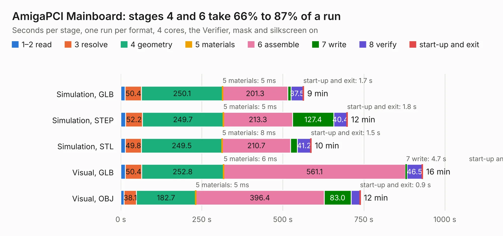

# 112. AmigaPCI Mainboard

Board 112 of the 3,130 of [Corpus Testing](../Corpus-Testing.md), on [Corpus Page 2](../CorpusTestingPages/Corpus-Testing-02.md#112-amigapci-mainboard).

| Mode and format | 1–2 read | 3 resolve | 4 geometry | 5 materials | 6 assemble | 7 write | 8 verify | start-up and exit | Total |
|---|---:|---:|---:|---:|---:|---:|---:|---:|---:|
| Simulation, GLB | 13.6 | 50.4 | 250.1 | 5&nbsp;ms | 201.3 | 9.7 | 37.5 | 1.7 | 564.2 |
| Simulation, STEP | 14.6 | 52.2 | 249.7 | 5&nbsp;ms | 213.3 | 127.4 | 40.4 | 1.8 | 699.5 |
| Simulation, STL | 13.7 | 49.8 | 249.5 | 8&nbsp;ms | 210.7 | 21.3 | 41.2 | 1.5 | 587.6 |
| Simulation, OBJ | 12.1 | 48.5 | 246.1 | 6&nbsp;ms | 215.8 | 420.7 | 52.4 | 4.8 | 1000.4 |
| Visual, GLB | 14.1 | 50.4 | 252.8 | 6&nbsp;ms | 561.1 | 4.7 | 46.5 | 1.5 | 931.2 |
| Visual, OBJ | 10.3 | 38.1 | 182.7 | 5&nbsp;ms | 396.4 | 83.0 | 27.4 | 0.9 | 738.8 |

<table align="center"><tr><td valign="top">

| Board | Repo: [AmigaPCI/AmigaPCI-MainBoard](https://github.com/AmigaPCI/AmigaPCI-MainBoard) Board: `AmigaPCI Mainboard.kicad_pcb` |
|---|---|
| Folder | KiCAD / AmigaPCI Mainboard-KiCAD REV 70 |
| Complexity | 493&nbsp;/&nbsp;1000 (size&nbsp;343, features&nbsp;150) |
| KESE&nbsp;features | through vias, slotted holes, custom pads, rounded, trapezoid or chamfered pads, arc tracks, filled zones, copper drawings, copper text, stack-up, dielectric εr and tanδ, copper finish |
| Tested | 9th November 2026 to 11th November 2026 |
| Copper&nbsp;layers | 6 |
| File&nbsp;format | KiCad 8 (20240108) |
| Parts,&nbsp;tracks,&nbsp;vias | 723, 20,477, 2,447 |
| Triangles,&nbsp;simulation | 36,016,370 in 1274 parts |
| Verifier | PASS in all six runs |
| Run&nbsp;again | Visual, OBJ: failed in the corpus run, run again with the memory cap raised from 11 GB to 14.5 GB, and passed |
| Run&nbsp;again | Simulation, OBJ: failed in the corpus run, run again with no memory cap and no time limit (swap added to a 16 GB machine), and passed |

</td><td valign="top">

<table>
<tr><th>File type</th><th>File size</th><th>Peak memory used</th></tr>
<tr><th colspan="3" align="left">Simulation</th></tr>
<tr><td>GLB</td><td align="right">1.2&nbsp;GB</td><td align="right">7.2&nbsp;GB</td></tr>
<tr><td>STEP</td><td align="right">5.6&nbsp;GB</td><td align="right">9.7&nbsp;GB</td></tr>
<tr><td>STL</td><td align="right">1.8&nbsp;GB</td><td align="right">8.0&nbsp;GB</td></tr>
<tr><td>OBJ</td><td align="right">4.1&nbsp;GB</td><td align="right">24&nbsp;GB</td></tr>
<tr><th colspan="3" align="left">Visual</th></tr>
<tr><td>GLB</td><td align="right">644&nbsp;MB</td><td align="right">10&nbsp;GB</td></tr>
<tr><td>OBJ</td><td align="right">2.2&nbsp;GB</td><td align="right">14&nbsp;GB</td></tr>
</table>

</td></tr></table>

| Previous | Next |
|:---|---:|
| [111. AmigaPCI 68040](b0111b_AmigaPCI-LBC040_AmigaPCI-68040.md) | [113. anavi-light-controller](b0113b_anavi-light-controller_anavi-light-controller.md) |
