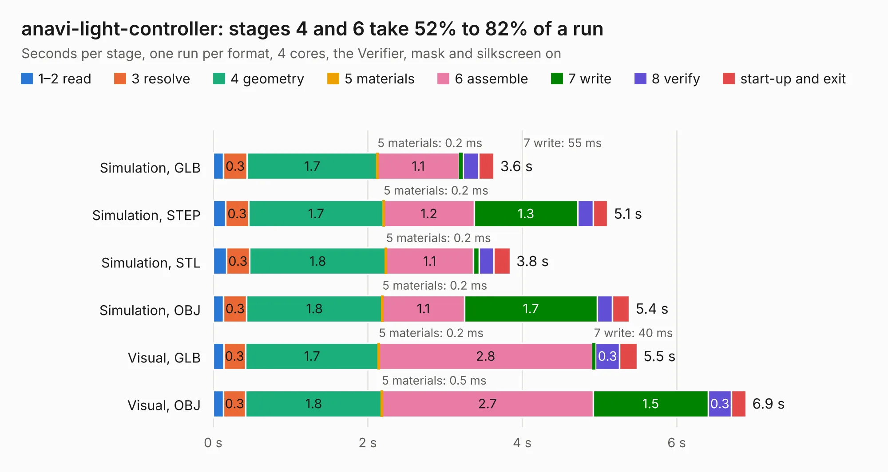

# 113. anavi-light-controller

Board 113 of the 3,119 of [Corpus Testing](../Corpus-Testing.md), on [Corpus Page 2](../CorpusTestingPages/Corpus-Testing-02.md#113-anavi-light-controller).

| Mode and format | 1–2 read | 3 resolve | 4 geometry | 5 materials | 6 assemble | 7 write | 8 verify | start-up and exit | Total |
|---|---:|---:|---:|---:|---:|---:|---:|---:|---:|
| Simulation, GLB | 0.1 | 0.3 | 1.7 | 0.2&nbsp;ms | 1.1 | 55&nbsp;ms | 0.2 | 0.2 | 3.6 |
| Simulation, STEP | 0.2 | 0.3 | 1.7 | 0.2&nbsp;ms | 1.2 | 1.3 | 0.2 | 0.2 | 5.1 |
| Simulation, STL | 0.2 | 0.3 | 1.8 | 0.2&nbsp;ms | 1.1 | 74&nbsp;ms | 0.2 | 0.2 | 3.8 |
| Simulation, OBJ | 0.1 | 0.3 | 1.8 | 0.2&nbsp;ms | 1.1 | 1.7 | 0.2 | 0.2 | 5.4 |
| Visual, GLB | 0.1 | 0.3 | 1.7 | 0.2&nbsp;ms | 2.8 | 40&nbsp;ms | 0.3 | 0.2 | 5.5 |
| Visual, OBJ | 0.1 | 0.3 | 1.8 | 0.5&nbsp;ms | 2.7 | 1.5 | 0.3 | 0.2 | 6.9 |

<table align="center"><tr><td valign="top">

| Board | Repo: [AnaviTechnology/anavi-light-controller](https://github.com/AnaviTechnology/anavi-light-controller) Board: `anavi-light-controller.kicad_pcb` |
|---|---|
| Complexity | 203&nbsp;/&nbsp;1000 (size&nbsp;138, features&nbsp;65) |
| KESE&nbsp;features | through vias, slotted holes, drill offsets, filled zones, curved board outline |
| Tested | 9th November 2026 |
| Copper&nbsp;layers | 2 |
| File&nbsp;format | KiCad 4 (4) |
| Parts,&nbsp;tracks,&nbsp;vias | 22, 164, 12 |
| Triangles,&nbsp;simulation | 355,398 in 30 parts |
| Verifier | PASS in all six runs |

</td><td valign="top">

<table>
<tr><th>File type</th><th>File size</th><th>Peak memory used</th></tr>
<tr><th colspan="3" align="left">Simulation</th></tr>
<tr><td>GLB</td><td align="right">13&nbsp;MB</td><td align="right">267&nbsp;MB</td></tr>
<tr><td>STEP</td><td align="right">67&nbsp;MB</td><td align="right">292&nbsp;MB</td></tr>
<tr><td>STL</td><td align="right">18&nbsp;MB</td><td align="right">267&nbsp;MB</td></tr>
<tr><td>OBJ</td><td align="right">36&nbsp;MB</td><td align="right">270&nbsp;MB</td></tr>
<tr><th colspan="3" align="left">Visual</th></tr>
<tr><td>GLB</td><td align="right">8.9&nbsp;MB</td><td align="right">265&nbsp;MB</td></tr>
<tr><td>OBJ</td><td align="right">26&nbsp;MB</td><td align="right">265&nbsp;MB</td></tr>
</table>

</td></tr></table>

| Previous | Next |
|:---|---:|
| [112. AmigaPCI Mainboard](b0112b_AmigaPCI-MainBoard_AmigaPCI-Mainboard.md) | [114. Board 2x06 W15.24](b0114b_658-Computer_Kicad-Boards-Blank-Board-2x06-W15-24_Board-2x06-W15-24.md) |
