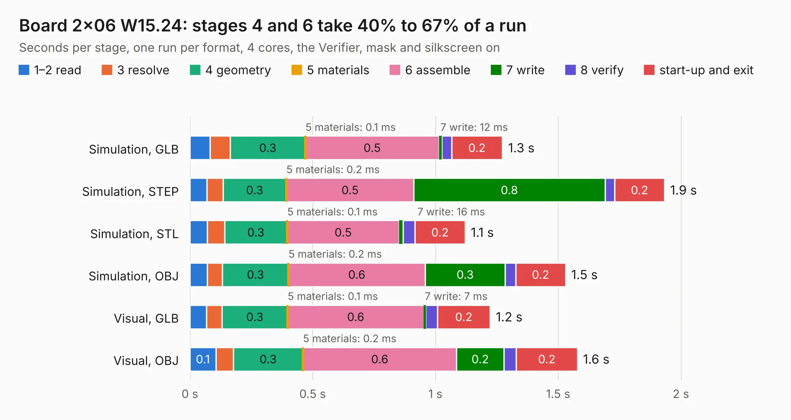

# 114. Board 2x06 W15.24

Board 114 of the 3,126 of [Corpus Testing](../Corpus-Testing.md), on [Corpus Page 2](../CorpusTestingPages/Corpus-Testing-02.md#114-board-2x06-w1524).

| Mode and format | 1–2 read | 3 resolve | 4 geometry | 5 materials | 6 assemble | 7 write | 8 verify | start-up and exit | Total |
|---|---:|---:|---:|---:|---:|---:|---:|---:|---:|
| Simulation, GLB | 82&nbsp;ms | 83&nbsp;ms | 0.3 | 0.1&nbsp;ms | 0.5 | 12&nbsp;ms | 39&nbsp;ms | 0.2 | 1.3 |
| Simulation, STEP | 70&nbsp;ms | 65&nbsp;ms | 0.3 | 0.2&nbsp;ms | 0.5 | 0.8 | 39&nbsp;ms | 0.2 | 1.9 |
| Simulation, STL | 71&nbsp;ms | 70&nbsp;ms | 0.3 | 0.1&nbsp;ms | 0.5 | 16&nbsp;ms | 49&nbsp;ms | 0.2 | 1.1 |
| Simulation, OBJ | 70&nbsp;ms | 62&nbsp;ms | 0.3 | 0.2&nbsp;ms | 0.6 | 0.3 | 43&nbsp;ms | 0.2 | 1.5 |
| Visual, GLB | 68&nbsp;ms | 63&nbsp;ms | 0.3 | 0.1&nbsp;ms | 0.6 | 7&nbsp;ms | 48&nbsp;ms | 0.2 | 1.2 |
| Visual, OBJ | 0.1 | 71&nbsp;ms | 0.3 | 0.2&nbsp;ms | 0.6 | 0.2 | 51&nbsp;ms | 0.2 | 1.6 |

<table align="center"><tr><td valign="top">

| Board | Repo: [andrewpaterson/658-Computer](https://github.com/andrewpaterson/658-Computer) Board: `Board 2x06 W15.24.kicad_pcb` |
|---|---|
| Folder | Kicad / Boards / Blank / Board 2x06 W15.24 |
| Complexity | 89&nbsp;/&nbsp;1000 (size&nbsp;34, features&nbsp;55) |
| KESE&nbsp;features | rounded, trapezoid or chamfered pads, knockout text, stack-up, dielectric εr and tanδ |
| Tested | 9th November 2026 |
| Copper&nbsp;layers | 2 |
| File&nbsp;format | KiCad 9 (20241229) |
| Parts,&nbsp;tracks,&nbsp;vias | 4, 0, 0 |
| Triangles,&nbsp;simulation | 62,080 in 24 parts |
| Verifier | PASS in all six runs |

</td><td valign="top">

<table>
<tr><th>File type</th><th>File size</th><th>Peak memory used</th></tr>
<tr><th colspan="3" align="left">Simulation</th></tr>
<tr><td>GLB</td><td align="right">2.1&nbsp;MB</td><td align="right">70&nbsp;MB</td></tr>
<tr><td>STEP</td><td align="right">6.9&nbsp;MB</td><td align="right">171&nbsp;MB</td></tr>
<tr><td>STL</td><td align="right">3.1&nbsp;MB</td><td align="right">72&nbsp;MB</td></tr>
<tr><td>OBJ</td><td align="right">6.0&nbsp;MB</td><td align="right">83&nbsp;MB</td></tr>
<tr><th colspan="3" align="left">Visual</th></tr>
<tr><td>GLB</td><td align="right">1.3&nbsp;MB</td><td align="right">106&nbsp;MB</td></tr>
<tr><td>OBJ</td><td align="right">3.7&nbsp;MB</td><td align="right">107&nbsp;MB</td></tr>
</table>

</td></tr></table>

| Previous | Next |
|:---|---:|
| [113. anavi-light-controller](b0113b_anavi-light-controller_anavi-light-controller.md) | [115. Board 2x06 W22.86](b0115b_658-Computer_Kicad-Boards-Blank-Board-2x06-W22-86_Board-2x06-W22-86.md) |
