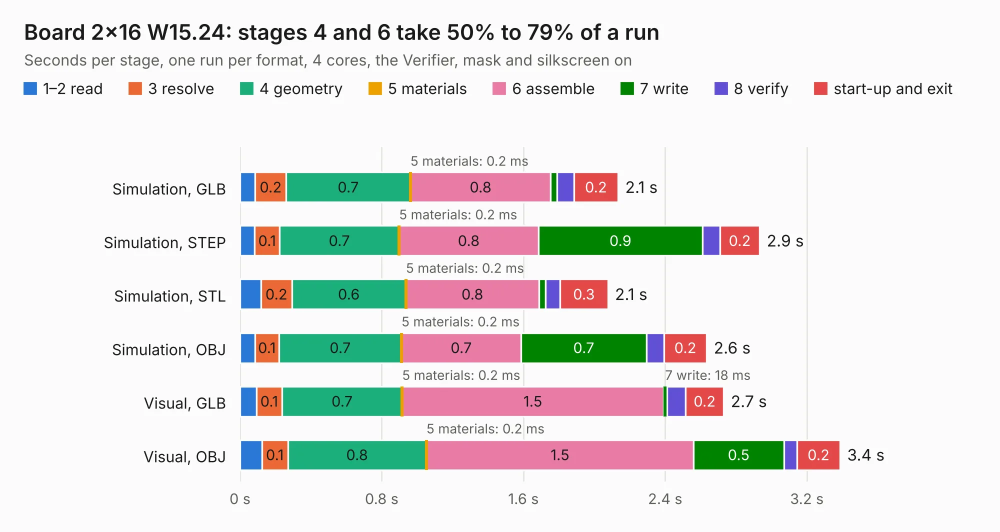

# 115. Board 2x16 W15.24

Board 115 of the 3,100 of [Corpus Testing](../Corpus-Testing.md), on [Corpus Page 2](../CorpusTestingPages/Corpus-Testing-02.md#115-board-2x16-w1524).

| Mode and format | 1–2 read | 3 resolve | 4 geometry | 5 materials | 6 assemble | 7 write | 8 verify | start-up and exit | Total |
|---|---:|---:|---:|---:|---:|---:|---:|---:|---:|
| Simulation, GLB | 86&nbsp;ms | 0.2 | 0.7 | 0.2&nbsp;ms | 0.8 | 36&nbsp;ms | 94&nbsp;ms | 0.2 | 2.1 |
| Simulation, STEP | 83&nbsp;ms | 0.1 | 0.7 | 0.2&nbsp;ms | 0.8 | 0.9 | 98&nbsp;ms | 0.2 | 2.9 |
| Simulation, STL | 0.1 | 0.2 | 0.6 | 0.2&nbsp;ms | 0.8 | 37&nbsp;ms | 84&nbsp;ms | 0.3 | 2.1 |
| Simulation, OBJ | 84&nbsp;ms | 0.1 | 0.7 | 0.2&nbsp;ms | 0.7 | 0.7 | 98&nbsp;ms | 0.2 | 2.6 |
| Visual, GLB | 92&nbsp;ms | 0.1 | 0.7 | 0.2&nbsp;ms | 1.5 | 18&nbsp;ms | 0.1 | 0.2 | 2.7 |
| Visual, OBJ | 0.1 | 0.1 | 0.8 | 0.2&nbsp;ms | 1.5 | 0.5 | 75&nbsp;ms | 0.2 | 3.4 |

<table align="center"><tr><td valign="top">

| Board | Repo: [andrewpaterson/658-Computer](https://github.com/andrewpaterson/658-Computer) Board: `Board 2x16 W15.24.kicad_pcb` |
|---|---|
| Folder | Kicad / Boards / Blank / Board 2x16 W15.24 |
| Complexity | 89&nbsp;/&nbsp;1000 (size&nbsp;34, features&nbsp;55) |
| KESE&nbsp;features | rounded, trapezoid or chamfered pads, knockout text, stack-up, dielectric εr and tanδ |
| Tested | 9th November 2026 |
| Copper&nbsp;layers | 2 |
| File&nbsp;format | KiCad 9 (20241229) |
| Parts,&nbsp;tracks,&nbsp;vias | 4, 0, 0 |
| Triangles,&nbsp;simulation | 143,440 in 40 parts |
| Verifier | PASS in all six runs |

</td><td valign="top">

<table>
<tr><th>File type</th><th>File size</th><th>Peak memory used</th></tr>
<tr><th colspan="3" align="left">Simulation</th></tr>
<tr><td>GLB</td><td align="right">4.7&nbsp;MB</td><td align="right">184&nbsp;MB</td></tr>
<tr><td>STEP</td><td align="right">15&nbsp;MB</td><td align="right">197&nbsp;MB</td></tr>
<tr><td>STL</td><td align="right">7.2&nbsp;MB</td><td align="right">185&nbsp;MB</td></tr>
<tr><td>OBJ</td><td align="right">14&nbsp;MB</td><td align="right">181&nbsp;MB</td></tr>
<tr><th colspan="3" align="left">Visual</th></tr>
<tr><td>GLB</td><td align="right">2.8&nbsp;MB</td><td align="right">155&nbsp;MB</td></tr>
<tr><td>OBJ</td><td align="right">7.8&nbsp;MB</td><td align="right">157&nbsp;MB</td></tr>
</table>

</td></tr></table>

| Previous | Next |
|:---|---:|
| [114. Board 2x12 W22.86](b0114b_658-Computer_Kicad-Boards-Blank-Board-2x12-W22-86_Board-2x12-W22-86.md) | [116. Board 2x16 W22.86](b0116b_658-Computer_Kicad-Boards-Blank-Board-2x16-W22-86_Board-2x16-W22-86.md) |
