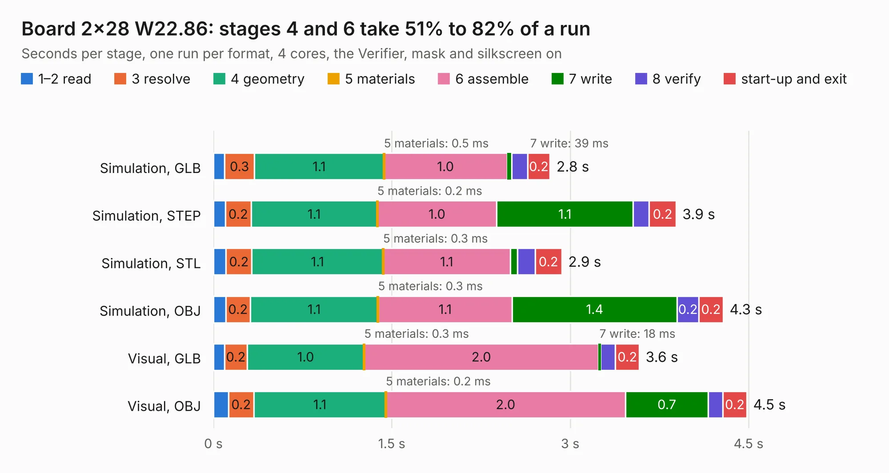

# 125. Board 2x28 W22.86

Board 125 of the 3,112 of [Corpus Testing](../Corpus-Testing.md), on [Corpus Page 2](../CorpusTestingPages/Corpus-Testing-02.md#125-board-2x28-w2286).

| Mode and format | 1–2 read | 3 resolve | 4 geometry | 5 materials | 6 assemble | 7 write | 8 verify | start-up and exit | Total |
|---|---:|---:|---:|---:|---:|---:|---:|---:|---:|
| Simulation, GLB | 94&nbsp;ms | 0.3 | 1.1 | 0.5&nbsp;ms | 1.0 | 39&nbsp;ms | 0.1 | 0.2 | 2.8 |
| Simulation, STEP | 0.1 | 0.2 | 1.1 | 0.2&nbsp;ms | 1.0 | 1.1 | 0.1 | 0.2 | 3.9 |
| Simulation, STL | 0.1 | 0.2 | 1.1 | 0.3&nbsp;ms | 1.1 | 61&nbsp;ms | 0.1 | 0.2 | 2.9 |
| Simulation, OBJ | 0.1 | 0.2 | 1.1 | 0.3&nbsp;ms | 1.1 | 1.4 | 0.2 | 0.2 | 4.3 |
| Visual, GLB | 94&nbsp;ms | 0.2 | 1.0 | 0.3&nbsp;ms | 2.0 | 18&nbsp;ms | 0.1 | 0.2 | 3.6 |
| Visual, OBJ | 0.1 | 0.2 | 1.1 | 0.2&nbsp;ms | 2.0 | 0.7 | 0.1 | 0.2 | 4.5 |

<table align="center"><tr><td valign="top">

| Board | Repo: [andrewpaterson/658-Computer](https://github.com/andrewpaterson/658-Computer) Board: `Board 2x28 W22.86.kicad_pcb` |
|---|---|
| Folder | Kicad / Boards / Blank / Board 2x28 W22.86 |
| Complexity | 89&nbsp;/&nbsp;1000 (size&nbsp;34, features&nbsp;55) |
| KESE&nbsp;features | rounded, trapezoid or chamfered pads, knockout text, stack-up, dielectric εr and tanδ |
| Tested | 9th November 2026 |
| Copper&nbsp;layers | 2 |
| File&nbsp;format | KiCad 9 (20241229) |
| Parts,&nbsp;tracks,&nbsp;vias | 4, 0, 0 |
| Triangles,&nbsp;simulation | 242,128 in 64 parts |
| Verifier | PASS in all six runs |

</td><td valign="top">

<table>
<tr><th>File type</th><th>File size</th><th>Peak memory used</th></tr>
<tr><th colspan="3" align="left">Simulation</th></tr>
<tr><td>GLB</td><td align="right">7.7&nbsp;MB</td><td align="right">211&nbsp;MB</td></tr>
<tr><td>STEP</td><td align="right">25&nbsp;MB</td><td align="right">236&nbsp;MB</td></tr>
<tr><td>STL</td><td align="right">12&nbsp;MB</td><td align="right">211&nbsp;MB</td></tr>
<tr><td>OBJ</td><td align="right">24&nbsp;MB</td><td align="right">217&nbsp;MB</td></tr>
<tr><th colspan="3" align="left">Visual</th></tr>
<tr><td>GLB</td><td align="right">4.5&nbsp;MB</td><td align="right">211&nbsp;MB</td></tr>
<tr><td>OBJ</td><td align="right">13&nbsp;MB</td><td align="right">210&nbsp;MB</td></tr>
</table>

</td></tr></table>

| Previous | Next |
|:---|---:|
| [124. Board 2x28 W15.24](b0124b_658-Computer_Kicad-Boards-Blank-Board-2x28-W15-24_Board-2x28-W15-24.md) | [126. Board 2x32 W15.24](b0126b_658-Computer_Kicad-Boards-Blank-Board-2x32-W15-24_Board-2x32-W15-24.md) |
