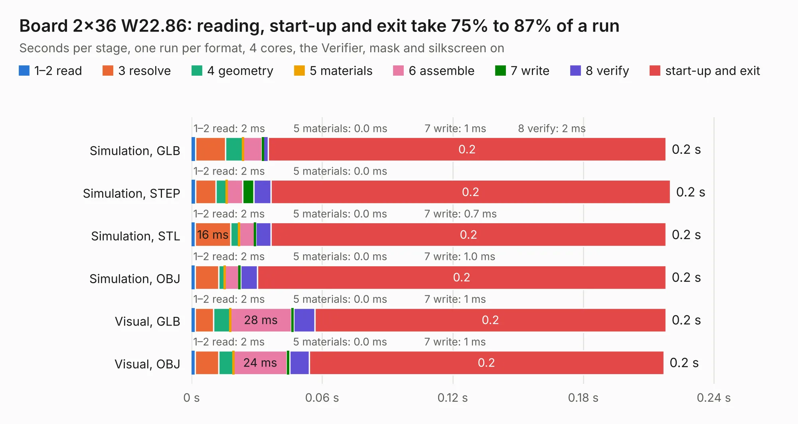

# 145. Board 2x36 W22.86

Board 145 of the 3,129 of [Corpus Testing](../Corpus-Testing.md), on [Corpus Page 2](../CorpusTestingPages/Corpus-Testing-02.md#145-board-2x36-w2286).

| Mode and format | 1–2 read | 3 resolve | 4 geometry | 5 materials | 6 assemble | 7 write | 8 verify | start-up and exit | Total |
|---|---:|---:|---:|---:|---:|---:|---:|---:|---:|
| Simulation, GLB | 2&nbsp;ms | 14&nbsp;ms | 8&nbsp;ms | 0.0&nbsp;ms | 8&nbsp;ms | 1&nbsp;ms | 2&nbsp;ms | 0.2 | 0.2 |
| Simulation, STEP | 2&nbsp;ms | 9&nbsp;ms | 5&nbsp;ms | 0.0&nbsp;ms | 7&nbsp;ms | 5&nbsp;ms | 8&nbsp;ms | 0.2 | 0.2 |
| Simulation, STL | 2&nbsp;ms | 16&nbsp;ms | 4&nbsp;ms | 0.0&nbsp;ms | 7&nbsp;ms | 0.7&nbsp;ms | 7&nbsp;ms | 0.2 | 0.2 |
| Simulation, OBJ | 2&nbsp;ms | 11&nbsp;ms | 3&nbsp;ms | 0.0&nbsp;ms | 6&nbsp;ms | 1.0&nbsp;ms | 8&nbsp;ms | 0.2 | 0.2 |
| Visual, GLB | 2&nbsp;ms | 8&nbsp;ms | 8&nbsp;ms | 0.0&nbsp;ms | 28&nbsp;ms | 1&nbsp;ms | 10&nbsp;ms | 0.2 | 0.2 |
| Visual, OBJ | 2&nbsp;ms | 11&nbsp;ms | 7&nbsp;ms | 0.0&nbsp;ms | 24&nbsp;ms | 1&nbsp;ms | 9&nbsp;ms | 0.2 | 0.2 |

<table align="center"><tr><td valign="top">

| Board | Repo: [andrewpaterson/658-Computer](https://github.com/andrewpaterson/658-Computer) Board: `Board 2x36 W22.86.kicad_pcb` |
|---|---|
| Folder | Kicad / Boards / Pins / Board 2x36 W22.86 |
| Complexity | 47&nbsp;/&nbsp;1000 (size&nbsp;17, features&nbsp;30) |
| KESE&nbsp;features | stack-up, dielectric εr and tanδ |
| Tested | 9th November 2026 |
| Copper&nbsp;layers | 2 |
| File&nbsp;format | KiCad 9 (20241229) |
| Parts,&nbsp;tracks,&nbsp;vias | 0, 0, 0 |
| Triangles,&nbsp;simulation | 72 in 3 parts |
| Note | no components |
| Verifier | PASS in all six runs |

</td><td valign="top">

<table>
<tr><th>File type</th><th>File size</th><th>Peak memory used</th></tr>
<tr><th colspan="3" align="left">Simulation</th></tr>
<tr><td>GLB</td><td align="right">6.3&nbsp;kB</td><td align="right">37&nbsp;MB</td></tr>
<tr><td>STEP</td><td align="right">29&nbsp;kB</td><td align="right">37&nbsp;MB</td></tr>
<tr><td>STL</td><td align="right">3.9&nbsp;kB</td><td align="right">37&nbsp;MB</td></tr>
<tr><td>OBJ</td><td align="right">10&nbsp;kB</td><td align="right">37&nbsp;MB</td></tr>
<tr><th colspan="3" align="left">Visual</th></tr>
<tr><td>GLB</td><td align="right">7.7&nbsp;kB</td><td align="right">40&nbsp;MB</td></tr>
<tr><td>OBJ</td><td align="right">10&nbsp;kB</td><td align="right">38&nbsp;MB</td></tr>
</table>

</td></tr></table>

| Previous | Next |
|:---|---:|
| [144. Board 2x32 W22.86](b0144b_658-Computer_Kicad-Boards-Pins-Board-2x32-W22-86_Board-2x32-W22-86.md) | [146. Audio Address Decode](b0146b_658-Computer_Audio-Address-Decode.md) |
