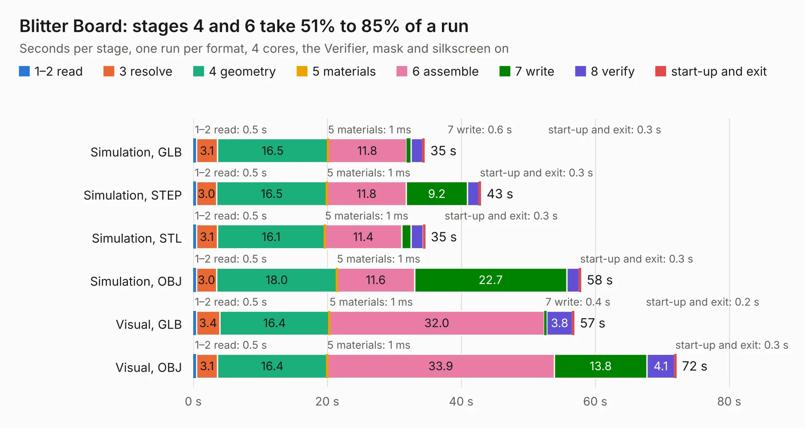

# 146. Blitter Board

Board 146 of the 3,102 of [Corpus Testing](../Corpus-Testing.md), on [Corpus Page 2](../CorpusTestingPages/Corpus-Testing-02.md#146-blitter-board).

| Mode and format | 1–2 read | 3 resolve | 4 geometry | 5 materials | 6 assemble | 7 write | 8 verify | start-up and exit | Total |
|---|---:|---:|---:|---:|---:|---:|---:|---:|---:|
| Simulation, GLB | 0.5 | 3.1 | 16.5 | 1&nbsp;ms | 11.8 | 0.6 | 1.8 | 0.3 | 34.5 |
| Simulation, STEP | 0.5 | 3.0 | 16.5 | 1&nbsp;ms | 11.8 | 9.2 | 1.7 | 0.3 | 42.9 |
| Simulation, STL | 0.5 | 3.1 | 16.1 | 1&nbsp;ms | 11.4 | 1.4 | 1.8 | 0.3 | 34.6 |
| Simulation, OBJ | 0.5 | 3.0 | 18.0 | 1&nbsp;ms | 11.6 | 22.7 | 1.9 | 0.3 | 57.9 |
| Visual, GLB | 0.5 | 3.4 | 16.4 | 1&nbsp;ms | 32.0 | 0.4 | 3.8 | 0.2 | 56.9 |
| Visual, OBJ | 0.5 | 3.1 | 16.4 | 1&nbsp;ms | 33.9 | 13.8 | 4.1 | 0.3 | 72.1 |

<table align="center"><tr><td valign="top">

| Board | Repo: [andrewpaterson/658-Computer](https://github.com/andrewpaterson/658-Computer) Board: `Blitter Board.kicad_pcb` |
|---|---|
| Folder | Kicad / Computer / Blitter / Blitter Board |
| Complexity | 264&nbsp;/&nbsp;1000 (size&nbsp;184, features&nbsp;80) |
| KESE&nbsp;features | through vias, rounded, trapezoid or chamfered pads, curved board outline, knockout text, stack-up, dielectric εr and tanδ |
| Tested | 9th November 2026 |
| Copper&nbsp;layers | 2 |
| File&nbsp;format | KiCad 9 (20241229) |
| Parts,&nbsp;tracks,&nbsp;vias | 22, 2,712, 230 |
| Triangles,&nbsp;simulation | 3,921,994 in 339 parts |
| Verifier | PASS in all six runs |

</td><td valign="top">

<table>
<tr><th>File type</th><th>File size</th><th>Peak memory used</th></tr>
<tr><th colspan="3" align="left">Simulation</th></tr>
<tr><td>GLB</td><td align="right">131&nbsp;MB</td><td align="right">1.3&nbsp;GB</td></tr>
<tr><td>STEP</td><td align="right">550&nbsp;MB</td><td align="right">1.5&nbsp;GB</td></tr>
<tr><td>STL</td><td align="right">196&nbsp;MB</td><td align="right">1.3&nbsp;GB</td></tr>
<tr><td>OBJ</td><td align="right">412&nbsp;MB</td><td align="right">2.5&nbsp;GB</td></tr>
<tr><th colspan="3" align="left">Visual</th></tr>
<tr><td>GLB</td><td align="right">86&nbsp;MB</td><td align="right">1.5&nbsp;GB</td></tr>
<tr><td>OBJ</td><td align="right">272&nbsp;MB</td><td align="right">1.8&nbsp;GB</td></tr>
</table>

</td></tr></table>

| Previous | Next |
|:---|---:|
| [145. Audio Clock](b0145b_658-Computer_Audio-Clock.md) | [147. Added 8bit](b0147b_658-Computer_Added-8bit.md) |
