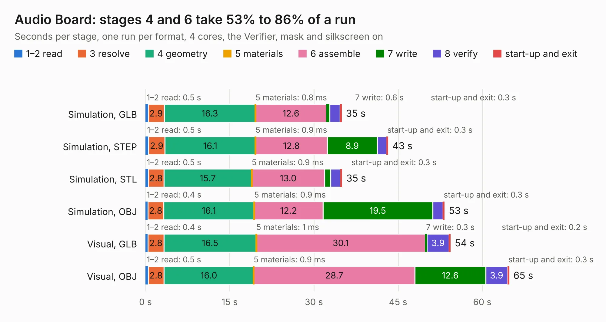

# 147. Audio Board

Board 147 of the 3,130 of [Corpus Testing](../Corpus-Testing.md), on [Corpus Page 2](../CorpusTestingPages/Corpus-Testing-02.md#147-audio-board).

| Mode and format | 1–2 read | 3 resolve | 4 geometry | 5 materials | 6 assemble | 7 write | 8 verify | start-up and exit | Total |
|---|---:|---:|---:|---:|---:|---:|---:|---:|---:|
| Simulation, GLB | 0.5 | 2.9 | 16.3 | 0.8&nbsp;ms | 12.6 | 0.6 | 1.8 | 0.3 | 34.9 |
| Simulation, STEP | 0.5 | 2.9 | 16.1 | 0.9&nbsp;ms | 12.8 | 8.9 | 1.7 | 0.3 | 43.2 |
| Simulation, STL | 0.5 | 2.8 | 15.7 | 0.9&nbsp;ms | 13.0 | 1.0 | 1.8 | 0.3 | 35.0 |
| Simulation, OBJ | 0.4 | 2.8 | 16.1 | 0.9&nbsp;ms | 12.2 | 19.5 | 1.9 | 0.3 | 53.3 |
| Visual, GLB | 0.4 | 2.8 | 16.5 | 1&nbsp;ms | 30.1 | 0.3 | 3.9 | 0.2 | 54.3 |
| Visual, OBJ | 0.5 | 2.8 | 16.0 | 0.9&nbsp;ms | 28.7 | 12.6 | 3.9 | 0.3 | 64.8 |

<table align="center"><tr><td valign="top">

| Board | Repo: [andrewpaterson/658-Computer](https://github.com/andrewpaterson/658-Computer) Board: `Audio Board.kicad_pcb` |
|---|---|
| Folder | Kicad / Computer / Audio / Audio Board |
| Complexity | 263&nbsp;/&nbsp;1000 (size&nbsp;183, features&nbsp;80) |
| KESE&nbsp;features | through vias, rounded, trapezoid or chamfered pads, curved board outline, knockout text, stack-up, dielectric εr and tanδ |
| Tested | 9th November 2026 |
| Copper&nbsp;layers | 2 |
| File&nbsp;format | KiCad 9 (20241229) |
| Parts,&nbsp;tracks,&nbsp;vias | 23, 2,507, 229 |
| Triangles,&nbsp;simulation | 3,598,500 in 299 parts |
| Verifier | PASS in all six runs |

</td><td valign="top">

<table>
<tr><th>File type</th><th>File size</th><th>Peak memory used</th></tr>
<tr><th colspan="3" align="left">Simulation</th></tr>
<tr><td>GLB</td><td align="right">120&nbsp;MB</td><td align="right">1.2&nbsp;GB</td></tr>
<tr><td>STEP</td><td align="right">501&nbsp;MB</td><td align="right">1.4&nbsp;GB</td></tr>
<tr><td>STL</td><td align="right">180&nbsp;MB</td><td align="right">1.1&nbsp;GB</td></tr>
<tr><td>OBJ</td><td align="right">377&nbsp;MB</td><td align="right">2.3&nbsp;GB</td></tr>
<tr><th colspan="3" align="left">Visual</th></tr>
<tr><td>GLB</td><td align="right">78&nbsp;MB</td><td align="right">1.6&nbsp;GB</td></tr>
<tr><td>OBJ</td><td align="right">248&nbsp;MB</td><td align="right">1.7&nbsp;GB</td></tr>
</table>

</td></tr></table>

| Previous | Next |
|:---|---:|
| [146. Audio Address Decode](b0146b_658-Computer_Audio-Address-Decode.md) | [148. Audio Clock](b0148b_658-Computer_Audio-Clock.md) |
