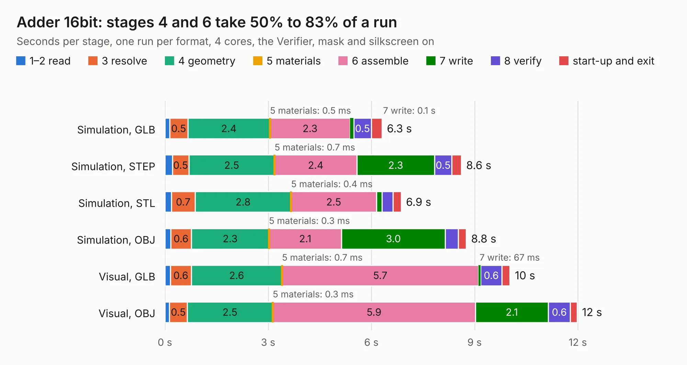

# 151. Adder 16bit

Board 151 of the 3,130 of [Corpus Testing](../Corpus-Testing.md), on [Corpus Page 2](../CorpusTestingPages/Corpus-Testing-02.md#151-adder-16bit).

| Mode and format | 1–2 read | 3 resolve | 4 geometry | 5 materials | 6 assemble | 7 write | 8 verify | start-up and exit | Total |
|---|---:|---:|---:|---:|---:|---:|---:|---:|---:|
| Simulation, GLB | 0.1 | 0.5 | 2.4 | 0.5&nbsp;ms | 2.3 | 0.1 | 0.5 | 0.3 | 6.3 |
| Simulation, STEP | 0.2 | 0.5 | 2.5 | 0.7&nbsp;ms | 2.4 | 2.3 | 0.5 | 0.3 | 8.6 |
| Simulation, STL | 0.2 | 0.7 | 2.8 | 0.4&nbsp;ms | 2.5 | 0.2 | 0.3 | 0.2 | 6.9 |
| Simulation, OBJ | 0.2 | 0.6 | 2.3 | 0.3&nbsp;ms | 2.1 | 3.0 | 0.4 | 0.2 | 8.8 |
| Visual, GLB | 0.2 | 0.6 | 2.6 | 0.7&nbsp;ms | 5.7 | 67&nbsp;ms | 0.6 | 0.2 | 10.0 |
| Visual, OBJ | 0.1 | 0.5 | 2.5 | 0.3&nbsp;ms | 5.9 | 2.1 | 0.6 | 0.2 | 12.0 |

<table align="center"><tr><td valign="top">

| Board | Repo: [andrewpaterson/658-Computer](https://github.com/andrewpaterson/658-Computer) Board: `Adder 16bit.kicad_pcb` |
|---|---|
| Folder | Kicad / Computer / Component Boards / Adder 16bit |
| Complexity | 225&nbsp;/&nbsp;1000 (size&nbsp;155, features&nbsp;70) |
| KESE&nbsp;features | through vias, rounded, trapezoid or chamfered pads, knockout text, stack-up, dielectric εr and tanδ |
| Tested | 9th November 2026 |
| Copper&nbsp;layers | 2 |
| File&nbsp;format | KiCad 9 (20241229) |
| Parts,&nbsp;tracks,&nbsp;vias | 11, 627, 83 |
| Triangles,&nbsp;simulation | 565,568 in 65 parts |
| Verifier | PASS in all six runs |

</td><td valign="top">

<table>
<tr><th>File type</th><th>File size</th><th>Peak memory used</th></tr>
<tr><th colspan="3" align="left">Simulation</th></tr>
<tr><td>GLB</td><td align="right">20&nbsp;MB</td><td align="right">343&nbsp;MB</td></tr>
<tr><td>STEP</td><td align="right">90&nbsp;MB</td><td align="right">369&nbsp;MB</td></tr>
<tr><td>STL</td><td align="right">28&nbsp;MB</td><td align="right">335&nbsp;MB</td></tr>
<tr><td>OBJ</td><td align="right">57&nbsp;MB</td><td align="right">418&nbsp;MB</td></tr>
<tr><th colspan="3" align="left">Visual</th></tr>
<tr><td>GLB</td><td align="right">14&nbsp;MB</td><td align="right">388&nbsp;MB</td></tr>
<tr><td>OBJ</td><td align="right">42&nbsp;MB</td><td align="right">391&nbsp;MB</td></tr>
</table>

</td></tr></table>

| Previous | Next |
|:---|---:|
| [150. Added 8bit](b0150b_658-Computer_Added-8bit.md) | [152. Address Buffer 16bit](b0152b_658-Computer_Address-Buffer-16bit.md) |
