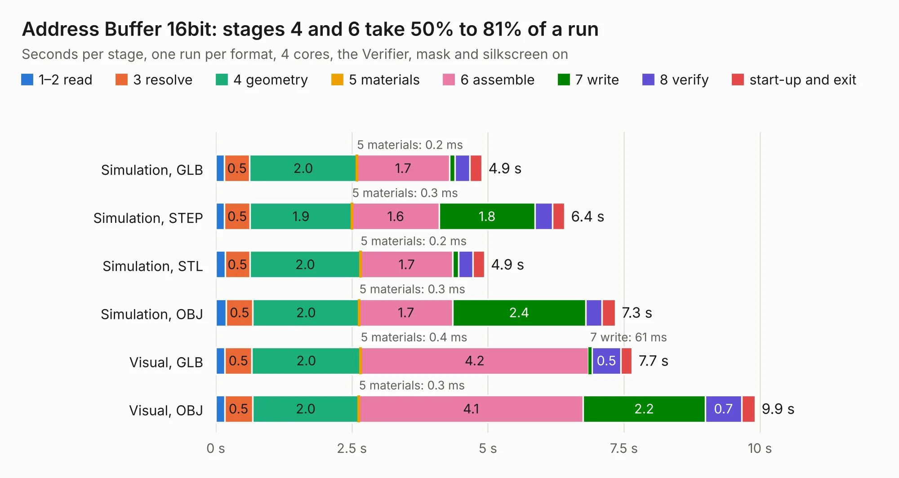

# 152. Address Buffer 16bit

Board 152 of the 3,118 of [Corpus Testing](../Corpus-Testing.md), on [Corpus Page 2](../CorpusTestingPages/Corpus-Testing-02.md#152-address-buffer-16bit).

| Mode and format | 1–2 read | 3 resolve | 4 geometry | 5 materials | 6 assemble | 7 write | 8 verify | start-up and exit | Total |
|---|---:|---:|---:|---:|---:|---:|---:|---:|---:|
| Simulation, GLB | 0.2 | 0.5 | 2.0 | 0.2&nbsp;ms | 1.7 | 0.1 | 0.3 | 0.2 | 4.9 |
| Simulation, STEP | 0.2 | 0.5 | 1.9 | 0.3&nbsp;ms | 1.6 | 1.8 | 0.3 | 0.2 | 6.4 |
| Simulation, STL | 0.2 | 0.5 | 2.0 | 0.2&nbsp;ms | 1.7 | 0.1 | 0.3 | 0.2 | 4.9 |
| Simulation, OBJ | 0.2 | 0.5 | 2.0 | 0.3&nbsp;ms | 1.7 | 2.4 | 0.3 | 0.2 | 7.3 |
| Visual, GLB | 0.2 | 0.5 | 2.0 | 0.4&nbsp;ms | 4.2 | 61&nbsp;ms | 0.5 | 0.2 | 7.7 |
| Visual, OBJ | 0.2 | 0.5 | 2.0 | 0.3&nbsp;ms | 4.1 | 2.2 | 0.7 | 0.2 | 9.9 |

<table align="center"><tr><td valign="top">

| Board | Repo: [andrewpaterson/658-Computer](https://github.com/andrewpaterson/658-Computer) Board: `Address Buffer 16bit.kicad_pcb` |
|---|---|
| Folder | Kicad / Computer / Component Boards / Address Buffer 16bit |
| Complexity | 231&nbsp;/&nbsp;1000 (size&nbsp;161, features&nbsp;70) |
| KESE&nbsp;features | through vias, rounded, trapezoid or chamfered pads, knockout text, stack-up, dielectric εr and tanδ |
| Tested | 9th November 2026 |
| Copper&nbsp;layers | 2 |
| File&nbsp;format | KiCad 9 (20241229) |
| Parts,&nbsp;tracks,&nbsp;vias | 20, 636, 77 |
| Triangles,&nbsp;simulation | 484,576 in 63 parts |
| Verifier | PASS in all six runs |

</td><td valign="top">

<table>
<tr><th>File type</th><th>File size</th><th>Peak memory used</th></tr>
<tr><th colspan="3" align="left">Simulation</th></tr>
<tr><td>GLB</td><td align="right">17&nbsp;MB</td><td align="right">284&nbsp;MB</td></tr>
<tr><td>STEP</td><td align="right">80&nbsp;MB</td><td align="right">352&nbsp;MB</td></tr>
<tr><td>STL</td><td align="right">24&nbsp;MB</td><td align="right">287&nbsp;MB</td></tr>
<tr><td>OBJ</td><td align="right">49&nbsp;MB</td><td align="right">378&nbsp;MB</td></tr>
<tr><th colspan="3" align="left">Visual</th></tr>
<tr><td>GLB</td><td align="right">13&nbsp;MB</td><td align="right">367&nbsp;MB</td></tr>
<tr><td>OBJ</td><td align="right">39&nbsp;MB</td><td align="right">376&nbsp;MB</td></tr>
</table>

</td></tr></table>

| Previous | Next |
|:---|---:|
| [151. Adder 16bit](b0151b_658-Computer_Adder-16bit.md) | [153. Address Buffer 24bit](b0153b_658-Computer_Address-Buffer-24bit.md) |
