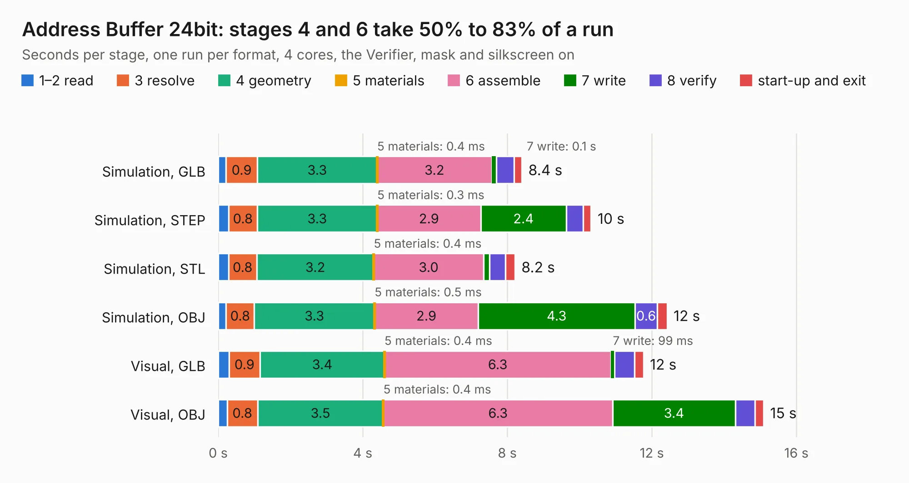

# 153. Address Buffer 24bit

Board 153 of the 3,132 of [Corpus Testing](../Corpus-Testing.md), on [Corpus Page 2](../CorpusTestingPages/Corpus-Testing-02.md#153-address-buffer-24bit).

| Mode and format | 1–2 read | 3 resolve | 4 geometry | 5 materials | 6 assemble | 7 write | 8 verify | start-up and exit | Total |
|---|---:|---:|---:|---:|---:|---:|---:|---:|---:|
| Simulation, GLB | 0.2 | 0.9 | 3.3 | 0.4&nbsp;ms | 3.2 | 0.1 | 0.5 | 0.2 | 8.4 |
| Simulation, STEP | 0.3 | 0.8 | 3.3 | 0.3&nbsp;ms | 2.9 | 2.4 | 0.5 | 0.2 | 10.3 |
| Simulation, STL | 0.3 | 0.8 | 3.2 | 0.4&nbsp;ms | 3.0 | 0.2 | 0.4 | 0.3 | 8.2 |
| Simulation, OBJ | 0.2 | 0.8 | 3.3 | 0.5&nbsp;ms | 2.9 | 4.3 | 0.6 | 0.3 | 12.4 |
| Visual, GLB | 0.3 | 0.9 | 3.4 | 0.4&nbsp;ms | 6.3 | 99&nbsp;ms | 0.5 | 0.3 | 11.8 |
| Visual, OBJ | 0.2 | 0.8 | 3.5 | 0.4&nbsp;ms | 6.3 | 3.4 | 0.5 | 0.2 | 15.1 |

<table align="center"><tr><td valign="top">

| Board | Repo: [andrewpaterson/658-Computer](https://github.com/andrewpaterson/658-Computer) Board: `Address Buffer 24bit.kicad_pcb` |
|---|---|
| Folder | Kicad / Computer / Component Boards / Address Buffer 24bit |
| Complexity | 239&nbsp;/&nbsp;1000 (size&nbsp;169, features&nbsp;70) |
| KESE&nbsp;features | through vias, rounded, trapezoid or chamfered pads, knockout text, stack-up, dielectric εr and tanδ |
| Tested | 9th November 2026 |
| Copper&nbsp;layers | 2 |
| File&nbsp;format | KiCad 9 (20241229) |
| Parts,&nbsp;tracks,&nbsp;vias | 28, 857, 114 |
| Triangles,&nbsp;simulation | 684,690 in 87 parts |
| Verifier | PASS in all six runs |

</td><td valign="top">

<table>
<tr><th>File type</th><th>File size</th><th>Peak memory used</th></tr>
<tr><th colspan="3" align="left">Simulation</th></tr>
<tr><td>GLB</td><td align="right">24&nbsp;MB</td><td align="right">344&nbsp;MB</td></tr>
<tr><td>STEP</td><td align="right">112&nbsp;MB</td><td align="right">427&nbsp;MB</td></tr>
<tr><td>STL</td><td align="right">34&nbsp;MB</td><td align="right">357&nbsp;MB</td></tr>
<tr><td>OBJ</td><td align="right">70&nbsp;MB</td><td align="right">510&nbsp;MB</td></tr>
<tr><th colspan="3" align="left">Visual</th></tr>
<tr><td>GLB</td><td align="right">18&nbsp;MB</td><td align="right">503&nbsp;MB</td></tr>
<tr><td>OBJ</td><td align="right">55&nbsp;MB</td><td align="right">495&nbsp;MB</td></tr>
</table>

</td></tr></table>

| Previous | Next |
|:---|---:|
| [152. Address Buffer 16bit](b0152b_658-Computer_Address-Buffer-16bit.md) | [154. Audio DAC](b0154b_658-Computer_Audio-DAC.md) |
