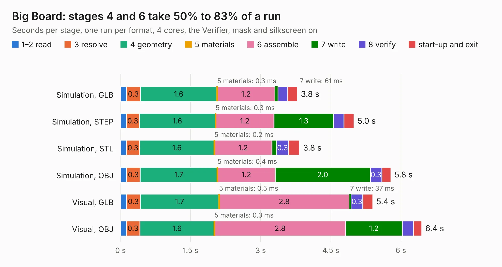

# 155. Big Board

Board 155 of the 3,125 of [Corpus Testing](../Corpus-Testing.md), on [Corpus Page 2](../CorpusTestingPages/Corpus-Testing-02.md#155-big-board).

| Mode and format | 1–2 read | 3 resolve | 4 geometry | 5 materials | 6 assemble | 7 write | 8 verify | start-up and exit | Total |
|---|---:|---:|---:|---:|---:|---:|---:|---:|---:|
| Simulation, GLB | 0.1 | 0.3 | 1.6 | 0.3&nbsp;ms | 1.2 | 61&nbsp;ms | 0.2 | 0.2 | 3.8 |
| Simulation, STEP | 0.1 | 0.3 | 1.6 | 0.3&nbsp;ms | 1.2 | 1.3 | 0.2 | 0.2 | 5.0 |
| Simulation, STL | 0.1 | 0.3 | 1.6 | 0.2&nbsp;ms | 1.2 | 0.1 | 0.3 | 0.2 | 3.8 |
| Simulation, OBJ | 0.1 | 0.3 | 1.7 | 0.4&nbsp;ms | 1.2 | 2.0 | 0.3 | 0.2 | 5.8 |
| Visual, GLB | 0.1 | 0.3 | 1.7 | 0.5&nbsp;ms | 2.8 | 37&nbsp;ms | 0.3 | 0.2 | 5.4 |
| Visual, OBJ | 0.1 | 0.3 | 1.6 | 0.3&nbsp;ms | 2.8 | 1.2 | 0.2 | 0.2 | 6.4 |

<table align="center"><tr><td valign="top">

| Board | Repo: [andrewpaterson/658-Computer](https://github.com/andrewpaterson/658-Computer) Board: `Big Board.kicad_pcb` |
|---|---|
| Folder | Kicad / Computer / Component Boards / Big Board |
| Complexity | 163&nbsp;/&nbsp;1000 (size&nbsp;88, features&nbsp;75) |
| KESE&nbsp;features | through vias, rounded, trapezoid or chamfered pads, filled zones, stack-up, dielectric εr and tanδ |
| Tested | 9th November 2026 |
| Copper&nbsp;layers | 2 |
| File&nbsp;format | KiCad 9 (20241229) |
| Parts,&nbsp;tracks,&nbsp;vias | 4, 23, 1 |
| Triangles,&nbsp;simulation | 402,342 in 72 parts |
| Verifier | PASS in all six runs |

</td><td valign="top">

<table>
<tr><th>File type</th><th>File size</th><th>Peak memory used</th></tr>
<tr><th colspan="3" align="left">Simulation</th></tr>
<tr><td>GLB</td><td align="right">13&nbsp;MB</td><td align="right">264&nbsp;MB</td></tr>
<tr><td>STEP</td><td align="right">46&nbsp;MB</td><td align="right">295&nbsp;MB</td></tr>
<tr><td>STL</td><td align="right">20&nbsp;MB</td><td align="right">272&nbsp;MB</td></tr>
<tr><td>OBJ</td><td align="right">40&nbsp;MB</td><td align="right">275&nbsp;MB</td></tr>
<tr><th colspan="3" align="left">Visual</th></tr>
<tr><td>GLB</td><td align="right">8.1&nbsp;MB</td><td align="right">273&nbsp;MB</td></tr>
<tr><td>OBJ</td><td align="right">24&nbsp;MB</td><td align="right">277&nbsp;MB</td></tr>
</table>

</td></tr></table>

| Previous | Next |
|:---|---:|
| [154. Audio DAC](b0154b_658-Computer_Audio-DAC.md) | [156. Clock Doubler](b0156b_658-Computer_Clock-Doubler.md) |
