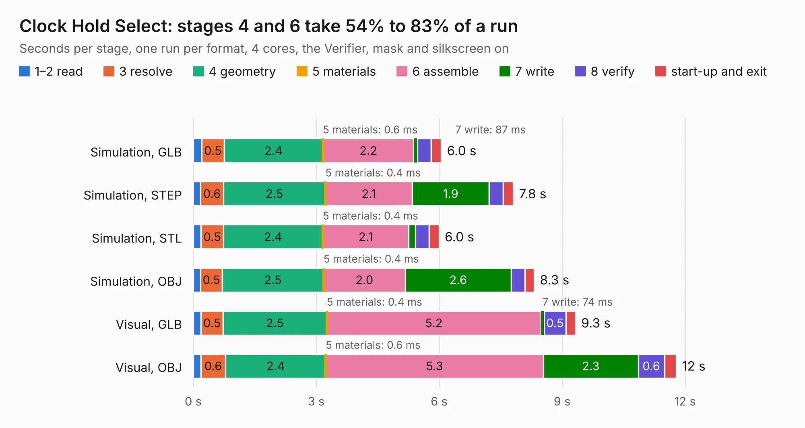

# 157. Clock Hold Select

Board 157 of the 3,129 of [Corpus Testing](../Corpus-Testing.md), on [Corpus Page 2](../CorpusTestingPages/Corpus-Testing-02.md#157-clock-hold-select).

| Mode and format | 1–2 read | 3 resolve | 4 geometry | 5 materials | 6 assemble | 7 write | 8 verify | start-up and exit | Total |
|---|---:|---:|---:|---:|---:|---:|---:|---:|---:|
| Simulation, GLB | 0.2 | 0.5 | 2.4 | 0.6&nbsp;ms | 2.2 | 87&nbsp;ms | 0.3 | 0.2 | 6.0 |
| Simulation, STEP | 0.2 | 0.6 | 2.5 | 0.4&nbsp;ms | 2.1 | 1.9 | 0.3 | 0.2 | 7.8 |
| Simulation, STL | 0.2 | 0.5 | 2.4 | 0.4&nbsp;ms | 2.1 | 0.2 | 0.3 | 0.2 | 6.0 |
| Simulation, OBJ | 0.2 | 0.5 | 2.5 | 0.4&nbsp;ms | 2.0 | 2.6 | 0.3 | 0.2 | 8.3 |
| Visual, GLB | 0.2 | 0.5 | 2.5 | 0.4&nbsp;ms | 5.2 | 74&nbsp;ms | 0.5 | 0.2 | 9.3 |
| Visual, OBJ | 0.2 | 0.6 | 2.4 | 0.6&nbsp;ms | 5.3 | 2.3 | 0.6 | 0.3 | 11.8 |

<table align="center"><tr><td valign="top">

| Board | Repo: [andrewpaterson/658-Computer](https://github.com/andrewpaterson/658-Computer) Board: `Clock Hold Select.kicad_pcb` |
|---|---|
| Folder | Kicad / Computer / Component Boards / Clock Hold Select |
| Complexity | 233&nbsp;/&nbsp;1000 (size&nbsp;163, features&nbsp;70) |
| KESE&nbsp;features | through vias, rounded, trapezoid or chamfered pads, knockout text, stack-up, dielectric εr and tanδ |
| Tested | 9th November 2026 |
| Copper&nbsp;layers | 2 |
| File&nbsp;format | KiCad 9 (20241229) |
| Parts,&nbsp;tracks,&nbsp;vias | 23, 645, 84 |
| Triangles,&nbsp;simulation | 536,128 in 92 parts |
| Verifier | PASS in all six runs |

</td><td valign="top">

<table>
<tr><th>File type</th><th>File size</th><th>Peak memory used</th></tr>
<tr><th colspan="3" align="left">Simulation</th></tr>
<tr><td>GLB</td><td align="right">18&nbsp;MB</td><td align="right">313&nbsp;MB</td></tr>
<tr><td>STEP</td><td align="right">86&nbsp;MB</td><td align="right">379&nbsp;MB</td></tr>
<tr><td>STL</td><td align="right">27&nbsp;MB</td><td align="right">310&nbsp;MB</td></tr>
<tr><td>OBJ</td><td align="right">55&nbsp;MB</td><td align="right">415&nbsp;MB</td></tr>
<tr><th colspan="3" align="left">Visual</th></tr>
<tr><td>GLB</td><td align="right">15&nbsp;MB</td><td align="right">440&nbsp;MB</td></tr>
<tr><td>OBJ</td><td align="right">46&nbsp;MB</td><td align="right">404&nbsp;MB</td></tr>
</table>

</td></tr></table>

| Previous | Next |
|:---|---:|
| [156. Clock Doubler](b0156b_658-Computer_Clock-Doubler.md) | [158. Clock Hold Standard](b0158b_658-Computer_Clock-Hold-Standard.md) |
